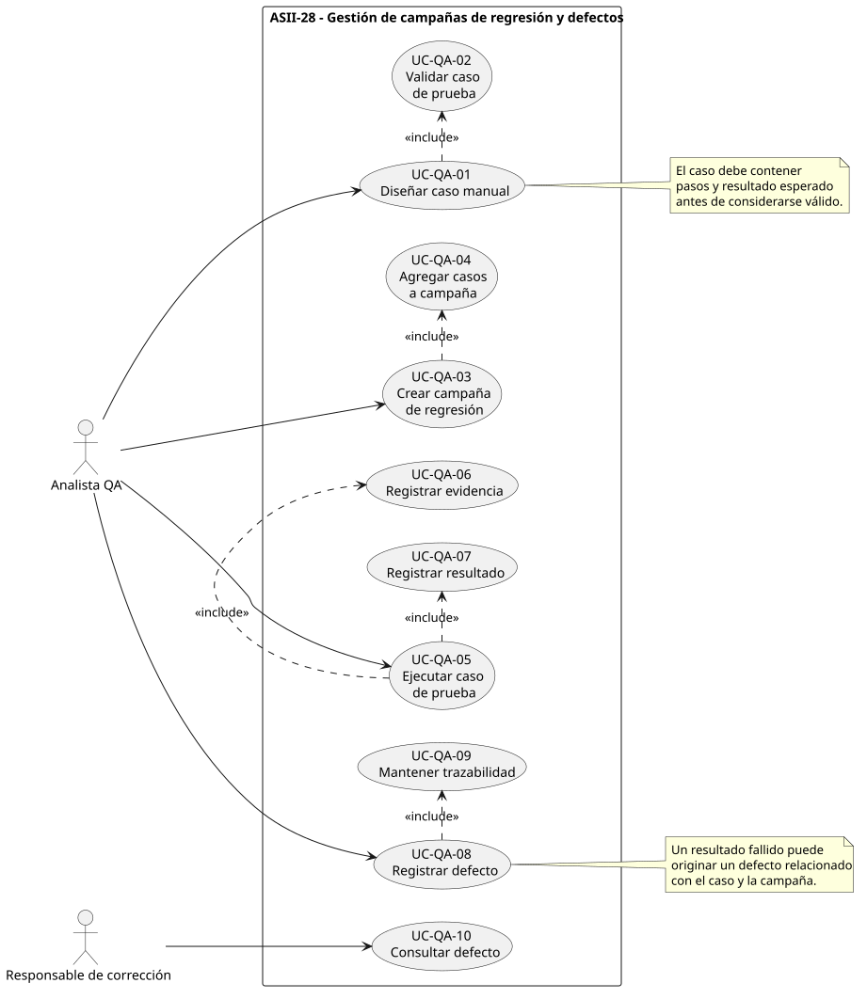
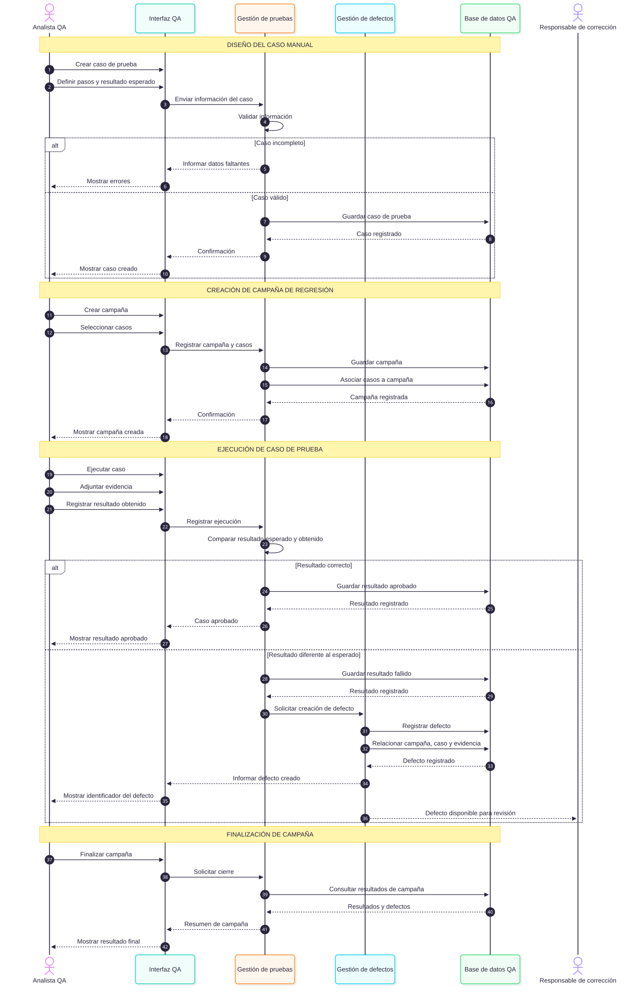

# ASII-28 — QA funcional, pruebas manuales y matriz de regresión

## Semana 1 — UML y narrativa de alcance

**Estudiante:** Madelin Jazmín Cerón Molina  
**GitHub:** `@MadelinCeron`  
**Módulo:** ASII-28 — QA funcional, pruebas manuales y matriz de regresión  
**Adaptación:** Gestión de campañas de regresión y defectos  
**Proceso:** diseño de casos manuales, campaña de regresión, evidencia, defectos y trazabilidad.

## Objetivo

Modelar el proceso de QA funcional para registrar casos de prueba manuales, organizar campañas de regresión, ejecutar pruebas, almacenar evidencia, registrar resultados y documentar defectos manteniendo trazabilidad entre todos los elementos.

## Alcance

Esta semana contempla:

- Diseño de casos de prueba manuales.
- Validación de casos de prueba.
- Creación de campañas de regresión.
- Asociación de casos a una campaña.
- Ejecución manual de casos.
- Registro de evidencia.
- Registro de resultados.
- Identificación de casos aprobados o fallidos.
- Registro de defectos.
- Relación entre campaña, caso, ejecución, evidencia y defecto.

No se implementan todavía endpoints API, automatización de pruebas, interfaz de usuario ni integración con herramientas externas de seguimiento de defectos.

## Diagramas

### Casos de uso

Representa las operaciones principales:

- Diseñar caso manual.
- Validar caso.
- Crear campaña de regresión.
- Agregar casos a campaña.
- Ejecutar caso.
- Registrar evidencia.
- Registrar resultado.
- Registrar defecto.
- Mantener trazabilidad.

### Actividad

Representa el flujo desde el diseño del caso de prueba hasta el cierre de una campaña, incluyendo decisiones de aprobación o fallo.

### Secuencia

Representa la interacción entre:

- Analista QA.
- Interfaz QA.
- Gestión de pruebas.
- Gestión de defectos.
- Base de datos QA.
- Responsable de corrección.

## Evidencia

La narrativa de alcance y la trazabilidad se encuentran en:

`narrativa-alcance-trazabilidad.md`

## Resultado

La Semana 1 deja definido el flujo funcional base para gestionar pruebas manuales, campañas de regresión, evidencia y defectos antes de iniciar su implementación.
