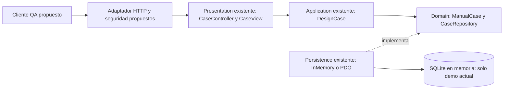

# Frontera cliente-servidor propuesta

## Decisión y responsabilidades

Mantener el núcleo vanilla existente como módulo; agregar posteriormente una
frontera HTTP integrada con el host HIS. No desplegar un microservicio independiente:
no hay necesidad medida de escalado, autonomía operativa o infraestructura adicional.
Una extracción futura exige contrato estable, propietario de datos y evidencia
de carga/disponibilidad; no se deriva de usar nombres REST.

Las flechas al núcleo describen dependencias/invocaciones; el contrato de lectura,
el frontend y el host HTTP QA todavía no existen. El cliente presenta formularios,
consulta detalle y muestra carga/error/éxito; validar campos mejora UX, pero no
sustituye reglas de servidor. En incrementos posteriores presentará campañas y
ejecuciones. Nunca ejecuta SQL ni decide permisos o reglas críticas de resultados.

El servidor decodificará JSON, autenticará/autorizará, resolverá ámbito QA, aplicará
límites de entrada y mapeará status/body a HTTP. Presentation mantiene formato y
salida, DesignCase coordina y ManualCase rechaza valores vacíos. PDO conserva
prepare/execute; no se coloca SQL ni lógica de campaña en el adaptador HTTP.

## Seguridad: existente frente a propuesta

Dependencias reales del HIS: bootstrap/app.php registra TenantMiddleware como
`tenant` y JwtAuth como `jwt.auth`; app/Http/Middleware contiene ambos y
RequirePermission para RBAC. JwtAuth contrasta tenant de token con hospital y
valida sesión/membresía. config/rbac.php define permisos actuales, sin los de
casos QA propuestos. No se cambia autenticación global ni se replica el emisor JWT.

Propuesta: usar Bearer validado por el host, `X-Tenant-ID` UUID de hospital activo
y permisos explícitos acordados. No basta validar el header: qa_manual_cases y
CaseRepository actuales no contienen ámbito/propietario. **Bloquea publicar API**
hasta definir si QA es hospitalario o transversal. Este contrato asume ámbito
hospitalario por resolver, con asociación persistida y consulta/escritura filtradas
por identidad validada; el cliente no elige dueño mediante payload. Extender el
puerto requerirá contrato versionado y paridad de adaptadores, no filtros solo en UI.

Datos QA pertenecen a ASII-28, no a tablas clínicas ni al módulo de CI. Integración
con requisitos/versiones usa referencias opacas acordadas, sin consultas clínicas
ni escritura directa a bases ajenas. Evidencias futuras serán referencias privadas,
con autorización en descarga, tipo/tamaño por acordar y retención definida; no
URLs públicas, rutas locales arbitrarias o datos de pacientes en ejemplos/logs.
Campañas y defectos heredarán el ámbito validado y acceso mínimo por operación.

Auditoría propuesta: actor/ámbito validados, acción, ID opaco, resultado, fecha y
request_id; acordar contrato con gobernanza, sin afirmar que ya se emiten eventos QA.
No registrar tokens, contraseñas, propósito/pasos, observaciones ni archivos.

## Resiliencia y observabilidad propuestas

Preservar StorageFailure → 503 seguro; inesperados → 500 sin stack/SQL. El servidor
generará correlación; aceptará X-Request-ID solo si cumple `[A-Za-z0-9._-]{1,64}`,
de otro modo generará uno nuevo, evitando inyección en logs. Respuesta y log tendrán
el mismo ID. Medir latencia, códigos y fallos por operación, sin contenido sensible.

Metas iniciales por validar: timeout cliente 10 s y presupuesto DB inferior a ese
plazo. GET podrá reintentar como máximo dos veces con espera exponencial/jitter
ante red/503/504; no reintentar 400/401/403/404/422. POST **no se reintenta** sin
idempotencia: la respuesta puede perderse tras guardar. La demo genera ID nuevo
en cada alta y no implementa clave idempotente ni deduplicación por propósito.

No prometer SLA ni healthcheck QA existente. Una sonda futura verificará servicio
y almacén autorizado sin datos clínicos; registrar disponibilidad observada y
restauración antes de fijar objetivos. La pérdida de conexión no devuelve éxito
ni dispara escrituras compensatorias en módulos externos.
