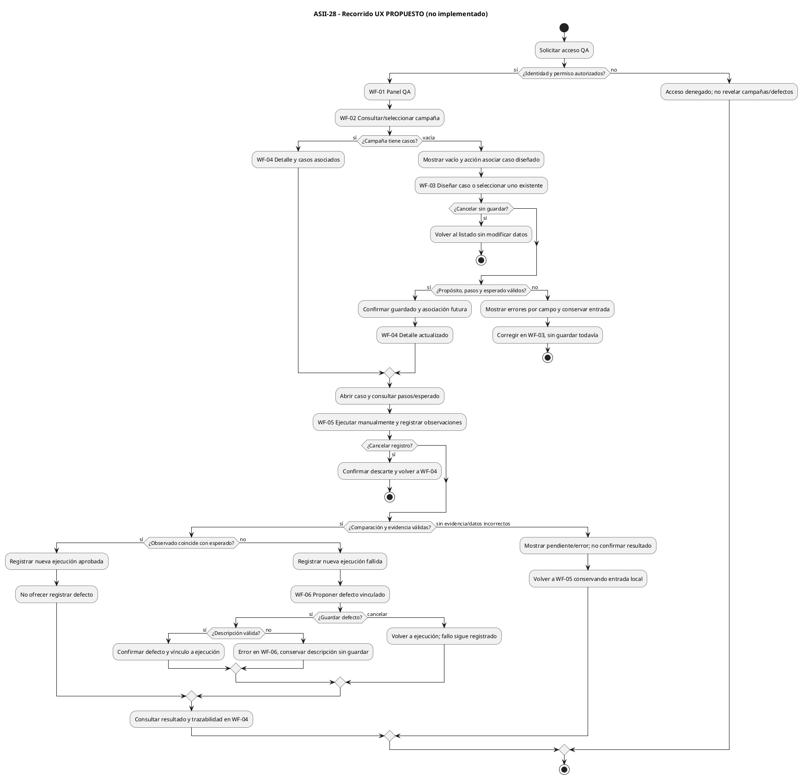

# User flow — propuesta completa, no flujo implementado

Fuente editable PlantUML; los WF corresponden a las seis secciones de wireframes.html.
Acceso/permisos son una frontera futura: el núcleo CLI no autentica ni tiene tenant.



Los stop en cancelación/error cierran este intento, no bloquean reabrir la pantalla.
Ante error de transporte, conservar formulario y ofrecer reintento de lectura;
no reenviar automáticamente un guardado de resultado incierto. Asociación y
guardado del caso son pasos distintos del servidor futuro, sin transacción inventada.
Referencia de evidencia es precondición del contrato conceptual LSP; si la política
posterior permite omitirla debe acordarse para todos los sustitutos, no por adaptador.

## Validación de la entrega

PlantUML 1.2026.9 temporal: fuente extraída del bloque anterior, checkonly y render
PNG aprobados; representación inspeccionada. Edge headless renderizó el HTML con
perfil temporal aislado; imagen de escritorio revisada, sin datos ni cuenta reales.
Se verificaron seis secciones WF, IDs únicos, etiquetas y enlaces/fragmentos existentes,
controles disabled y ausencia de scripts/formularios/conexiones externas: PASS.
Los trece RF/RNF de Semana 2 están en la tabla de reglas-interaccion.md.
git diff --check y git diff --cached --check: PASS antes del commit.
No se modificó PHP ni se ejecutaron pruebas funcionales/usabilidad con personas.
Comandos de render (fuente/salida solo en carpeta temporal):

```text
java -jar <TEMP>/asii28-plantuml-v1.2026.9.jar -checkonly <TEMP>/user-flow.puml
java -jar <TEMP>/asii28-plantuml-v1.2026.9.jar -tpng <TEMP>/user-flow.puml
msedge.exe --headless --disable-gpu --no-first-run --user-data-dir=<perfil-temporal> --window-size=1440,3000 --screenshot=<TEMP>/wireframes-desktop.png <URL-file-de-wireframes.html>
```

No se versionan screenshots; los archivos HTML y el flujo son la fuente editable.
El render verifica presentación del diseño, no integración con API ni cumplimiento WCAG.
