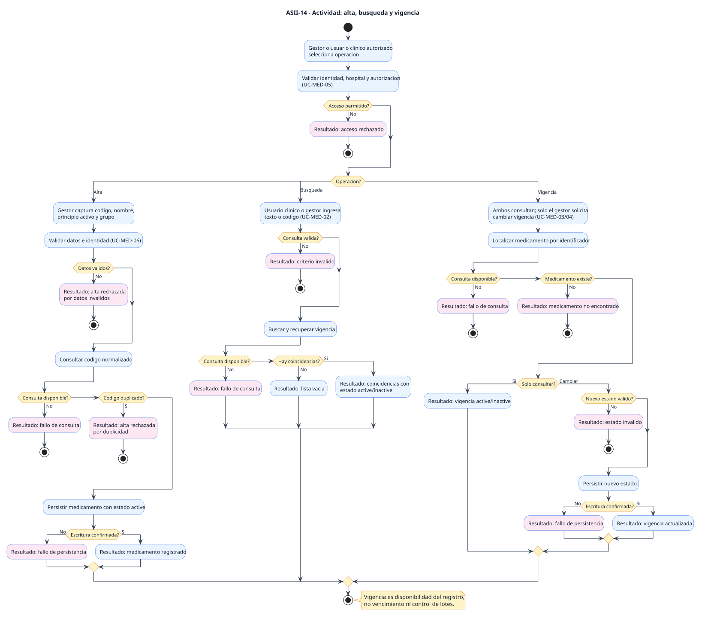
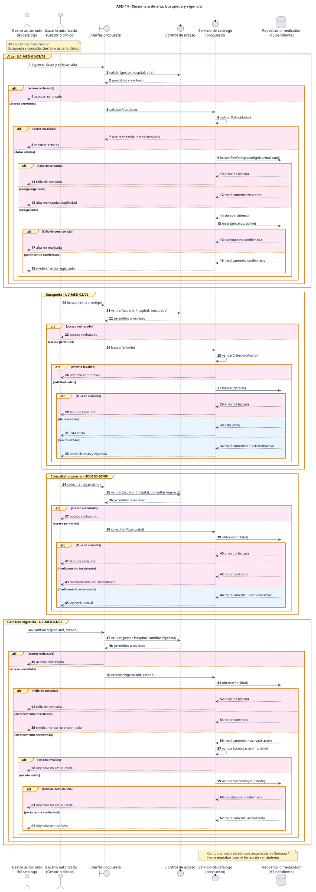

# ASII-14 - Catalogo de medicamentos - Semana 1

- **Estudiante:** María Yamilet Lindo Pablo
- **GitHub:** [`Yamilet1235`](https://github.com/Yamilet1235)
- **Proceso:** alta, busqueda y control de vigencia de un medicamento
- **Issue:** [#165 - ASII-14 - Catalogo de medicamentos](https://github.com/compilations-teams/sistema-hospitalario-integrado-SistenasII-2026-G3/issues/165)
- **Base del futuro PR:** `develop` (`Refs #165`)

## Objetivo y alcance

Modelar como usuarios autorizados registran y buscan medicamentos y consultan o cambian su disponibilidad en el catalogo. La vigencia se propone como estado `active/inactive` del registro; no representa vencimiento de lotes. Esta entrega solo contiene analisis UML y narrativa: no implementa backend, API, UI, migraciones ni servicios.

## Diagramas

### Casos de uso

[Abrir SVG](./01-casos-de-uso.svg) | [Fuente PlantUML](./fuentes/01-casos-de-uso.puml)

Delimita al gestor del catalogo, al usuario clinico y al control de acceso. Los `include` representan validaciones obligatorias; los rechazos permanecen como resultados alternos.

### Actividad

[Abrir SVG](./02-actividad.svg) | [Fuente PlantUML](./fuentes/02-actividad.puml)

Recorre alta, busqueda y vigencia con datos invalidos, duplicidad propuesta, consulta fallida, lista vacia, medicamento inexistente y fallo de persistencia.

### Secuencia

[Abrir SVG](./03-secuencia.svg) | [Fuente PlantUML](./fuentes/03-secuencia.puml)

Muestra participantes propuestos, mensajes, validaciones y respuestas. Ningun alta o cambio comunica exito antes de recibir confirmacion del repositorio.

## Evidencia documental

- [Narrativa de alcance y trazabilidad](./narrativa-alcance-trazabilidad.md)
- [Declaracion de uso de IA](./DECLARACION_IA.md)

Los comandos de regeneracion y validacion ejecutados se informan al entregar el trabajo. El futuro PR se dirigira a `develop`.
