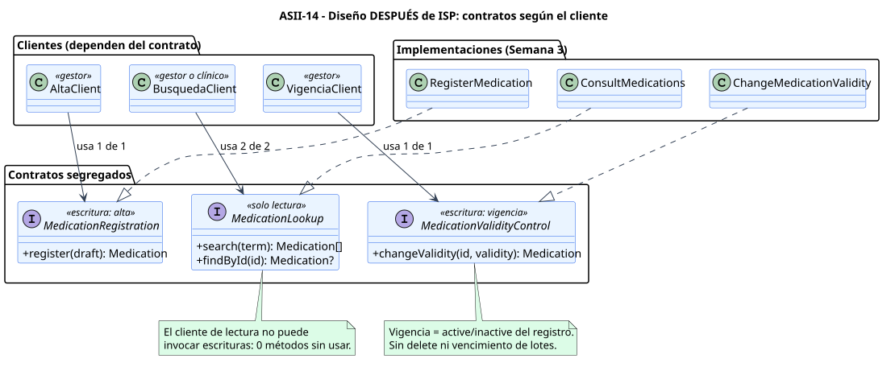

# Diseño SOLID: ISP aplicado al catálogo de medicamentos

**Principio:** *Interface Segregation Principle*. Ningún cliente debe verse obligado a depender de métodos que no usa (fuente del curso: <https://mvpcluster.com/diseno-de-software-2/>).

Los clientes provienen de los casos de uso de Semana 1:

| Cliente | Actor | Caso de uso | Operaciones que invoca |
|---|---|---|---|
| `AltaClient` | Gestor | UC-MED-01 | registrar |
| `BusquedaClient` | Gestor o usuario clínico | UC-MED-02, UC-MED-03 | buscar y obtener por identificador para consultar la vigencia |
| `VigenciaClient` | Gestor | UC-MED-04 | cambiar vigencia |

## Diseño antes


[Fuente PlantUML](./fuentes/01-diseno-antes-isp.puml)

`MedicationCatalogService` reúne las cuatro operaciones. Los tres clientes dependen de los cuatro métodos, aunque cada uno usa uno o dos:

| Cliente | Métodos disponibles | Usados | Sin usar |
|---|---:|---:|---:|
| `AltaClient` | 4 | 1 | 3 |
| `BusquedaClient` | 4 | 2 | 2 |
| `VigenciaClient` | 4 | 1 | 3 |

Consecuencias:

- El cliente de búsqueda, que también usa el usuario clínico, recibe un objeto capaz de registrar y cambiar vigencia. El permiso solo puede imponerse fuera del tipo.
- Cualquier cambio en la firma de `register` obliga a actualizar los dobles de búsqueda y vigencia, aunque no lo usen.
- Un doble de prueba para búsqueda debe implementar escrituras vacías o que lanzan excepciones.

## Diseño después



[Fuente PlantUML](./fuentes/02-diseno-despues-isp.puml)

| Contrato | Métodos | Responsabilidad | Cliente |
|---|---|---|---|
| `MedicationRegistration` | `register(draft)` | Validar el alta, comprobar el código provisional y devolver el registro confirmado | `AltaClient` |
| `MedicationLookup` | `search(term)`, `findById(id)` | Lecturas del catálogo con su vigencia, sin efectos | `BusquedaClient` |
| `MedicationValidityControl` | `changeValidity(id, validity)` | Transición `active`/`inactive`, previa localización, y confirmación | `VigenciaClient` |

### Por qué tres contratos y no cuatro

- `search` y `findById` permanecen juntos: el mismo cliente los usa en secuencia (buscar y abrir el detalle o la vigencia), comparten permiso de lectura y no tienen efectos. Separarlos crearía una interfaz por método sin un cliente que lo necesite.
- `register` y `changeValidity` se separan aunque ambos sean del gestor: responden a casos de uso distintos y a motivos de cambio diferentes (validación de datos y unicidad frente a la transición de estado). Ningún cliente usa ambos.
- `MedicationValidityControl` solo admite `active` e `inactive`. No ofrece borrar ni vencer lotes, así que inactivar no puede confundirse con eliminar el medicamento ni con el vencimiento de un lote.

## Dependencias

```text
Clientes  ──depende de──▶  Contrato segregado  ◀──implementa──  Caso de uso (Semana 3)  ──▶  Puerto de persistencia
```

- Las dependencias apuntan hacia los contratos (abstracciones), nunca hacia una implementación concreta ni hacia PDO.
- Una misma clase podría implementar varios contratos. Los clientes siguen viendo solo el suyo.
- La autorización (UC-MED-05) ocurre antes de invocar el contrato. Con ISP, además, el cliente de lectura **no tiene** métodos de escritura que invocar.

## Fuera del diseño

- El contrato `MedicationCatalog` que Prescripciones propone en su Semana 1 es suyo y sigue sin implementarse. Podría satisfacerse adaptando `MedicationLookup::findById`, pero ese acuerdo está pendiente de coordinación y no se define aquí.
- Implementación ejecutable: comienza en Semana 3 (`micro-his`). Esta semana solo aporta la [evidencia mínima](./EVIDENCIA.md) de la segregación.
