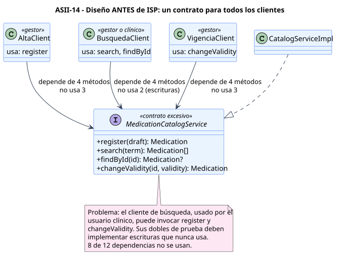

# Diseño SOLID: ISP aplicado al catálogo de medicamentos

**Principio:** *Interface Segregation Principle*. Ningún cliente debe verse obligado a depender de métodos que no usa (fuente del curso: <https://mvpcluster.com/diseno-de-software-2/>).

Los clientes provienen de los casos de uso de Semana 1:

| Cliente | Actor | Caso de uso | Operaciones que invoca |
|---|---|---|---|
| `AltaClient` | Gestor | UC-MED-01 | registrar |
| `BusquedaClient` | Gestor o usuario clínico | UC-MED-02, UC-MED-03 | buscar y obtener por identificador para consultar la vigencia |
| `VigenciaClient` | Gestor | UC-MED-04 | cambiar vigencia |

## Diseño antes

[Fuente PlantUML](./fuentes/01-diseno-antes-isp.puml)

`MedicationCatalogService` reúne las cuatro operaciones. Los tres clientes dependen de los cuatro métodos, aunque cada uno usa uno o dos:

| Cliente | Métodos disponibles | Usados | Sin usar |
|---|---:|---:|---:|
| `AltaClient` | 4 | 1 | 3 |
| `BusquedaClient` | 4 | 2 | 2 |
| `VigenciaClient` | 4 | 1 | 3 |

Consecuencias:

- El cliente de búsqueda, que también usa el usuario clínico, recibe un objeto capaz de registrar y cambiar vigencia. El permiso solo puede imponerse fuera del tipo.
- Cualquier cambio en la firma de `register` obliga a actualizar los dobles de búsqueda y vigencia, aunque no lo usen.
- Un doble de prueba para búsqueda debe implementar escrituras vacías o que lanzan excepciones.
