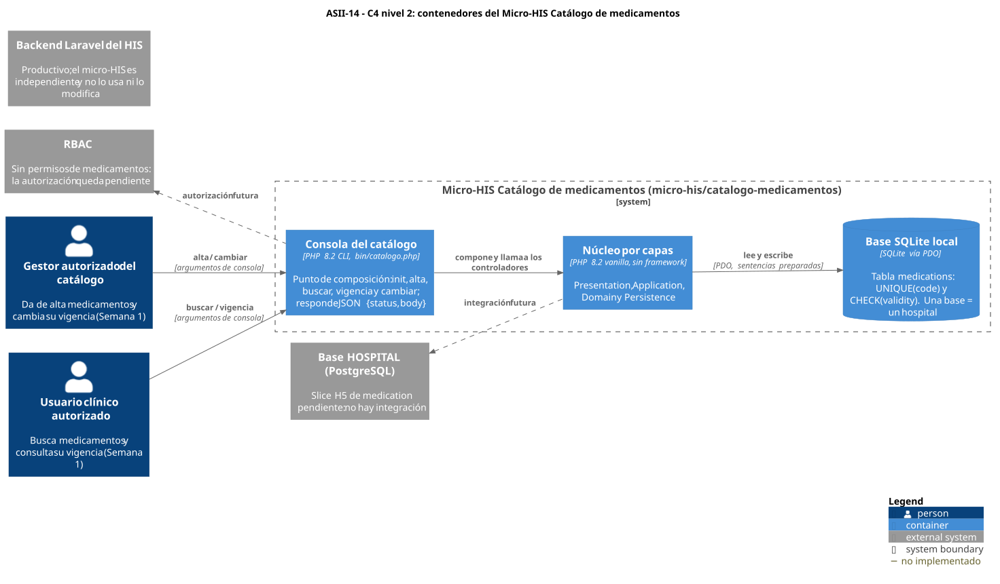
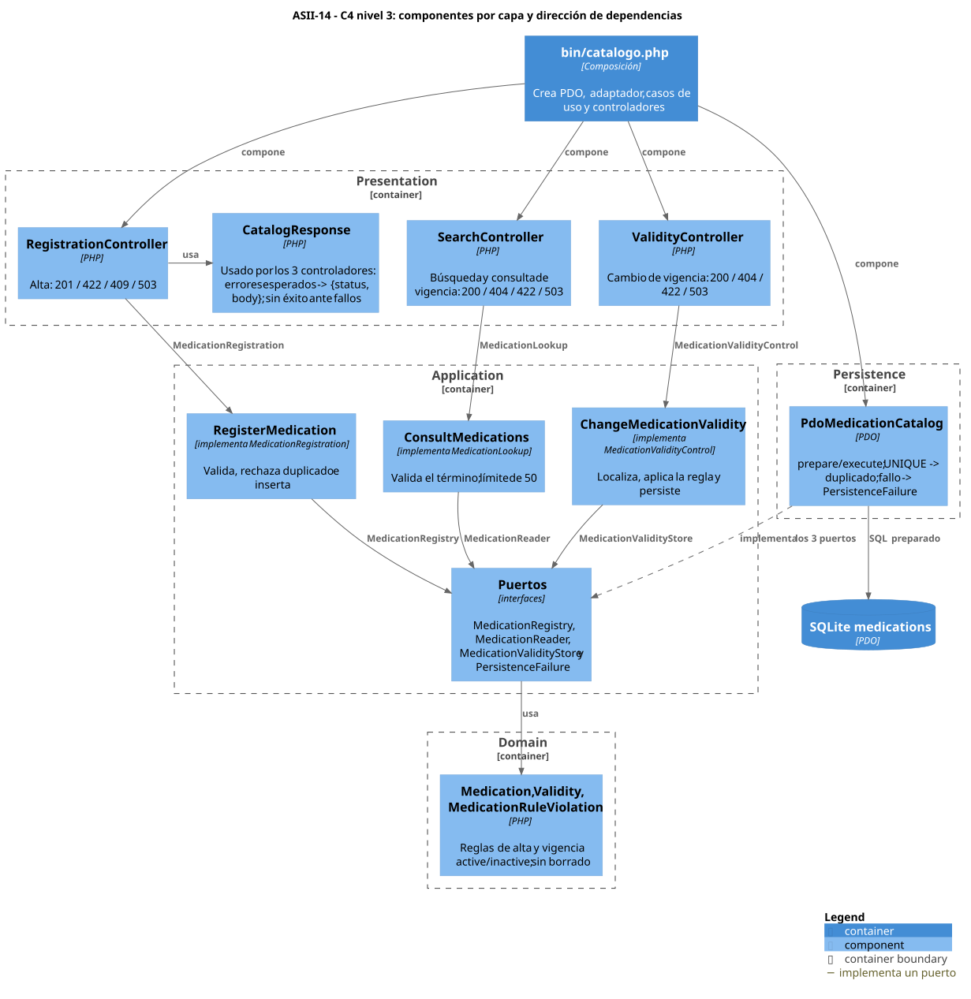

# ASII-14 - Catálogo de medicamentos - Semana 3

- **Estudiante:** María Yamilet Lindo Pablo ([`Yamilet1235`](https://github.com/Yamilet1235))
- **Tema:** diseño arquitectónico, vistas y patrones
- **Flujo:** alta, búsqueda y control de vigencia de un medicamento
- **Código:** [`micro-his/catalogo-medicamentos/`](../../../micro-his/catalogo-medicamentos/) (PHP 8.2+ vanilla, sin framework, separado del backend Laravel)
- **Issue:** [#165](https://github.com/compilations-teams/sistema-hospitalario-integrado-SistenasII-2026-G3/issues/165) · PR #542, #543, #544, #545 y el de esta documentación

## Vista arquitectónica (entregable)

### C4 nivel 2: contenedores



[Fuente C4-PlantUML](./fuentes/01-c4-contenedores.puml)

### C4 nivel 3: componentes y dependencias



[Fuente C4-PlantUML](./fuentes/02-c4-componentes.puml)

## Capas y responsabilidades

| Capa | Archivos | Responsabilidad | Depende de |
|---|---|---|---|
| Presentation | `RegistrationController`, `SearchController`, `ValidityController`, `CatalogResponse` | Traducir entrada y salida a `{status, body}`; nunca informar éxito ante un fallo | Contratos de Application y Domain |
| Application | Contratos `MedicationRegistration`, `MedicationLookup`, `MedicationValidityControl`; casos de uso `RegisterMedication`, `ConsultMedications`, `ChangeMedicationValidity`; puertos `MedicationRegistry`, `MedicationReader`, `MedicationValidityStore` | Orquestar cada operación y declarar qué necesita de la persistencia | Domain |
| Domain | `Medication`, `Validity`, `MedicationRuleViolation` | Reglas de alta y de vigencia `active/inactive` | Nada |
| Persistence | `PdoMedicationCatalog` | Implementar los tres puertos con PDO y sentencias preparadas | Application (puertos) y Domain |
| Composición | `bin/catalogo.php` | Crear PDO, adaptador, casos de uso y controladores | Todas |

**Dirección de dependencias:** Presentation → Application → Domain ← Persistence. Persistence implementa los puertos definidos en Application (inversión de dependencias), así que ni Domain ni Application conocen PDO. `tests/architecture.php` lo verifica sobre el código fuente.

**Continuidad con Semana 2:** cada controlador recibe solo su contrato segregado, y cada caso de uso usa su puerto por completo. `tests/presentation.php` lo comprueba por reflexión.

**Patrones:** arquitectura en capas, puertos y adaptadores (*ports and adapters*), objeto de valor (`Validity`), inyección por constructor y raíz de composición.

## Cómo ejecutar

Requisitos: PHP 8.2+ con `pdo_sqlite` y `mbstring`. Desde la raíz del repositorio:

```bash
php micro-his/catalogo-medicamentos/tests/run.php   # dobles + arquitectura, sin base de datos
php micro-his/catalogo-medicamentos/tests/pdo.php   # adaptador PDO real sobre sqlite::memory: (base aislada)

# Flujo por consola sobre un archivo SQLite propio (por ejemplo, en un directorio temporal):
php micro-his/catalogo-medicamentos/bin/catalogo.php /tmp/catalogo.sqlite init
php micro-his/catalogo-medicamentos/bin/catalogo.php /tmp/catalogo.sqlite alta amx-500 "Amoxicilina 500 mg" Amoxicilina "Antibiótico"
php micro-his/catalogo-medicamentos/bin/catalogo.php /tmp/catalogo.sqlite buscar amox
php micro-his/catalogo-medicamentos/bin/catalogo.php /tmp/catalogo.sqlite cambiar 1 inactive
php micro-his/catalogo-medicamentos/bin/catalogo.php /tmp/catalogo.sqlite vigencia 1
```

Respuestas: 201/200 de éxito; `MEDICATION_INVALID` 422, `MEDICATION_CODE_DUPLICATED` 409, `MEDICATION_NOT_FOUND` 404 y `CATALOG_UNAVAILABLE` 503. El CLI termina con 0 en éxito, 1 en error y 2 por uso incorrecto. No son endpoints acordados con otros módulos.

## Pruebas: dobles frente a base real

| Suite | Tipo | Cubre |
|---|---|---|
| `tests/domain.php` | Unitaria, sin dobles | Reglas de alta y de vigencia |
| `tests/application.php` | **Doble** `FakeCatalog` | Camino feliz, reglas y error de persistencia de las tres operaciones |
| `tests/presentation.php` | Casos de uso reales + **doble** | Códigos de respuesta, sin éxito ante fallos; dependencias ISP |
| `tests/architecture.php` | Estática | Dirección de dependencias, solo `prepare` y sin borrado |
| `tests/pdo.php` | **Adaptador PDO real**, `sqlite::memory:` aislada por proceso | SQL preparado, UNIQUE, CHECK, comodines, inyección, fallo real sin esquema y flujo completo |

Resultados reales: [EVIDENCIA.md](./EVIDENCIA.md).

## Supuestos y decisiones

- **Esquema:** `database/schema.sql` es local del micro-HIS (SQLite). No reemplaza el slice H5 de `medication`, pendiente en `openspec/.../tasks.md`. No se crearon migraciones ni semillas.
- **Hospital:** una base equivale a un hospital (base HOSPITAL por hospital según el README), así que no hay columna de hospital.
- **Unicidad:** código normalizado en mayúsculas, único por base. Es una identidad provisional de Semana 1.
- **Permisos:** el micro-HIS no implementa autorización por rol (RF-07 y CA-09 pendientes). RBAC concede hoy solo `medicamentos.ver`; los permisos de escritura están propuestos en [Semana 5](../semana-05/contrato-api.md).
- **Vigencia:** `active/inactive` del registro. Inactivar no borra el medicamento ni representa el vencimiento de un lote; no hay operación de borrado.
- **Límites propios:** código `[A-Z0-9][A-Z0-9-]{1,19}`, textos de 2 a 120 caracteres, término de 2 a 60 y máximo 50 resultados.

## Limitaciones

- SQLite solo pliega a minúsculas los caracteres ASCII, así que una búsqueda que difiera solo en mayúsculas acentuadas puede no coincidir.
- No se verificó contra PostgreSQL, por falta de esquema H5 y para no usar bases compartidas.
- No hay API HTTP ni UI. El patrón Repository con adaptador InMemory y la entrada MVC corresponden a Semana 4.

[Declaración de uso de IA](./DECLARACION_IA.md)
