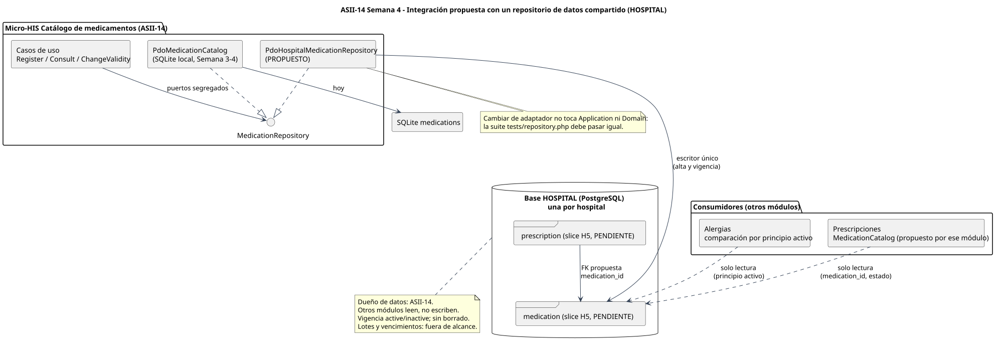

# Integración con un repositorio de datos compartido

[Fuente PlantUML](./fuentes/02-repositorio-compartido.puml)

## Situación real del repositorio

| Hecho verificado | Fuente |
|---|---|
| Hay una base clínica HOSPITAL (PostgreSQL) por hospital | README, sección "Estado actual" |
| `medication` y `prescription` pertenecen al slice H5, todavía sin migración | `openspec/changes/postgresql-federated-schema-rebuild/tasks.md` (3.5) |
| Prescripciones propone un contrato `MedicationCatalog` para leer medicamento, principio activo, grupo y estado | `docs/prescripciones/semana-01/README.md` |
| Alergias compara alergias registradas con el principio activo del medicamento | `docs/prescripciones/semana-01/narrativa-alcance-trazabilidad.md` |

## Propuesta (no implementada)

1. **Propiedad de los datos:** ASII-14 es el único escritor de `medication` (alta y cambio de vigencia). Prescripciones y Alergias solo leen.
2. **Adaptador nuevo, mismo contrato:** `PdoHospitalMedicationRepository` implementaría `MedicationRepository` contra la tabla H5. Application y Domain no cambian. La señal de que el cambio es correcto: `tests/repository.php` pasa con el nuevo adaptador.
3. **Lectura de los consumidores:** a través del contrato de solo lectura `MedicationLookup` (o del `MedicationCatalog` que defina Prescripciones), nunca escribiendo en la tabla. Una FK `prescription.medication_id` protege la integridad dentro de la misma base HOSPITAL.
4. **Vigencia:** un medicamento `inactive` sigue existiendo para la historia clínica y las prescripciones antiguas; los consumidores deben rechazarlo para nuevas indicaciones. No hay borrado. Lotes y vencimientos quedan fuera.
5. **Alcance por hospital:** cada base HOSPITAL tiene su catálogo, así que no se agrega columna de hospital. Un catálogo común entre hospitales requeriría la base CENTRAL y un acuerdo que hoy no existe.

## Riesgos y decisiones pendientes

| Riesgo | Mitigación propuesta | Responsable |
|---|---|---|
| Columnas e identidad de `medication` aún no definidas (H5) | Mantener el contrato estable y adaptar solo Persistence cuando H5 exista | Esquema H5 / ASII-14 |
| Código de principio activo distinto entre catálogo y Alergias | Acordar una codificación común antes de integrar | ASII-14 con Alergias y Prescripciones |
| Escrituras desde otros módulos | Permisos de base o vistas de solo lectura para los consumidores | Integración |
| SQLite pasa a minúsculas solo los caracteres ASCII | En PostgreSQL usar `lower()` o `ILIKE`, que respetan Unicode | ASII-14 al implementar el adaptador |

Nada de esta sección está acordado con otros módulos: es la propuesta de ASII-14 para coordinar.
