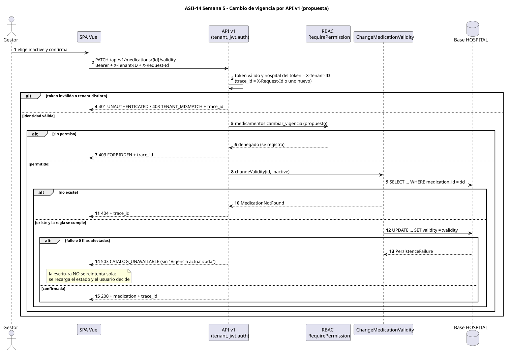

# Diseño cliente-servidor del catálogo (propuesta)

 · [fuente](./fuentes/01-c4-cliente-servidor.puml)

 · [fuente](./fuentes/02-secuencia-api.puml)

El cliente (SPA Vue) solo habla HTTP JSON con el API v1. El servidor ejecuta los mismos casos de uso del micro-HIS: el diseño cambia la entrada (Router local → API Laravel) y el adaptador de persistencia, no Application ni Domain.

| Aspecto | Decisión | Fundamento o fuente |
|---|---|---|
| **Propiedad de datos** | ASII-14 es dueño y único escritor de `medication` en cada base HOSPITAL; los demás módulos leen | [repositorio compartido](../semana-04/repositorio-compartido.md) |
| **Comunicación** | SPA → API: HTTPS JSON síncrono. Prescripciones → catálogo: llamada en proceso a `MedicationLookup`, sin red | Mismo monolito Laravel (README) |
| **Seguridad** | JWT Bearer y `X-Tenant-ID` validados por `tenant` y `jwt.auth`; permiso por operación con RBAC; el hospital nunca viene del cuerpo; validación de tipos antes del caso de uso; sentencias preparadas | `routes/api.php`, `config/rbac.php`, micro-HIS |
| **Permisos** | Lectura con `medicamentos.ver` (existe). Escritura con `medicamentos.registrar` y `medicamentos.cambiar_vigencia` (**propuestos**); sin ellos, 403 por defecto | [contrato API](./contrato-api.md) |
| **Resiliencia** | Fallo de persistencia → 503 explícito, nunca éxito ni lista vacía. El cliente reintenta solo las lecturas (GET), con un máximo de 2 reintentos y espera creciente. Las escrituras no se reintentan: tras un 503 o un timeout se vuelve a consultar el estado | Semana 1 y micro-HIS (`CatalogResponse`) |
| **Idempotencia** | `PATCH` de vigencia es idempotente en su efecto final, pero repetir el mismo estado responde 422. El alta no lo es: un reintento choca con el código único (409), lo que evita duplicados | Reglas de dominio |
| **Observabilidad** | `trace_id` (recibido en `X-Request-Id` o generado) en toda respuesta y en el log de cada operación, junto con usuario, hospital, operación, estado y duración. No se registran datos clínicos de pacientes: el catálogo no los tiene | Convención RBAC (SD-RBAC-16) |
| **Consistencia** | Fuerte dentro de la base HOSPITAL: unicidad por restricción `UNIQUE` y confirmación por filas afectadas. Entre hospitales no se sincroniza: cada hospital tiene su catálogo | Base por hospital (README) |
| **Vigencia frente a vencimiento** | El API solo maneja `active/inactive` del registro; presentaciones, lotes y vencimientos están fuera del contrato | Semana 1 |

## Qué existe y qué no

- **Existe y está probado:** micro-HIS con las cuatro operaciones por CLI y HTTP local (Semanas 3 y 4), `medicamentos.ver` en RBAC, middlewares `tenant` y `jwt.auth`.
- **No existe:** rutas `/api/v1/medications` en Laravel, la tabla `medication` (H5) y los permisos de escritura. Es diseño para Semanas 16 y 17.
