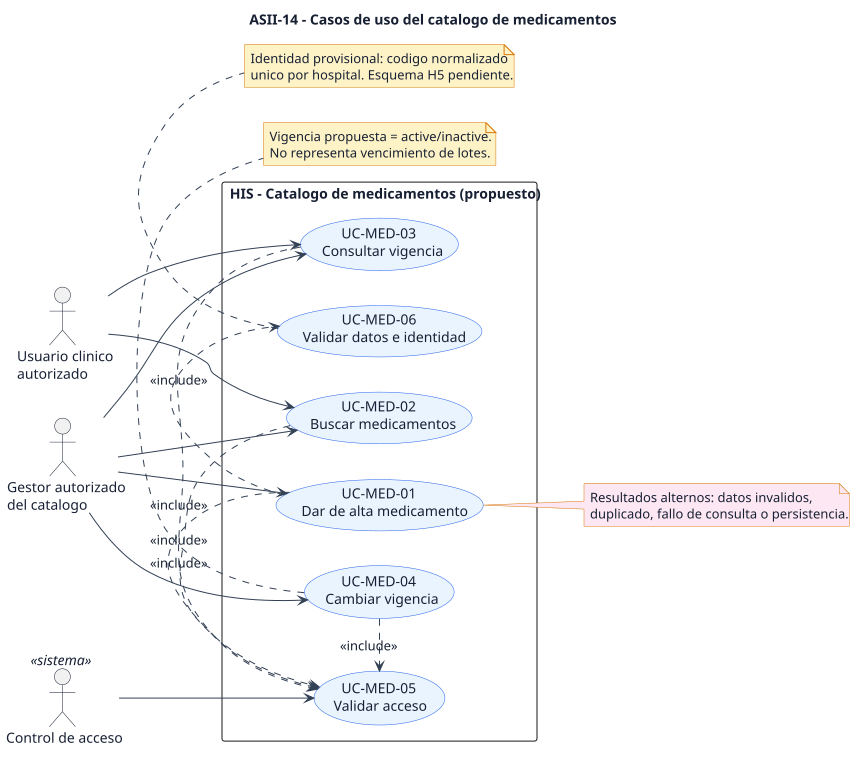
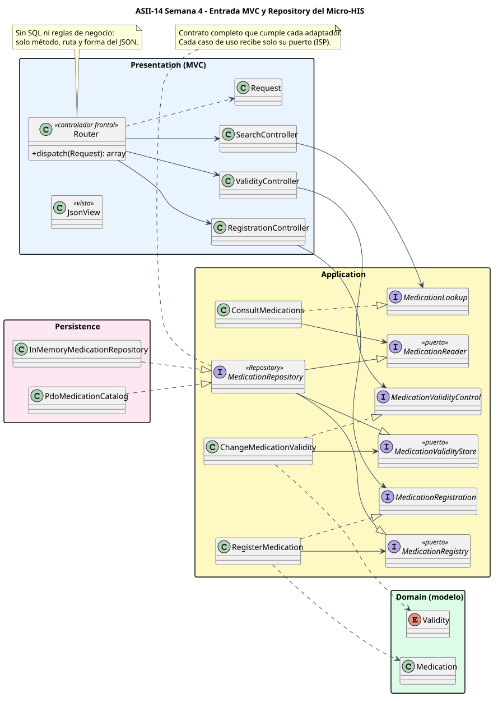
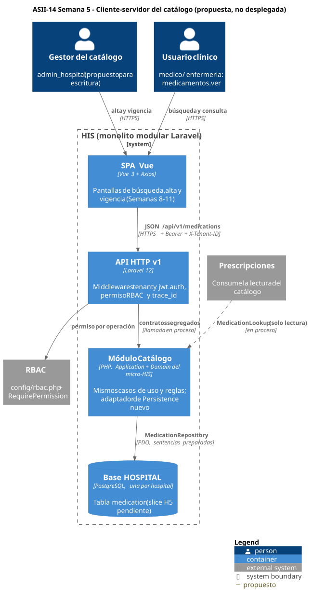

# Catálogo de medicamentos (ASII-14)

## Primera evaluación parcial: defensa de la arquitectura

**Proceso:** alta, búsqueda y control de vigencia de un medicamento.
**Distinción clave:** la vigencia (`active`/`inactive`) es del **registro**; no es el vencimiento de un lote. Presentaciones, lotes y existencias están fuera del alcance actual.

María Yamilet Lindo Pablo · `Yamilet1235` · Issue #165

---

## 1. Actores y casos de uso (Semana 1)

Gestor: alta y cambio de vigencia. Usuario clínico: búsqueda y consulta. Control de acceso antes de cada operación.

---

## 2. Requisitos que guían el diseño (Semana 2)

| Requisito | Decisión que provoca |
|---|---|
| RF-03 código único por hospital | Rechazo 409 y `UNIQUE(code)` |
| RF-06 inactivar sin borrar | No existe operación de borrado |
| RF-08 éxito solo tras confirmación | 503 si no se confirma la escritura |
| RNF-01 rechazo sin llamar al catálogo | Permiso antes del caso de uso |
| RNF-04 0 métodos sin usar (ISP) | Contratos segregados por cliente |

---

## 3. ISP: un contrato por necesidad de cliente

Antes: 8 de 12 dependencias sin usar. Después: 0. Verificado con <code>evidencia/isp-segregacion.php</code>.

---

## 4. Capas, MVC y Repository (Semanas 3 y 4)

El Router no tiene SQL ni reglas. <code>MedicationRepository</code> lo cumplen PDO e InMemory; pruebas: 47 + 18 + 19 + 17 verificaciones.

---

## 5. Cliente-servidor y API v1 (Semana 5)

Verificado: <code>/api/v1</code>, JWT, <code>X-Tenant-ID</code>, <code>medicamentos.ver</code>. Propuesto: permisos de escritura y tabla H5.

---

## 6. Cambio práctico (ejercicio simulado)

**Pedido propuesto:** "Registrar presentaciones, por ejemplo Amoxicilina 500 mg cápsula y 250 mg/5 ml suspensión."

| Aspecto | Respuesta |
|---|---|
| Modelo | `Presentation` como entidad hija de `Medication` (forma y concentración) |
| Unicidad | El código del medicamento sigue único; la presentación es única por (medicamento, forma, concentración) |
| Vigencia | Cada presentación tiene su `active`/`inactive`; inactivar el medicamento bloquea las nuevas indicaciones de todas |
| Búsqueda | Devuelve el medicamento con sus presentaciones vigentes |
| Impacto | Contrato nuevo `PresentationRegistration` (ISP), adaptadores y API; los casos de uso existentes no cambian |

No hubo un cambio real del docente: es un ejercicio propuesto para la defensa.

---

## 7. Evidencia y pendientes

- **Ejecutado:** micro-HIS por CLI y HTTP; suites con código 0; OpenAPI válido; diagramas reproducibles.
- **Pendiente externo:**
  - aprobación requerida en `develop`;
  - tabla `medication` del slice H5;
  - permisos de escritura en RBAC.
- **No implementado todavía:** API v1 en Laravel y UI (Semanas 8–17).

Matriz decisión → evidencia: `semana-06/matriz-decisiones.md`.
