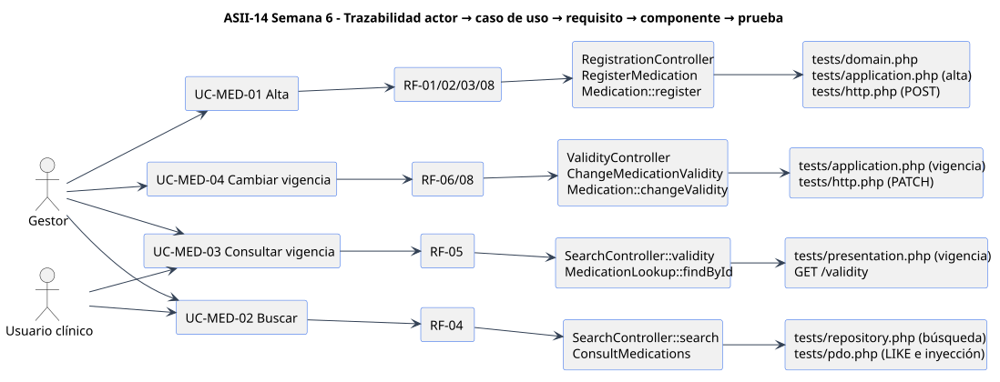

# Matriz decisión → evidencia y cambio práctico

 · [fuente](./fuentes/01-trazabilidad.puml)

## Matriz decisión → evidencia

| # | Decisión | Requisito | Evidencia verificable |
|---|---|---|---|
| D1 | Vigencia `active/inactive` del registro, sin borrado ni vencimiento de lotes | RF-06 | `Validity`; `tests/architecture.php` "ninguna capa implementa borrado"; `CHECK` en `schema.sql` |
| D2 | Código normalizado único por hospital | RF-03 | `RegisterMedication`; `UNIQUE(code)`; duplicado → 409 en `tests/repository.php` (ambos adaptadores) |
| D3 | Contratos segregados por cliente (ISP) | RNF-04 | `semana-02/evidencia/isp-segregacion.php`: 8 → 0 métodos sin usar |
| D4 | Éxito solo tras confirmar la persistencia | RF-08, RNF-03 | 503 sin mensaje de éxito en `tests/presentation.php`; `rowCount` en `tests/pdo.php` |
| D5 | Repository en Application con dos adaptadores | Semana 4 | `MedicationRepository`; `tests/repository.php` (19/19) |
| D6 | MVC sin SQL ni reglas en el controlador | Semana 4 | `tests/architecture.php` (Router sin Domain, Persistence ni SQL) |
| D7 | Sentencias preparadas para todo valor externo | RNF-05 | `PdoMedicationCatalog`; inyección y `%` literal en `tests/pdo.php` |
| D8 | API v1 con permiso por operación y `trace_id` | RF-07, RNF-01 | `semana-05/openapi.yaml` (lint válido). **Sin implementar en Laravel** |
| D9 | Monolito modular, no microservicio | Semana 5 | `semana-05/frontera-microservicio.md`, con disparadores medibles propuestos |

## Cambio práctico defendido (ejercicio simulado)

> No se recibió un cambio real del docente. Este es un ejercicio **propuesto** para preparar la defensa; no se atribuye a ninguna persona.

**Pedido:** "Registrar presentaciones del medicamento, por ejemplo Amoxicilina 500 mg cápsula y 250 mg/5 ml suspensión, y que la búsqueda las muestre."

| Pregunta | Respuesta defendida | Verificación propuesta |
|---|---|---|
| ¿Dónde vive la regla? | `Presentation` en Domain: forma farmacéutica y concentración, hija de `Medication` | Prueba de dominio: concentración vacía → 422 |
| ¿Cambia la unicidad? | No para el medicamento (código único). La presentación es única por (medicamento, forma, concentración) | Duplicado → 409 en la suite de contrato |
| ¿Y la vigencia? | Cada presentación tiene su `active/inactive`. Un medicamento `inactive` bloquea nuevas indicaciones de todas sus presentaciones sin borrarlas | Inactivar el medicamento → búsqueda las marca no prescribibles |
| ¿Y la búsqueda? | Sigue por código, nombre o principio activo y devuelve las presentaciones vigentes | Resultado incluye presentaciones |
| ¿Qué cambia en el diseño? | Contrato nuevo `PresentationRegistration` para un cliente nuevo (ISP), métodos nuevos en el Repository y en ambos adaptadores, y una ruta `POST /api/v1/medications/{id}/presentations` | Los casos de uso actuales y sus pruebas no cambian |
| ¿Qué NO se hace? | Lotes, existencias ni vencimientos: siguen fuera de alcance | — |

**Decisión:** el cambio es aditivo y respeta las capas, por eso no se implementa en esta semana. Se dejaría como parte independiente con sus pruebas si el docente lo pidiera.
