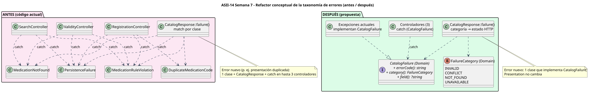

# Componentes, contratos y refactor

 · [fuente](./fuentes/01-componentes.puml)

## Contratos de entrada y salida

| Componente | Capa | Entrada | Salida | Estado |
|---|---|---|---|---|
| `MedicationCatalogPage.vue` | UI | Ruta `/medicamentos`, usuario autenticado | Estado de página (carga, vacío, resultados, error) | Propuesto |
| `MedicationSearchForm.vue` | UI | Texto del usuario | Evento `search(term)` solo con 2–60 caracteres | Propuesto |
| `MedicationResultsTable.vue` | UI | `Medication[]` | Eventos `open(id)` y `request-validity(id)` | Propuesto |
| `MedicationFormDialog.vue` | UI | Borrador del alta | Evento `submit(draft)`; muestra el `field` de un 422 | Propuesto |
| `ValidityChangeDialog.vue` | UI | Medicamento y estado destino | `confirm` o `cancel`; nunca cambia sin confirmación | Propuesto |
| `medicationsApi.js` | Cliente | `search`, `get`, `create` y `changeValidity` | Promesa con `{ data }` o error con `status`, `error`, `field` y `trace_id`; reintenta solo los GET | Propuesto |
| `MedicationController` (Laravel) | Presentación | Petición HTTP ya autenticada y autorizada | `{status, body}` con `trace_id`; sin SQL ni reglas | Propuesto (Semana 16) |
| Contratos ISP y casos de uso | Application | Borrador, término, id, `Validity` | `Medication` o excepción esperada | **Existe** |
| `MedicationRepository` | Persistence | `Medication`, id, término | Registro confirmado o `PersistenceFailure` | **Existe** (PDO e InMemory) |

UI, aplicación, dominio y persistencia quedan separados: la UI no conoce SQL ni reglas, solo el contrato HTTP; el controlador Laravel no decide reglas; el dominio no conoce HTTP. El módulo no se amplía: los componentes cubren solo alta, búsqueda, consulta y vigencia.

## Punto de mayor acoplamiento: la taxonomía de errores

Medición sobre `micro-his/catalogo-medicamentos/src` (fan-in = archivos que nombran la clase):

| Clase | Fan-in | Lectura |
|---|---:|---|
| `Medication` | 12 | Abstracción estable del dominio: acoplamiento deseable |
| `MedicationRuleViolation`, `PersistenceFailure` | 7 cada una | Inestable: se repite en `catch` de Presentation |
| `DuplicateMedicationCode` | 5 | Ídem |
| `MedicationNotFound` | 4 | Ídem |

Hoy hay 4 bloques `catch` en 3 controladores que enumeran clases concretas, más el `match` de `CatalogResponse`. Agregar un error esperado, como "presentación duplicada" del cambio de Semana 6, obliga a modificar **hasta 5 archivos de Presentation**. Además, olvidar un `catch` convierte un error esperado en un 500.

 · [fuente](./fuentes/02-refactor-errores.puml)

## Refactor propuesto (conceptual, no aplicado)

| | Antes | Después |
|---|---|---|
| Contrato | Ninguno: cada controlador conoce 2–3 clases | `CatalogFailure` en **Domain**, con `errorCode()`, `category()` y `field()`; `FailureCategory` = INVALID, CONFLICT, NOT_FOUND, UNAVAILABLE |
| Controladores | `catch (A\|B\|C $e)` distinto en cada uno | `catch (CatalogFailure $e)` idéntico |
| `CatalogResponse` | `match` por clase | Categoría → 422, 409, 404 o 503 |
| Archivos a tocar para un error nuevo | Hasta 5 | 1, la nueva excepción |
| Riesgo de un 500 por un `catch` olvidado | Existe | Desaparece |

**Por qué en Domain:** `MedicationRuleViolation` vive en Domain. Si el contrato estuviera en Application, Domain dependería de Application. En Domain, Application (`PersistenceFailure`, `MedicationNotFound`, `DuplicateMedicationCode`) depende de Domain, que es la dirección permitida.

**Cómo se verificaría:** las suites actuales deben seguir pasando sin cambios en sus aserciones, y una prueba nueva lanzaría una excepción de categoría CONFLICT desconocida por los controladores y esperaría un 409.
