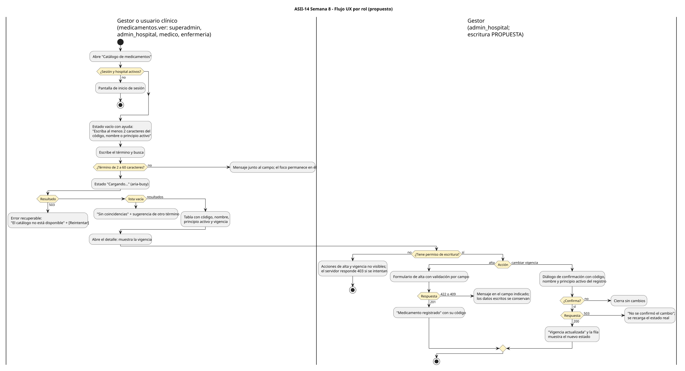

# Flujo por rol y reglas de interacción

 · [fuente](./fuentes/01-flujo-por-rol.puml)

## Roles y permisos

| Rol | Puede | Permiso | Estado |
|---|---|---|---|
| `superadmin`, `admin_hospital`, `medico`, `enfermeria` | Buscar y consultar la vigencia | `medicamentos.ver` | **Implementado** en `config/rbac.php` |
| `admin_hospital` (gestor de Semana 1) | Dar de alta y cambiar la vigencia | `medicamentos.registrar`, `medicamentos.cambiar_vigencia` | **Propuesto** (Semana 5); hoy ningún rol puede escribir |
| `recepcion` y demás roles | Nada en el catálogo | — | Implementado: no tienen `medicamentos.ver` |

La UI solo oculta acciones; la autoridad es el servidor. Hoy `can()` (`resources/js/router/permissions.js`) deniega siempre porque la autenticación no entrega `permissions`, así que la pantalla mostraría solo la lectura hasta resolverlo.

## Reglas de interacción

| # | Momento | Regla |
|---|---|---|
| R1 | Inicio | Sin sesión u hospital activo: se envía al inicio de sesión. Nunca se muestra un catálogo de otro hospital |
| R2 | Estado vacío | Ayuda contextual: qué se puede buscar (código, nombre o principio activo) y el mínimo de 2 caracteres |
| R3 | Validación del término | Se valida antes de enviar; el mensaje queda asociado al campo (`aria-describedby`) y el foco no se pierde |
| R4 | Carga | `aria-busy` y texto "Cargando…"; el botón se desactiva para evitar envíos dobles |
| R5 | Vacío frente a error | "Sin coincidencias" (200 con lista vacía) se distingue de "El catálogo no está disponible" (503), que ofrece **Reintentar** |
| R6 | Vigencia visible | Cada fila muestra `active` o `inactive` con texto, no solo con color. Un inactivo sigue visible y se marca "no disponible para nuevas indicaciones" |
| R7 | Alta | Validación por campo; un 422 marca el `field` devuelto y un 409 marca el código. Los datos escritos se conservan |
| R8 | Confirmación de vigencia | El diálogo repite código, nombre y principio activo del registro elegido y el estado destino, para evitar cambiar un medicamento equivocado |
| R9 | Fallo de escritura | Un 503 muestra "No se confirmó el cambio" y recarga el estado real; no se reintenta solo |
| R10 | Éxito | Mensaje con el código afectado; la fila se actualiza desde la respuesta del servidor |
| R11 | Sin permiso | Las acciones no se muestran; si llegara un 403, se explica "No tiene permiso para esta acción" sin datos técnicos |
| R12 | Vencimientos | La pantalla no menciona lotes ni fechas de vencimiento: no pertenecen al catálogo |
