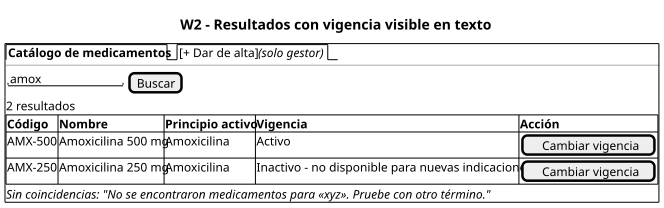
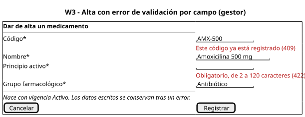
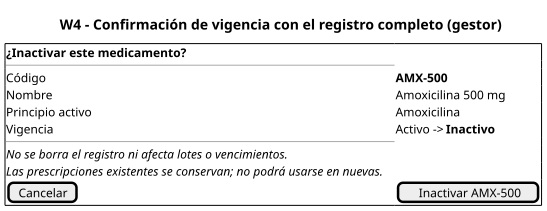
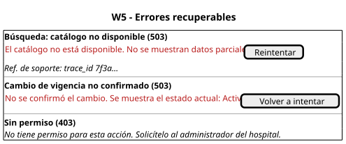

# Wireframes anotados

Baja fidelidad (PlantUML Salt), sin estilos finales. Fuentes en `fuentes/w*.puml`. Las reglas R1–R12 están en [reglas-interaccion.md](./reglas-interaccion.md).

## W1 - Búsqueda: estado vacío y carga

- **Estados:** vacío con ayuda y carga.
- **Mensajes:** "Escriba al menos 2 caracteres…".
- **Validación:** término de 2 a 60 caracteres antes de enviar.
- **Reglas:** R1, R2, R3 y R4. El hospital activo se muestra para que no haya duda del alcance.

## W2 - Resultados

- **Estados:** resultados y sin coincidencias.
- **Mensajes:** "Activo" o "Inactivo - no disponible para nuevas indicaciones".
- **Reglas:** R5 y R6. "Dar de alta" y "Cambiar vigencia" solo aparecen con permiso de escritura (propuesto).

## W3 - Alta con validación

- **Estados:** error de validación.
- **Mensajes:** el `field` del 422 y el código del 409, junto a su campo.
- **Validaciones:** obligatorios, longitudes y formato del código, igual que el dominio.
- **Reglas:** R7 y R10. Se conservan los datos y se informa que nace Activo.

## W4 - Confirmación de vigencia

- **Estados:** confirmación pendiente.
- **Mensajes:** el registro completo, el cambio "Activo → Inactivo" y lo que **no** ocurre: no se borra, no toca lotes ni vencimientos, conserva las prescripciones existentes.
- **Reglas:** R8 y R12. El botón nombra el código, "Inactivar AMX-500", para prevenir vincular el medicamento equivocado.

## W5 - Errores recuperables

- **Estados:** 503 de lectura, 503 de escritura y 403.
- **Mensajes:** sin datos técnicos; se muestra el `trace_id` como referencia de soporte.
- **Reglas:** R5, R9 y R11. Una lectura ofrece reintento; una escritura no confirmada recarga el estado real antes de ofrecer volver a intentar.

## Cobertura del enunciado

| Elemento pedido | Wireframe |
|---|---|
| Inicio y ayuda contextual | W1 |
| Decisiones y confirmación | W2 y W4 |
| Vacío, carga y éxito | W1, W2 y R10 |
| Errores recuperables | W3 y W5 |
| Prevención de datos vinculados incorrectamente | W4 (registro completo y código en el botón) |
