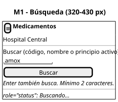
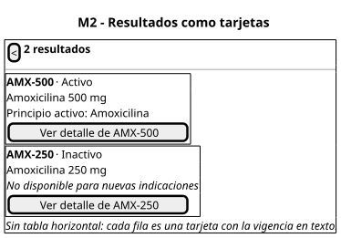
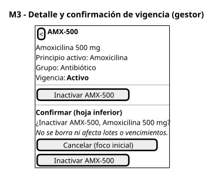
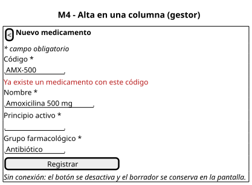

# Diseño responsive del catálogo

| Pantalla | Wireframe |
|---|---|
| M1 Búsqueda |  |
| M2 Resultados como tarjetas |  |
| M3 Detalle y confirmación |  |
| M4 Alta |  |

## Reglas de breakpoint

| Ancho | Navegación | Resultados | Formularios y diálogos |
|---|---|---|---|
| **320–430 px** (objetivo móvil) | Barra superior con título y botón atrás; menú plegado | Tarjetas apiladas: código y vigencia en la primera línea, nombre y principio activo debajo | Una columna, etiqueta encima del campo; la confirmación es una hoja inferior a pantalla completa |
| 431–767 px | Igual que móvil | Tarjetas en una columna más ancha | Igual que móvil |
| ≥ 768 px | Navegación del layout (`AppLayout.vue`) | Tabla de W2 con `caption` y `th scope` | Diálogo centrado de W3 y W4 |

## Reglas de contenido y de interacción en móvil

| # | Regla |
|---|---|
| RM1 | Sin desplazamiento horizontal a 320 px: no se muestra la tabla en ese ancho |
| RM2 | Orden por importancia: código y vigencia → nombre → principio activo → acción. El grupo farmacológico solo aparece en el detalle |
| RM3 | Objetivos táctiles de al menos 44 × 44 px en botones y tarjetas |
| RM4 | El botón principal ocupa el ancho de la pantalla y queda al final del contenido, no flotando sobre los datos |
| RM5 | La confirmación de vigencia es una hoja inferior con foco inicial en "Cancelar"; atrás o Esc la cierran sin cambios |
| RM6 | La vigencia siempre en texto ("Activo" o "Inactivo") junto al código, legible sin abrir el detalle |
| RM7 | Teclado del dispositivo: `inputmode="search"` en la búsqueda y `autocapitalize="characters"` en el código |
| RM8 | Con texto ampliado al 200 % el contenido se reacomoda en la misma columna, sin cortar textos (WCAG 1.4.10) |

## Conexión limitada

| Situación | Comportamiento |
|---|---|
| Búsqueda lenta (más de 3 s) | Se mantiene "Buscando…" en `role="status"`; no se borran los resultados anteriores hasta tener la respuesta nueva |
| Búsqueda fallida (sin red o 503) | "No se pudo consultar el catálogo" y [Reintentar]; reintento manual o automático solo en lecturas, máximo 2 |
| Alta o vigencia sin red | El botón se desactiva con "Sin conexión"; el borrador queda en pantalla y nunca se marca como guardado |
| Respuesta de escritura perdida (timeout) | "No sabemos si el cambio se guardó": se vuelve a consultar el medicamento antes de ofrecer repetir |

No se guardan cambios en el dispositivo para enviarlos después: una escritura clínica sin confirmación del servidor no se presenta como realizada.
