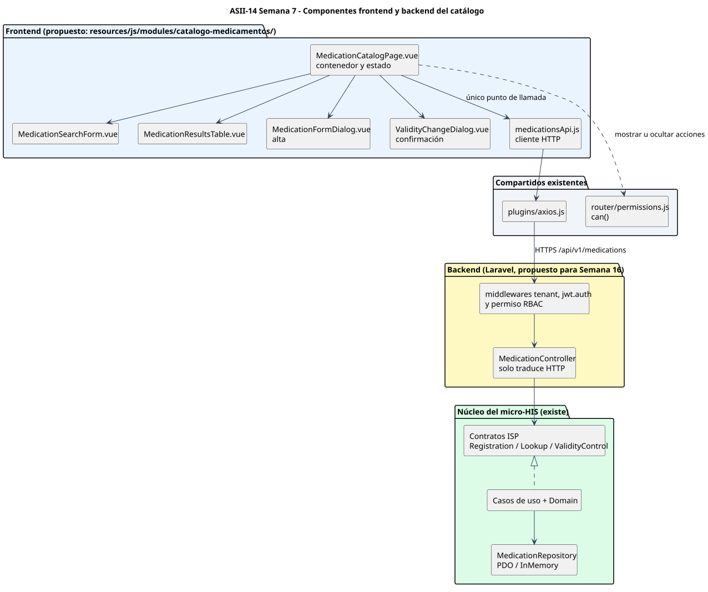
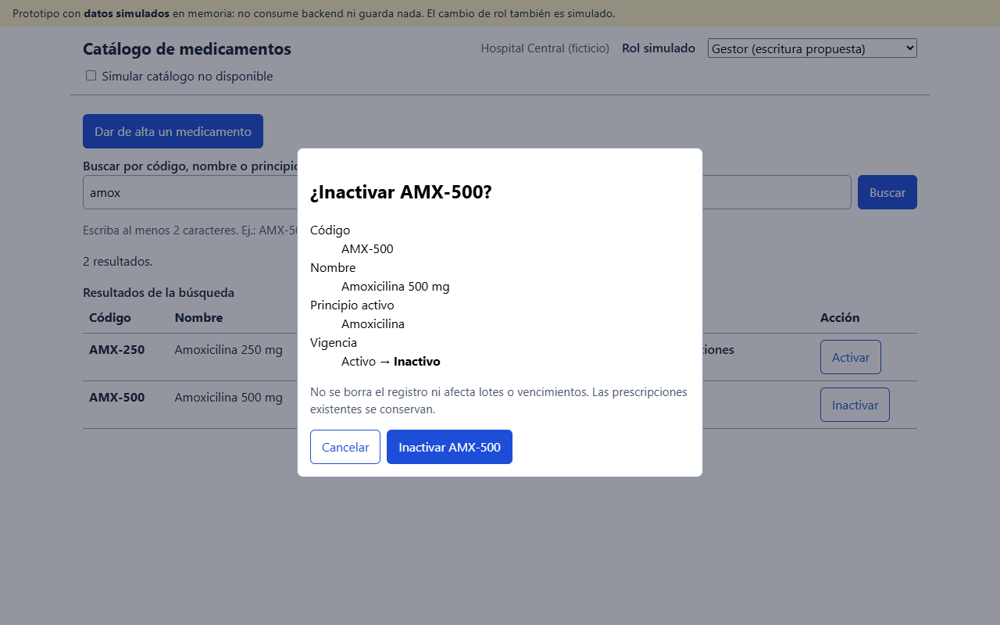
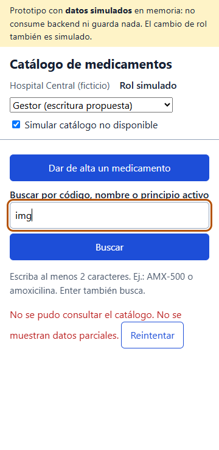

# Catálogo de medicamentos (ASII-14)

## Segunda evaluación parcial: componentes, UX, accesibilidad y movilidad

Se defiende con el prototipo navegable de la Semana 11, que usa **datos simulados y no consume backend**.

María Yamilet Lindo Pablo · `Yamilet1235` · Issue #165

---

## 1. Componentes que sostienen la UI (Semana 7)

- Una página contenedora, cuatro componentes y **un único** cliente HTTP.
- Punto de mayor acoplamiento medido: la taxonomía de errores (fan-in 7).
- Refactor propuesto: `CatalogFailure` en Domain.

---

## 2. Roles y estados en el prototipo

- **Lectura:** `medicamentos.ver` existe en RBAC.
- **Escritura:** permiso **propuesto**; el rol se simula en el prototipo.
- **Estados:** vacío, carga, resultados, sin coincidencias, error, éxito.
- **Confirmación:** muestra el registro completo y el foco empieza en "Cancelar".

---

## 3. Accesibilidad verificada (Semanas 9 y 11)

| Hallazgo (Semana 9) | En el prototipo | Comprobación |
|---|---|---|
| H3 botones ambiguos | `aria-label="Inactivar AMX-500"` | D6 y M6 |
| H5 foco de diálogos | Cancelar inicial y retorno al botón | D7, D8, M7 y M8 |
| H7 anuncios | `role="status"` "2 resultados." | D3 y M3 |
| H4 tabla | `caption` y `th scope` | D4 y M4 |
| H8 teclado | Enter busca | D3 y M3 |

24/24 comprobaciones reales en Chrome sin interfaz. No hubo pruebas con lector de pantalla ni con usuarios.

---

## 4. Movilidad y error crítico (Semanas 10 y 11)

- A 360 px: tarjetas, sin desplazamiento horizontal (M5).
- Error crítico: "No se pudo consultar el catálogo" con Reintentar, sin datos parciales ni un estado anterior (M12).
- La verificación encontró y corrigió dos defectos del prototipo.

---

## 5. Cambio solicitado (ejercicio simulado)

**Pedido:** "Que el usuario clínico vea por defecto solo medicamentos activos."

| Aspecto | Respuesta |
|---|---|
| Regla | Casilla "Incluir inactivos" desmarcada por defecto solo en la vista clínica |
| RF | RF-04 se mantiene: la API sigue devolviendo la vigencia; el filtro es de presentación |
| Riesgo | Un clínico podría no saber que un medicamento fue inactivado: el estado vacío dice "Hay N inactivos ocultos" |
| Accesibilidad | Casilla con etiqueta; el número de ocultos va en `role="status"` |
| Móvil | La casilla queda bajo el campo de búsqueda, en una columna |

No hubo un cambio real del docente. Detalle en <code>semana-12/matriz-decisiones.md</code>.

