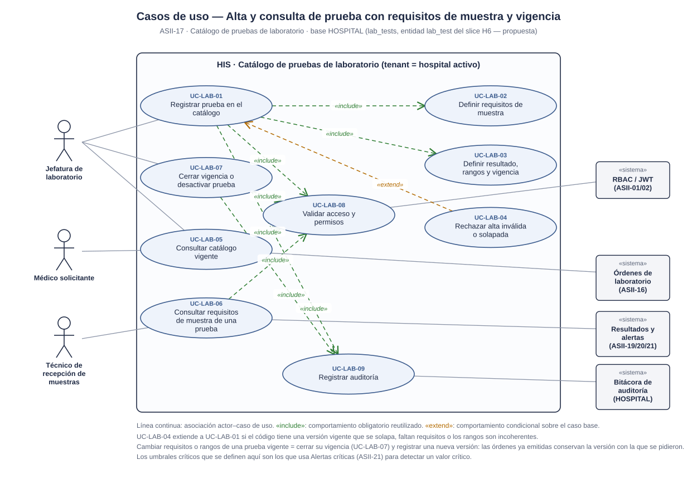
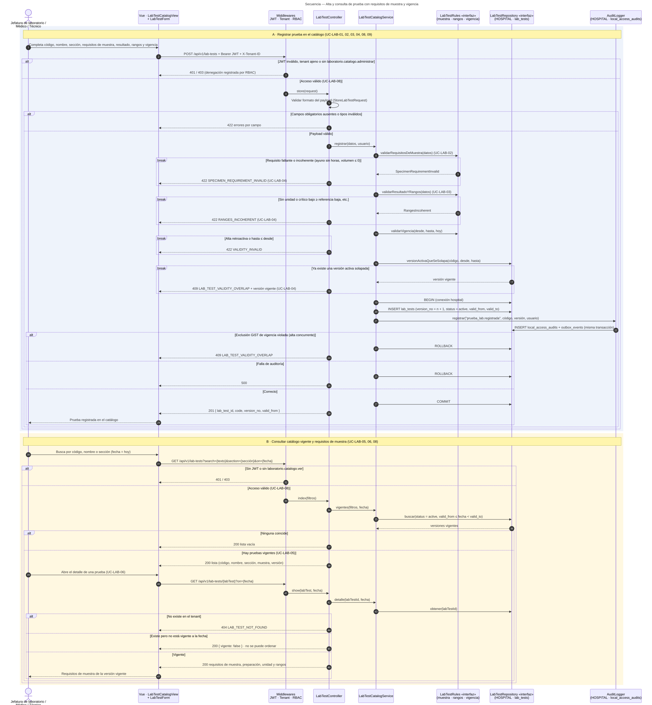

# Catálogo de pruebas de laboratorio — Semana 1

## Ficha de la asignación

- **Estudiante:** Herrera Sánchez, Axel Eliú (`AxelHerrera11`)
- **Módulo:** ASII-17 — Catálogo de pruebas de laboratorio (módulo absorbido tras la reorganización del grupo)
- **Semana:** Semana 1 — Conceptos generales, orientación a objetos y UML
- **Tarea individual:** Modele el proceso «alta y consulta de prueba con requisitos de muestra y vigencia». Casos de uso: delimitar actores y objetivo; el de actividad debe incluir decisiones, excepciones y resultado; el de secuencia debe mostrar participantes, mensajes, validaciones y respuesta. Mantenga trazabilidad entre los tres diagramas.
- **Entregable / evidencia:** UML de casos de uso, actividad y secuencia, y narrativa de alcance y trazabilidad.
- **Estructura:** Sistema Hospitalario Integrado 2026 | Semanas 1–15.

---

## Contexto arquitectónico

- **Backend:** Laravel 12 (PHP 8.2+), JWT y RBAC por permisos (`laboratorio.catalogo.administrar`, `laboratorio.catalogo.ver`).
- **Base de datos HOSPITAL (PostgreSQL):** la entidad `lab_test` está **prevista** en el slice H6 del esquema federado (junto a `lab_order`, `lab_order_item` y `specimen`), pero **aún no tiene migración** (tarea 3.6 de `openspec/changes/postgresql-federated-schema-rebuild/tasks.md`) ni columnas definidas.
  - Este módulo es dueño de `lab_test`. La propuesta de columnas está en el [Anexo A de la narrativa](./narrativa-alcance-trazabilidad.md#anexo-a--propuesta-de-la-tabla-lab_tests-hospital) y debe validarse con el grupo antes de implementar.
  - Cada fila es una **versión** de una prueba con vigencia `[valid_from, valid_to)`. Una exclusión GiST (como la de `bed_stays`, gracias a `btree_gist`) impediría que dos versiones activas del mismo código se solapen.
- **Auditoría:** se reutiliza la propuesta de `local_access_audits` (entidad `local_access_audit`, slice H8) documentada por Notas SOAP, en la misma conexión y transacción `hospital`.
- **Multitenancy:** cada hospital mantiene su catálogo en su base HOSPITAL; el hospital activo llega en `X-Tenant-ID`.
- **Frontend:** Vue 3, Pinia y Axios (`LabTestCatalogView` y `LabTestForm`).
- **Endpoints preliminares** (se formalizan en la Semana 5):
  - `POST /api/v1/lab-tests`
  - `GET /api/v1/lab-tests?search={texto}&section={sección}&on={fecha}`
  - `GET /api/v1/lab-tests/{labTest}?on={fecha}`
  - `PATCH /api/v1/lab-tests/{labTest}/validity`

---

## 1. Diagrama de casos de uso

[Abrir el diagrama de casos de uso en SVG](./01-casos-de-uso.svg) · [Fuente PlantUML](./fuentes/01-casos-de-uso.puml)

### Descripción

El objetivo es que **toda prueba que se pueda ordenar exista en el catálogo con sus requisitos de muestra, su tipo de resultado, sus rangos y una vigencia clara**, para que órdenes, recepción, resultados y alertas usen la misma definición.

- **Actores principales:**
  - *Jefatura de laboratorio:* registra pruebas, cierra su vigencia o las desactiva, y consulta.
  - *Médico solicitante:* consulta las pruebas vigentes antes de ordenar.
  - *Técnico de recepción de muestras:* consulta los requisitos de muestra.
- **Actores secundarios (sistemas):** *Órdenes de laboratorio (ASII-16)*, que solo ofrece pruebas vigentes; *Resultados y alertas (ASII-19/20/21)*, que usan unidad, rangos y umbrales críticos; *RBAC / JWT* y la *Bitácora de auditoría*.
- **UC-LAB-01 (Registrar prueba)** incluye `<<include>>` la definición de requisitos de muestra (UC-LAB-02), la de resultado, rangos y vigencia (UC-LAB-03), la validación de acceso (UC-LAB-08) y la auditoría (UC-LAB-09).
- **UC-LAB-04 (Rechazar alta inválida o solapada)** extiende `<<extend>>` a UC-LAB-01.
- **UC-LAB-05 (Consultar catálogo vigente)** y **UC-LAB-06 (Consultar requisitos de muestra)** incluyen la validación de acceso.
- **UC-LAB-07 (Cerrar vigencia o desactivar)** incluye la validación de acceso y la auditoría. Para cambiar requisitos o rangos se cierra la vigencia y se registra una nueva versión.

## 2. Diagrama de actividades

[Abrir el diagrama de actividades en SVG](./02-actividad.svg) · [Fuente Mermaid](./fuentes/02-actividad.mmd)

### Descripción

Recorre el proceso en tres particiones, con sus decisiones, excepciones y resultados.

- **A · Registrar prueba:** acceso (401/403); requisitos de muestra completos (422); resultado numérico con unidad y rangos coherentes (`422 RANGES_INCOHERENT`); vigencia no retroactiva (`422 VALIDITY_INVALID`), y sin otra versión activa solapada (`409 LAB_TEST_VALIDITY_OVERLAP`). El `INSERT` y la auditoría van en una sola transacción; la exclusión GiST resuelve las altas concurrentes. Resultado: prueba registrada (201).
- **B · Consultar catálogo vigente y requisitos:** acceso (401/403) y filtros (422). Se devuelven solo las versiones activas vigentes a la fecha; lista vacía si no hay coincidencias. El detalle devuelve `404` si la prueba no existe, o la marca «no vigente: no se puede ordenar» si existe pero no está vigente.
- **C · Cerrar vigencia o desactivar:** acceso, versión activa con vigencia abierta (404/409) y motivo y fecha válidos (422). Si hay órdenes pendientes, se advierte que conservan su versión. `UPDATE` y auditoría en la misma transacción. Resultado: la prueba deja de ofrecerse para nuevas órdenes (200).

## 3. Diagrama de secuencia

[Abrir el diagrama de secuencia en SVG](./03-secuencia.svg) · [Fuente Mermaid](./fuentes/03-secuencia.mmd)

### Descripción

- **Participantes:** Vue (`LabTestCatalogView` + `LabTestForm`), middlewares, `LabTestController`, `LabTestCatalogService`, `LabTestRules` «interfaz», `LabTestRepository` «interfaz» (HOSPITAL · `lab_tests`) y `AuditLogger` (HOSPITAL · `local_access_audits`).
- **Dependencias como interfaces:** `LabTestRules` agrupa las reglas de muestra, rangos y vigencia para poder agregar reglas nuevas sin modificar el servicio (base del principio OCP de la Semana 2). `LabTestRepository` aísla la persistencia de una tabla que todavía no existe.
- **Escenario A (registrar, mensajes 1–29):** `alt` para 401/403 y 422; `break` para requisito de muestra inválido, rangos incoherentes, vigencia inválida (422) y versión solapada (409). La transacción termina en `alt`: exclusión GiST por alta concurrente (409), falla de auditoría (500) o `COMMIT` y 201.
- **Escenario B (consultar, mensajes 30–47):** `alt` para 401/403; lista vacía o lista de vigentes; en el detalle, `alt` para 404, prueba no vigente (200 con `vigente: false`) o requisitos de la versión vigente (200).

---

Narrativa completa, trazabilidad, riesgos, dependencias y Anexo A: [narrativa-alcance-trazabilidad.md](./narrativa-alcance-trazabilidad.md) · Uso de IA: [DECLARACION_IA.md](./DECLARACION_IA.md)
