# Aplicación de OCP — Catálogo de pruebas de laboratorio

> «No se debe modificar el código de una clase o entidad, sino que estas deben de ser extendidas.»
> — Rodríguez González, L. M. *Principios básicos del diseño de software*. MVP Cluster.

La fuente lo ilustra con una clase `Oferta` que se resuelve con una subclase por servicio. El catálogo tiene esa forma: cada **tipo de resultado** (numérico, cualitativo y, después, ordinal, título o cultivo) se valida distinto. Se aplica al flujo **A · Registrar prueba** (UC-LAB-01 a 04).

## Antes

- Soportar resultados ordinales obliga a abrir el servicio, agregar un `case` y volver a probar todos los tipos.
- Muestra, definición del resultado y vigencia están en el mismo método: cambiar una puede romper otra.

## Después

| Elemento | Responsabilidad | ¿Cambia al agregar un tipo? |
|---|---|---|
| `ResultTypeSpec` «interfaz» | `type()` y `validate(draft)` | No |
| `NumericResultSpec` / `QualitativeResultSpec` | Unidad y rangos ordenados / al menos dos valores permitidos | No |
| `OrdinalResultSpec` | Escala sin repetidos y umbral dentro de la escala | Es la clase nueva |
| `ResultTypeRegistry` | Mapa `tipo → especificación`; desconocido = `RESULT_TYPE_UNSUPPORTED` | No |
| `SpecimenRequirementRule` / `ValidityRule` (`LabTestRule`) | Reglas comunes a todos los tipos | No |
| `LabTestValidator` | Ejecuta las reglas y la especificación del tipo | No |

## Dependencias

- `LabTestValidator` y `ResultTypeRegistry` dependen **solo de interfaces**; la demo verifica que su código no nombra ningún tipo concreto.
- Las reglas comunes se aplican también al tipo nuevo, sin escribir nada más.
- El solapamiento de vigencia **no** es una regla del validador: depende de otras filas y lo resuelve el repositorio (exclusión GiST del Anexo A de la Semana 1).

> **Supuesto:** el `CHECK` del Anexo A ya admite `'ordinal'`. Los valores permitidos aún no tienen columna; se propone `result_scale jsonb`, a acordar con ASII-19 y ASII-21.
