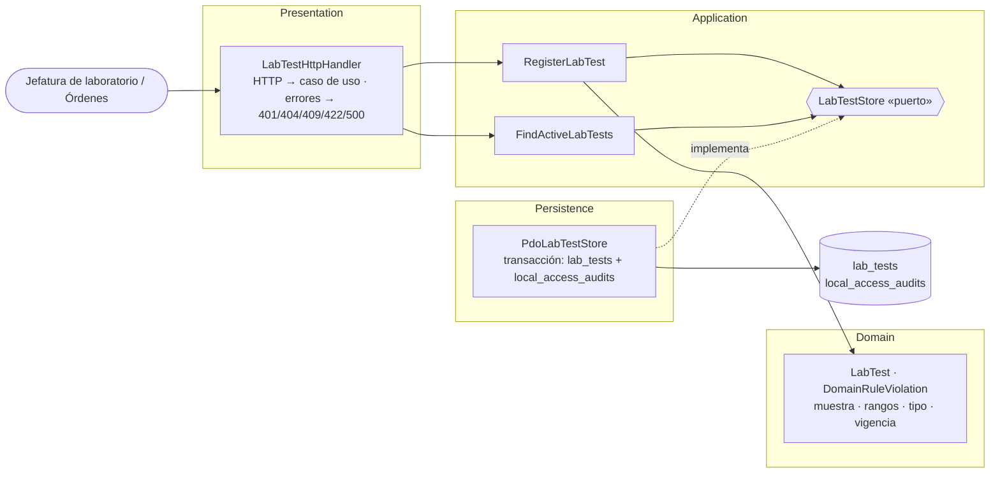

# Catálogo de pruebas de laboratorio — Semana 3: micro-HIS por capas

**Estudiante:** Herrera Sánchez, Axel Eliú (`AxelHerrera11`) · **Módulo:** ASII-17 · **Código:** [`micro-his/catalogo-pruebas-lab`](../../../micro-his/catalogo-pruebas-lab/)

Flujo implementado: **registrar una versión de prueba y consultar las vigentes** (UC-LAB-01 a 05 y 09), en PHP 8.2+ vanilla con PDO y sentencias preparadas, sin framework.

## Vista de componentes (C4, nivel 3)

| Capa | Responsabilidad | Depende de |
|---|---|---|
| Presentation | Traduce la petición y mapea errores a códigos HTTP; no tiene reglas | Application, Domain (errores) |
| Application | Orquesta el alta: versión siguiente, solapamiento de vigencia (409) y guardado | Domain y el puerto `LabTestStore` |
| Domain | `LabTest` nace válida o no nace: `SPECIMEN_REQUIREMENT_INVALID`, `RANGES_INCOHERENT`, `RESULT_DEFINITION_INVALID`, `VALIDITY_INVALID` | Nada |
| Persistence | Guarda la versión y su auditoría en una transacción; una violación de unicidad se traduce a 409 | Application (puerto), PDO |

Las dependencias apuntan hacia adentro: el dominio no conoce PDO ni HTTP.

## Pruebas (`php micro-his/catalogo-pruebas-lab/tests/run.php`)

Base SQLite en memoria creada desde `database/schema.sql`, con datos ficticios. Las **14 verificaciones** cubren el camino feliz (201 y auditoría), sin usuario (401), vigencia solapada (409), cinco reglas de dominio (422) sin guardar nada, la consulta por fecha y búsqueda, y la falla de auditoría (500) con rollback. La salida completa está en el PR.

**Limitaciones:** el esquema es un subconjunto portable; en PostgreSQL la exclusión GiST de vigencias (Anexo A de la Semana 1) es la última barrera contra solapamientos. Cerrar vigencias (UC-LAB-07) y el contrato HTTP formal quedan para las Semanas 4 y 5. Uso de IA: [DECLARACION_IA.md](./DECLARACION_IA.md).
