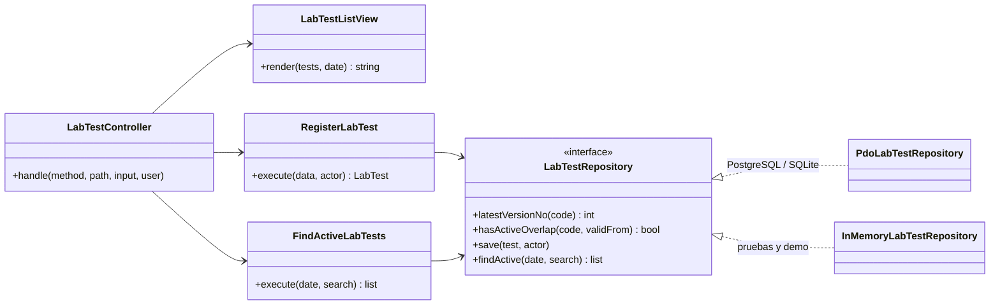

# Catálogo de pruebas de laboratorio — Semana 4: MVC y Repository

**Estudiante:** Herrera Sánchez, Axel Eliú (`AxelHerrera11`) · **Módulo:** ASII-17 · **Código:** [`micro-his/catalogo-pruebas-lab`](../../../micro-his/catalogo-pruebas-lab/)

Sobre el micro-HIS de la [Semana 3](../semana-03/README.md), esta semana organiza la presentación en **MVC** y formaliza el acceso a datos con el patrón **Repository**, con dos adaptadores que cumplen el mismo contrato.

## Mapa MVC

| Rol | Clase | Qué hace |
|---|---|---|
| Model | `Domain/LabTest` + casos de uso `RegisterLabTest` y `FindActiveLabTests` + `LabTestRepository` | Reglas del catálogo y acceso a datos; no sabe de HTTP ni de HTML |
| View | `Presentation/LabTestListView` | Tabla HTML de pruebas vigentes; escapa todo texto (`htmlspecialchars`) |
| Controller | `Presentation/LabTestController` | Traduce la petición, llama al caso de uso, elige JSON o la View (`?format=html`) y mapea errores a 401/404/409/422/500 |
| Front controller | `public/index.php` | Arma las dependencias, lee la petición y escribe la respuesta |



## Repository

- El puerto `LabTestStore` de la Semana 3 pasa a ser `LabTestRepository`: la aplicación pide «la versión más reciente», «¿hay una vigencia abierta?», «guardar con auditoría» y «vigentes a una fecha», sin SQL.
- `PdoLabTestRepository` guarda versión y auditoría en una transacción; `InMemoryLabTestRepository` guarda en arreglos y puede simular una base caída (`failNextSave`).
- **Prueba de contrato:** `tests/run.php` ejecuta la misma batería de 15 verificaciones con los dos adaptadores (30 en total). Si un adaptador se comporta distinto, la prueba falla.

## Repositorio compartido (base HOSPITAL)

En el HIS, `lab_tests` vive en la base HOSPITAL que comparten todos los módulos. **Regla propuesta:** cada tabla tiene un solo módulo que escribe; ASII-17 es dueño de `lab_tests`. Órdenes (ASII-16), Resultados (ASII-19/20) y Alertas (ASII-21) leen el catálogo por la API del módulo o por una vista de solo lectura acordada, y guardan el `lab_test_id` exacto de la versión que usaron. Integrarlo es cambiar el DSN del front controller (`MICROHIS_DSN`) a esa base.

## Cómo ejecutarlo

```bash
php micro-his/catalogo-pruebas-lab/tests/run.php                      # 30 verificaciones
php -S 127.0.0.1:8083 -t micro-his/catalogo-pruebas-lab/public        # SQLite temporal si no hay MICROHIS_DSN
curl -s "127.0.0.1:8083/lab-tests?format=html" -H 'X-User-Ref: medico1'
```

**Limitaciones:** el usuario llega en `X-User-Ref` (el JWT y el tenant son de la Semana 5). Uso de IA: [DECLARACION_IA.md](./DECLARACION_IA.md).
