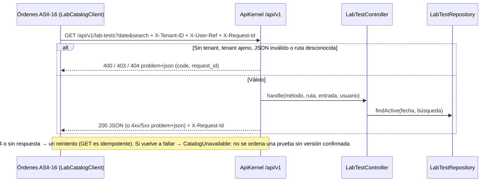

# Catálogo de pruebas de laboratorio — Semana 5: cliente-servidor y frontera de microservicio

**Estudiante:** Herrera Sánchez, Axel Eliú (`AxelHerrera11`) · **Módulo:** ASII-17 · **Código:** [`micro-his/catalogo-pruebas-lab`](../../../micro-his/catalogo-pruebas-lab/) · **Contrato:** [`openapi.yaml`](../../../micro-his/catalogo-pruebas-lab/openapi.yaml)

El micro-HIS de la [Semana 4](../semana-04/README.md) pasa a ser un **servidor API v1** con un **cliente** separado que solo conoce el contrato HTTP.



| Pieza | Qué hace |
|---|---|
| `Presentation/ApiKernel` | Prefijo `/api/v1`, `X-Tenant-ID` igual al del servidor (`MICROHIS_TENANT`), `X-Request-Id` (lo recibe o lo genera), errores RFC 9457 y `/health` y `/health/ready` |
| `public/index.php` | Front controller del servidor y log de acceso en JSON sin datos clínicos (método, ruta, estado y `request_id`) |
| `client/LabCatalogClient` | Timeout de 0,5 s al conectar y 2 s en total, un reintento seguro y `CatalogUnavailable` como falla segura; no carga `src/` |
| `openapi.yaml` | Contrato OpenAPI 3.1 validado con `npx @redocly/cli@1.34.5 lint`; una prueba comprueba que cada ruta declarada existe en el servidor |

## Frontera de microservicio

Es el módulo **más separable**: tiene una sola tabla propia (`lab_tests`), cambia poco y sus consumidores (Órdenes, Resultados y Alertas) solo leen y guardan el `lab_test_id` exacto. **Decisión: no se separa todavía**. Se queda como módulo del HIS con esta API como frontera, porque separarlo exigiría su propia base, despliegue y monitoreo para un catálogo de bajo volumen. Si se separa después, solo cambia la URL base del cliente.

**Propuesto, no implementado:** JWT en lugar de `X-User-Ref`, caché con `ETag` en el cliente y circuit breaker.

## Cómo ejecutarlo

```bash
php micro-his/catalogo-pruebas-lab/tests/run.php && php micro-his/catalogo-pruebas-lab/tests/api.php
php -S 127.0.0.1:8083 -t micro-his/catalogo-pruebas-lab/public
curl -s "127.0.0.1:8083/api/v1/lab-tests?search=gluc" -H 'X-Tenant-ID: HOSP-DEMO' -H 'X-User-Ref: medico1'
```

Uso de IA: [DECLARACION_IA.md](./DECLARACION_IA.md).
