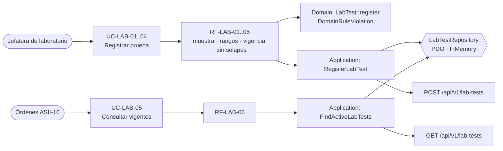

# Catálogo de pruebas de laboratorio — Semana 6: primera evaluación parcial

**Estudiante:** Herrera Sánchez, Axel Eliú (`AxelHerrera11`) · **Módulo:** ASII-17 · **Entrega:** defensa teórica y caso práctico arquitectónico.

## Tesis arquitectónica

En el flujo «alta y consulta de prueba con requisitos de muestra y vigencia», **una versión de prueba nace válida o no nace, y una vez usada nunca cambia**. Las reglas viven en el dominio y no en el controlador ni en la base. El acceso a datos pasa por un puerto (`LabTestRepository`) con dos adaptadores intercambiables, y el resto del HIS solo conoce el contrato `/api/v1/lab-tests` y guarda el `lab_test_id` exacto de la versión que usó. Así, un cambio en la regla, en la base o en el consumidor queda contenido en una sola pieza.

## Trazabilidad de punta a punta

| Semana | Qué aportó | Evidencia |
|---|---|---|
| 1 | Actores, UC-LAB-01..09, actividad, secuencia y Anexo A (`lab_tests` propuesta) | `docs/catalogo-pruebas-lab/semana-01/` (PR #43, integrado) |
| 2 | RF/RNF medibles y OCP para los tipos de resultado | `docs/catalogo-pruebas-lab/semana-02/` (PR #197) |
| 3 | Micro-HIS por capas con PDO y pruebas | `micro-his/catalogo-pruebas-lab/` (PR #199) |
| 4 | MVC + Repository con adaptadores PDO e InMemory y prueba de contrato | Reentrega de la Semana 4 (diseño del PR #59) |
| 5 | API v1, cliente con falla segura, OpenAPI y frontera de microservicio | Reentrega de la Semana 5 (diseño del PR #63) |
