# Catálogo de pruebas de laboratorio — Semana 7: componentes backend/frontend

**Estudiante:** Herrera Sánchez, Axel Eliú (`AxelHerrera11`) · **Módulo:** ASII-17 · **Entrega:** diagrama de componentes y propuesta de refactorización.

## Objetivo

Diseñar los componentes del flujo «alta y consulta de prueba con requisitos de muestra y vigencia» dentro del HIS real (Laravel 12 y Vue 3, ya presentes en `develop`), separando UI, aplicación, dominio y persistencia. El diseño reutiliza el dominio y los casos de uso del micro-HIS de las Semanas 3 a 5 sin reescribirlos.

[Fuente Mermaid](./fuentes/01-componentes.mmd)

## Componentes y responsabilidades

| Componente | Responsabilidad | Ya existe en `develop` |
|---|---|---|
| Middlewares `tenant` y `jwt.auth` | Resolver el hospital (`X-Tenant-ID`) y el usuario del JWT | Sí: `TenantMiddleware` y `JwtAuth` |
| Middleware `permission:modulo.accion` | Proteger cada ruta con el permiso de RBAC | Parcial: `spatie/laravel-permission` y `config/permission.php` están; falta registrar el alias `permission` en `bootstrap/app.php` y el catálogo de permisos (María, ASII-02) |
| `Api/V1/LabTestController` + `StoreLabTestRequest` | Controller delgado: valida tipos y obligatorios con el FormRequest y llama al caso de uso | No (propuesto) |
| Application: RegisterLabTest · FindActiveLabTests | Orquestan el caso de uso; se copian del micro-HIS sin cambios de lógica | En `micro-his/catalogo-pruebas-lab/src/Application` |
| Domain: LabTest · DomainRuleViolation | Reglas puras, sin Laravel | En `micro-his/catalogo-pruebas-lab/src/Domain` |
| `LabTestRepository` «interfaz» + `EloquentLabTestRepository` | Puerto de persistencia; el adaptador usa el Query Builder sobre la conexión `hospital` | El puerto y los adaptadores PDO/InMemory existen en el micro-HIS |
| `AuditLogger` | Evidencia en `local_access_audits` | Interfaz común de Cindy (plan de integración) |
| Vue: `LabCatalogPage.vue`, `LabTestTable.vue · LabTestForm.vue` | la tabla de pruebas vigentes con búsqueda y el formulario de alta con errores por campo | No (propuesto) |
| `stores/labCatalog.js` y `api/labCatalogApi.js` | Estado de la pantalla y llamadas HTTP con el plugin `axios` existente | Plugin `resources/js/plugins/axios.js` |

El formulario muestra el error del campo que devuelve el servidor (`field` del `problem+json`), por ejemplo «crítico bajo debe ser menor que referencia baja».

## Rutas protegidas

| Método | Ruta | Permiso |
|---|---|---|
| GET | `/api/v1/lab-tests` | `laboratorio.catalogo.ver` |
| POST | `/api/v1/lab-tests` | `laboratorio.catalogo.administrar` |
