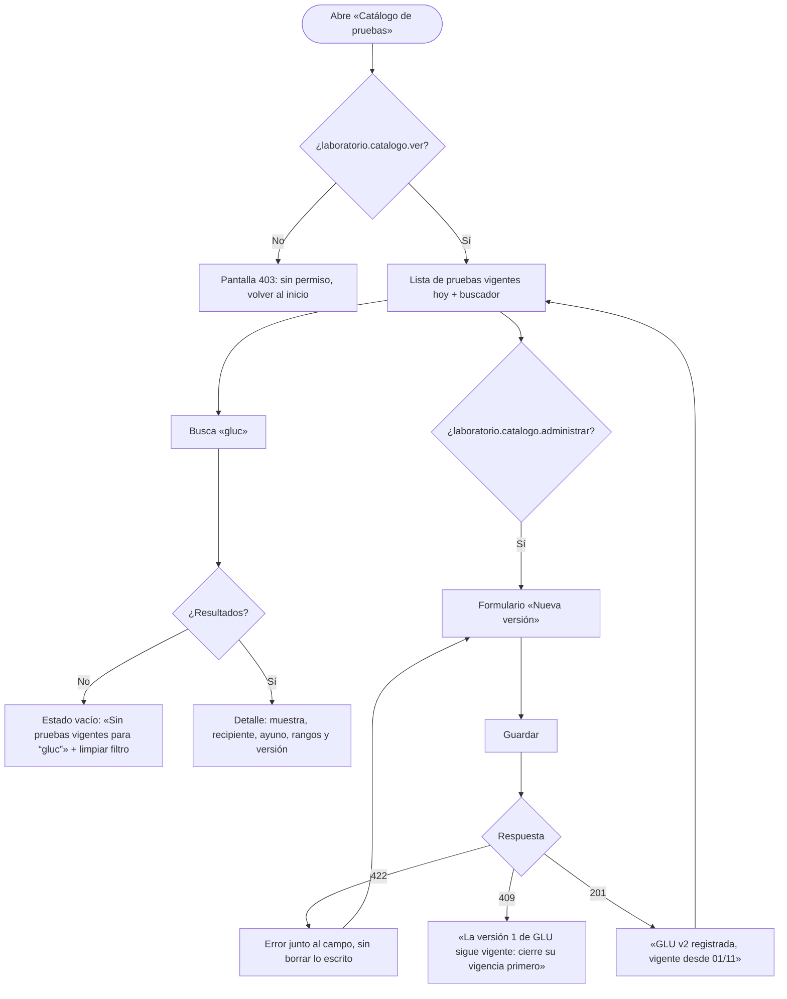

# Catálogo de pruebas de laboratorio — Semana 8: flujo UX por rol

**Estudiante:** Herrera Sánchez, Axel Eliú (`AxelHerrera11`) · **Módulo:** ASII-17 · **Entrega:** user flow, wireframes iniciales y reglas de interacción.

## Objetivo

Diseñar la experiencia del flujo «alta y consulta de prueba con requisitos de muestra y vigencia» para cada rol autorizado, con estados vacío, carga, éxito y error recuperable, y mensajes que usan los códigos reales del contrato API.

## Roles

| Rol | Objetivo en el flujo | Permiso |
|---|---|---|
| Jefatura de laboratorio | Registrar una versión nueva de una prueba con su muestra, rangos y vigencia | `laboratorio.catalogo.administrar` |
| Médico / Órdenes (ASII-16) | Encontrar la prueba vigente y ver qué muestra se toma | `laboratorio.catalogo.ver` |
| Técnico de laboratorio | Consultar los requisitos de muestra antes de recibirla | `laboratorio.catalogo.ver` |

## User flow



## Wireframes iniciales (baja fidelidad)

### 1. Lista de pruebas vigentes

```text
┌ Catálogo de pruebas ─────────────────────────────── Hospital: HOSP-DEMO ┐
│ Vigentes al: [18/10/2026 ▼]   Buscar: [gluc____________] [Buscar]        │
│                                                     [+ Nueva versión]  │
│ Código │ Nombre   │ Muestra      │ Unidad │ Referencia │ Versión        │
│ GLU    │ Glucosa  │ Suero · 1 mL │ mg/dL  │ 70–100     │ v1 [Ver]       │
└────────────────────────────────────────────────────────────────────────┘
```

### 2. Formulario «Nueva versión»

```text
┌ Nueva versión de prueba ───────────────────────────────────────────────┐
│ Código*  [NA_____]   Nombre* [Sodio______________]                     │
│ Muestra* [Suero ▼]   Volumen mínimo* [1__] mL   ☐ Requiere ayuno [__] h │
│ Tipo de resultado* (•) Numérico ( ) Cualitativo ( ) Texto              │
│ Unidad* [mmol/L]  Crítico bajo [120] Ref. baja [135] Ref. alta [145]    │
│                   Crítico alto [160]                                    │
│ ⚠ El crítico bajo debe ser menor que la referencia baja (RANGES_INCOHERENT)│
│ Vigente desde* [01/11/2026]                    [Cancelar] [Guardar]     │
└────────────────────────────────────────────────────────────────────────┘
```

### 3. Detalle de prueba

```text
┌ GLU · Glucosa · versión 1 ──────────────────────── vigente desde 19/10 ┐
│ Muestra: suero · tubo rojo · 1 mL · ayuno 8 h                          │
│ Rangos: referencia 70–100 mg/dL · crítico < 40 o > 400                 │
│ Las órdenes ya emitidas conservan esta versión.            [Volver]    │
└────────────────────────────────────────────────────────────────────────┘
```

## Estados de la pantalla

| Estado | Qué ve el usuario |
|---|---|
| Carga | Esqueleto de la tabla y el buscador deshabilitado |
| Vacío | «Sin pruebas vigentes para “texto” en esta fecha» y botón «Limpiar filtro» |
| Error de validación (422) | El mensaje junto al campo indicado en `field`; lo escrito no se borra |
| Vigencia solapada (409) | Aviso con la versión vigente y el enlace a su detalle |
| Catálogo no disponible (5xx o sin red) | «Catálogo no disponible: no se puede ordenar sin confirmar la versión» y reintentar |
| Éxito (201) | Confirmación con código, versión y fecha de vigencia |

## Reglas de interacción

- El botón «Nueva versión» solo aparece con `laboratorio.catalogo.administrar`; sin él, la ruta responde 403 aunque se escriba a mano.
- «Guardar» se habilita cuando están los campos obligatorios; las reglas de rangos las confirma el servidor y se muestran en el campo.
- La fecha de vigencia no ofrece días pasados (no hay altas retroactivas).
- Una versión vigente no se edita: el detalle no tiene botón «Editar», solo «Nueva versión».

Los wireframes se evalúan en la Semana 9 (usabilidad y accesibilidad) y se adaptan a móvil en la Semana 10. Uso de IA: [DECLARACION_IA.md](./DECLARACION_IA.md).
