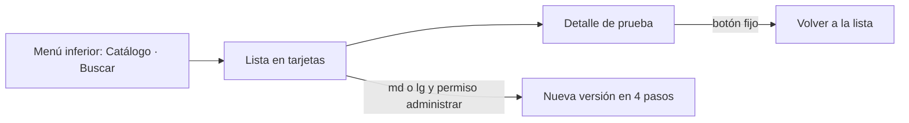

# Catálogo de pruebas de laboratorio — Semana 10: adaptación responsive y móvil

**Estudiante:** Herrera Sánchez, Axel Eliú (`AxelHerrera11`) · **Módulo:** ASII-17 · **Entrega:** escenarios móviles y prioridades de pantalla.

## Objetivo

Adaptar las pantallas de la [Semana 8](../semana-08/README.md) a teléfono y tablet según cómo se usan en el hospital, con las reglas de [breakpoints.md](./breakpoints.md) y las mejoras de la [Semana 9](../semana-09/README.md).

## Escenarios móviles

| # | Quién y dónde | Qué necesita | Respuesta del diseño |
|---|---|---|---|
| 1 | Técnico de laboratorio, en la ventanilla de recepción | Confirmar en el teléfono el recipiente y el volumen de una prueba antes de aceptar la muestra | Buscador arriba y tarjeta con muestra, recipiente, volumen y ayuno en grande |
| 2 | Médico, en la ronda | Ver si la prueba que va a ordenar requiere ayuno | Detalle con «Ayuno 8 h» como primera línea |
| 3 | Jefatura de laboratorio | Registrar una versión nueva | Solo `md` o `lg`: el formulario de rangos es largo; en `sm` se muestra «Use una tablet o computadora» |

## Prioridad de cada pantalla

| Pantalla | `sm` (teléfono) | `md` (tablet) |
|---|---|---|
| Lista de vigentes | Tarjetas: código, nombre y muestra; unidad y rangos en el detalle | Tabla con código, nombre, muestra y unidad |
| Detalle | Muestra, recipiente, volumen y ayuno arriba; rangos debajo | Dos columnas: muestra y rangos |
| Nueva versión | No disponible (mensaje) | Formulario en pasos: identificación, muestra, resultado y vigencia |

## Navegación móvil

## Mejoras de la Semana 9 incorporadas

H1 (orden de los rangos) se resuelve con el formulario en pasos y los rangos en la recta numérica; H2 («Duplicar como nueva versión») queda como acción del detalle en `md` y `lg`.

El prototipo navegable de la Semana 11 implementa estos breakpoints. Uso de IA: [DECLARACION_IA.md](./DECLARACION_IA.md).
