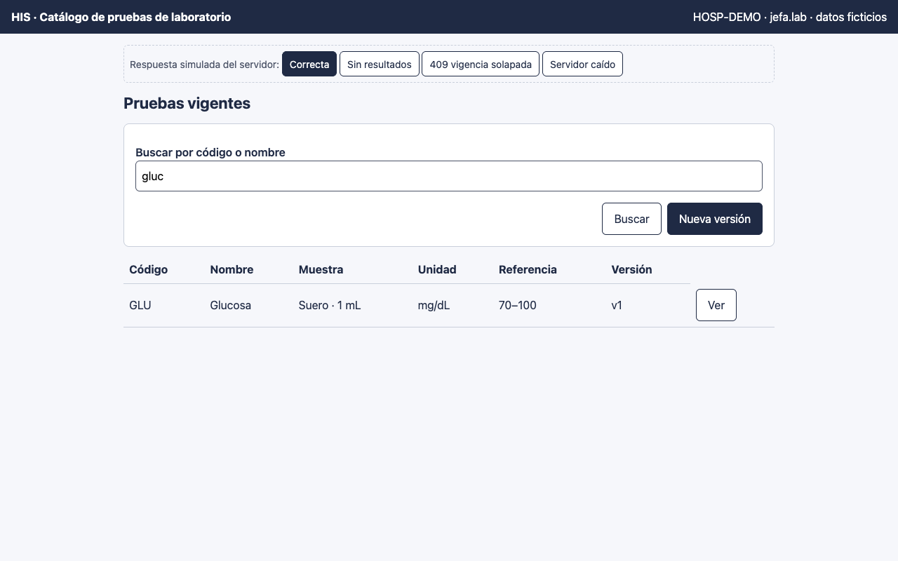
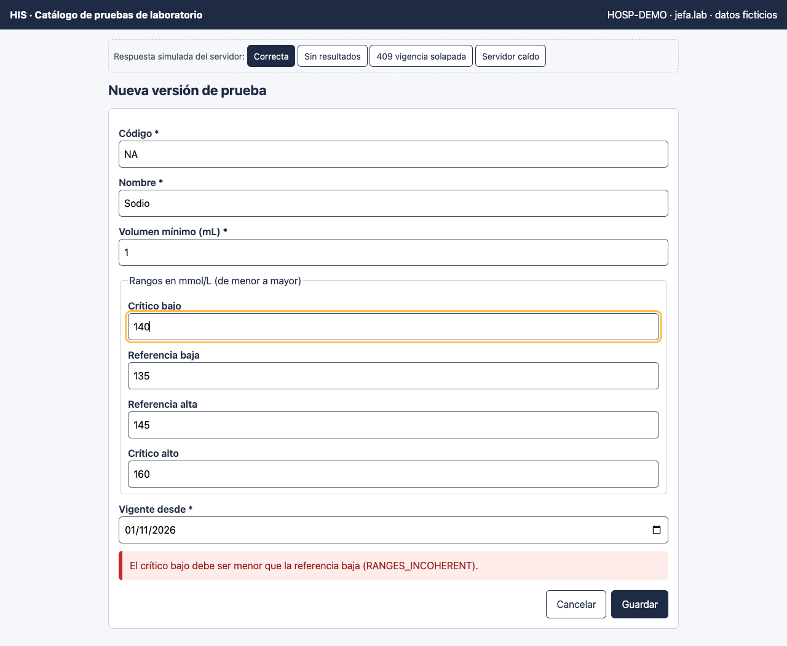
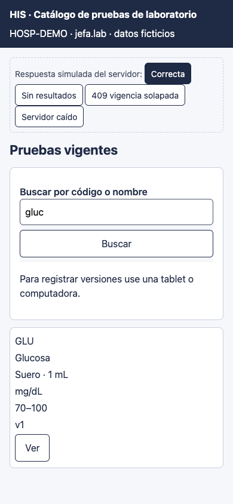

# Catálogo de pruebas de laboratorio — Semana 11: prototipo navegable

**Estudiante:** Herrera Sánchez, Axel Eliú (`AxelHerrera11`) · **Módulo:** ASII-17 · **Entrega:** prototipo navegable de escritorio y móvil.

## Cómo abrirlo

Abra [`prototipo/index.html`](./prototipo/index.html) en cualquier navegador. Es un solo archivo, funciona sin conexión y no llama a ningún servidor. Para verlo como teléfono, use el modo de dispositivo del navegador (390 px).

- **Pantallas:** lista de pruebas vigentes con búsqueda, detalle de prueba y formulario «Nueva versión».
- **Simulador:** la barra «Respuesta simulada del servidor» elige qué responde el servidor (Correcta, Sin resultados, 409 vigencia solapada y Servidor caído), con los mismos códigos del contrato `/api/v1`, para recorrer los caminos de error sin backend.

## Accesibilidad incluida

- Objetivos táctiles de 44 px como mínimo y foco visible (contorno ámbar de 3 px).
- Etiquetas en todos los campos y `fieldset` con `legend` en los grupos.
- Mensajes con texto, no solo color.
- `role="alert"` para lo crítico y `role="status"` para las confirmaciones.
- El foco va al título de cada pantalla y, ante un error, al campo afectado.

## Mejoras de las Semanas 9 y 10 aplicadas

- **H1 (orden de los rangos):** los rangos van en un `fieldset` «de menor a mayor» y, ante un error, el foco vuelve al campo.
- **H4 (foco tras el error):** el campo con error recibe el foco y queda unido al mensaje con `aria-describedby`.
- **H5 (confirmación no anunciada):** la confirmación se anuncia en una región `role="status"`.
- **Semana 10:** en `sm` no se ofrece «Nueva versión» y la tabla pasa a tarjetas.

## Recorrido automatizado (Chrome headless)

El prototipo se recorrió con Chrome headless (puppeteer), que hace clic y escribe como un usuario y verifica el texto visible: **10 pasos OK y ningún error de JavaScript**. La salida completa está en el PR.

## Capturas

**Lista de vigentes (escritorio)**

**Error de rangos junto al formulario**

**Lista en tarjetas (390 px), sin alta en el teléfono**

**Limitaciones:** el diseño visual final depende del layout base de Lis. La prueba con usuarios reales y la medición de contraste con herramienta quedan como siguiente paso. Uso de IA: [DECLARACION_IA.md](./DECLARACION_IA.md).
