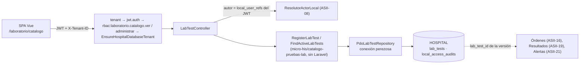

# Catálogo de pruebas de laboratorio — Semana 16: integración, validación y primera entrega funcional

**Estudiante:** Herrera Sánchez, Axel Eliú (`AxelHerrera11`) · **Módulo:** ASII-17 · **Issue:** #39

El micro-HIS del catálogo (Semanas 3 a 5) deja de correr aislado. Ahora tiene su tabla en HOSPITAL (`lab_tests`, slice H6, 000600), una API v1 en Laravel con `tenant`, `jwt.auth`, `rbac` y el guard de #1154, y una pantalla en la SPA.

| Parte | PR | Alcance |
|---|---|---|
| 1 | #1244 | Migración `lab_tests` y su prueba de integridad. Helper `hospitalRollbackSteps` para que una migración nueva no rompa las pruebas de rollback |
| 2 | #1320 | `LabTestController`, `CatalogoLabServiceProvider` (conexión perezosa y guard), pruebas Feature |
| 3 | #1247 | Pantalla Vue `/laboratorio/catalogo`, recorrido real de la SPA y capturas |
| 4 | este PR | Prueba contra PostgreSQL, recorrido HTTP con login real y este documento |

## Arquitectura de la integración



La versión vigente la decide el dominio (`hasActiveOverlap`). Si dos altas llegan a la vez, también la protege la base: `UNIQUE (code, version_no)` y la exclusión GiST de vigencias activas. Una violación de cualquiera de las dos responde `409 LAB_TEST_VALIDITY_OVERLAP`.

## Requisitos de la semana

| Requisito | Estado | Evidencia |
|---|---|---|
| Integrar con los componentes reales del HIS | **Hecho** | Tabla en HOSPITAL (#1244), API v1 detrás de los middlewares reales y del guard (#1320) y pantalla en la SPA (#1247). |
| Límites de autorización y de hospital | **Hecho y probado** | `laboratorio.catalogo.ver` (medico, técnico, bioquímico, superadmin); `laboratorio.catalogo.administrar` (superadmin; `admin_hospital` sigue en `pending`). |
| Migraciones y persistencia real | **Hecho y probado** | `LabTestCatalogIntegrityTest` (6) y `CatalogoLabPostgresTest` (4) contra PostgreSQL. |
| Primera entrega funcional | **Hecho** | Recorrido HTTP 9/9 y recorrido de la SPA 6/6 con login real. |
| Evidencia en staging u on-premise | **Entorno local de verificación** | No hay acceso a un staging del grupo. Se usó la misma pila con el seed de E2E de CI. |
| Errores corregidos | **Hecho** | Ver la tabla «Errores corregidos». |

## Evidencia ejecutada

Entorno: macOS, PHP 8.4.21, PostgreSQL 18.4 y Chrome headless. Bases desechables `his_*_e2e`, migradas y sembradas con `tests/E2E/fixtures/seed-e2e.php`. Los usuarios de superadmin, técnico y recepción se agregaron con [`agregar-usuario-e2e.php`](./evidencia/agregar-usuario-e2e.php), que solo corre sobre bases `*_e2e`. Todos los datos son ficticios.

```text
$ php vendor/bin/phpunit --testdox tests/Feature/CatalogoLab tests/Database/Hospital/CatalogoLabPostgresTest.php tests/Database/Hospital/LabTestCatalogIntegrityTest.php
Catalogo Lab Postgres
 ✔ Version author and h8 audit persist through the api
 ✔ Second active version is rejected and leaves no audit
 ✔ User without local reference is rejected by the real resolver
 ✔ Unreachable hospital database answers 503 and not 500
Lab Test Catalog Integrity
 ✔ Valid numeric test gets uuid and starts active
 ✔ Code and texts follow the domain
 ✔ Numeric ranges must be complete and ordered
 ✔ Only one active version per code and date
 ✔ Versions are retained and need an existing author
 ✔ Rollback removes only the catalog
Lab Test Api
 ✔ Identity tenant permission and hospital guard are enforced
 ✔ Superadmin registers and clinicians find the active version
 ✔ Domain rules map to http codes
 ✔ Actor without local reference cannot register
 ✔ Unavailable hospital answers 503 without details
OK (15 tests, 152 assertions)
```

- Recorrido HTTP con login JWT real: [`evidencia/recorrido-catalogo.sh`](./evidencia/recorrido-catalogo.sh). Salida en [`salida-recorrido-catalogo.txt`](./evidencia/salida-recorrido-catalogo.txt) (9/9) y lo que quedó en PostgreSQL en [`salida-psql.txt`](./evidencia/salida-psql.txt).
- Recorrido de la SPA: `evidencia/spa-catalogo.mjs` y `capturas/` (#1247), 6/6.

## Qué es real y qué se simula

| Prueba | Real | Simulado |
|---|---|---|
| `tests/Feature/CatalogoLab` | Middlewares, matriz RBAC, guard y controller | Identidad (tenant y JWT); HOSPITAL en memoria |
| `LabTestCatalogIntegrityTest` y `CatalogoLabPostgresTest` | PostgreSQL con las migraciones de `develop` más 000600, y el resolver de actor | Identidad |
| Recorrido HTTP y SPA | Login JWT, CENTRAL, tenant, RBAC, guard y HOSPITAL | Nada; solo los datos ficticios |

## Errores corregidos

| Error | Causa | Corrección |
|---|---|---|
| No había dónde persistir el catálogo en HOSPITAL | El slice H6 no tenía migración | `lab_tests` (000600) con las reglas del dominio y una exclusión de vigencias |
| Cualquier migración HOSPITAL nueva rompía 4 pruebas de otros slices | Usaban `migrate:rollback --step N` con N fijo | `hospitalRollbackSteps()` cuenta los archivos de migración |
| Un código con espacios habría llegado a PostgreSQL y respondido como «versión duplicada» | El adaptador trataba toda violación `23xxx` como unicidad, y el dominio no validaba el formato | Regla de dominio `CODE_INVALID`. Solo `23505` y `23P01` cuentan como unicidad |
| Con la base caída, la API habría respondido 500 | `PDO` abierto al construir y lecturas sin traducir | Conexión perezosa y `read()` → `PersistenceFailure` → 503 |
| El autor de la versión solo quedaba en la auditoría | El `INSERT` no lo guardaba | `created_by_user_ref_id` (FK a `local_user_refs`) |
| Los filtros de la pantalla quedaban desalineados en escritorio | Etiquetas e inputs en columnas distintas | Cada etiqueta agrupa su campo |

## Dependencias y pendientes

| Pendiente | Responsable |
|---|---|
| Activar `laboratorio.catalogo.administrar` para `admin_hospital` (hoy en `pending`) | RBAC (ASII-02) |
| FK de `lab_order_items.lab_test_id` a esta tabla | Órdenes (ASII-16) |
| Lectura de `critical_low` y `critical_high` para generar alertas | Alertas críticas (ASII-21) |
| Caso de uso «cerrar vigencia» para publicar una versión nueva del mismo código | ASII-17, siguiente iteración |
| Selección dinámica de base HOSPITAL por tenant; hasta entonces aplica el guard de #1154 | Integración / Tenants (ASII-25) |

[Declaración de uso de IA](./DECLARACION_IA.md)
