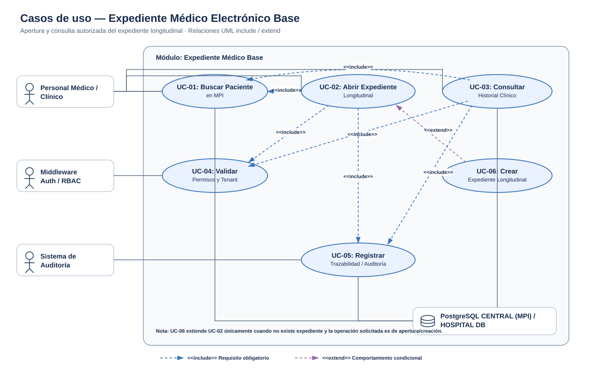
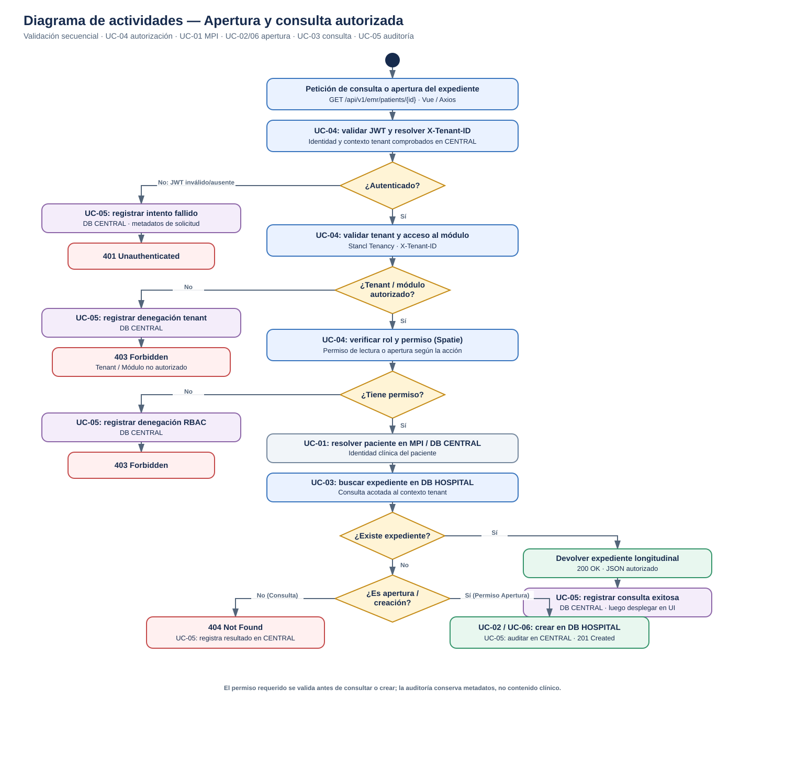
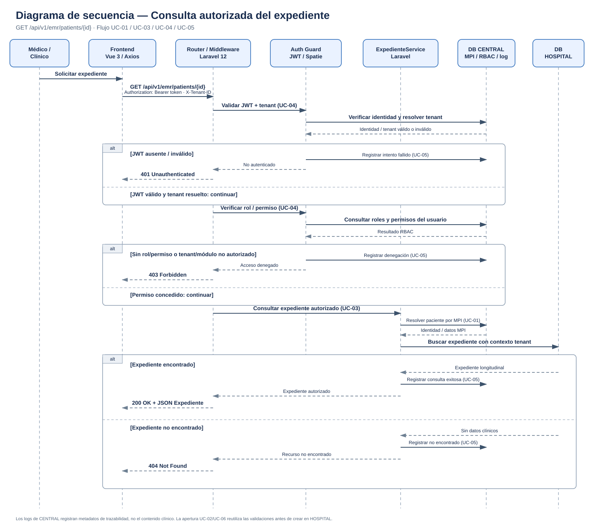

# Expediente Médico Electrónico Base

## Ficha de la Asignación 

- *Módulo:* Expediente médico electrónico base
- *Semana:* Semana 1 — Conceptos generales, orientación a objetos y UML
- *Tarea individual:* Modele el proceso «apertura y consulta autorizada del expediente longitudinal». Casos de uso: delimitar actores y objetivo; el de actividad debe incluir decisiones, excepciones y resultado; el de secuencia debe mostrar participantes, mensajes, validaciones y respuesta. Mantenga trazabilidad entre los tres diagramas.
- *Entregable / Evidencia:* UML de casos de uso y narrativa de alcance.
- *Estructura:* Sistema Hospitalario Integrado 2026 | Semanas 1–15.

---

### Contexto Arquitectónico

- *Backend:* Laravel 12 (PHP 8.2+), JWT y Spatie Laravel Permission.
- *Base de datos:* PostgreSQL federado (base **CENTRAL** para identidades, MPI y auditoría; base **HOSPITAL** para el expediente clínico).
- *Multitenancy:* Stancl Tenancy resolviendo el contexto del hospital mediante el header HTTP `X-Tenant-ID`.
- *Frontend:* Vue 3, Pinia y Axios.
- *Endpoint documentado:* `GET /api/v1/emr/patients/{id}`.

---

## 1. Diagrama de Casos de Uso

[Abrir diagrama de casos de uso en formato SVG](./01-casos-de-uso.svg)

### Descripción y Función

Delimita el alcance del módulo identificando a los actores del sistema y los objetivos funcionales del negocio. Representa la interacción entre el Personal Médico, los middlewares de autenticación/RBAC, el motor de auditoría y las bases de datos federadas. 

- *UC-01 (Buscar Paciente en MPI):* Identifica al paciente en la base CENTRAL.
- *UC-02 y UC-03 (Abrir / Consultar Expediente):* Ejecutan las operaciones clínicas principales e incluyen (`<<include>>`) de forma obligatoria la resolución de paciente, la validación de permisos/tenant y el registro de bitácora.
- *UC-04 (Validar Permisos y Tenant) y UC-05 (Registrar Auditoría):* Reglas transversales de seguridad y trazabilidad.
- *UC-06 (Crear Expediente Longitudinal):* Extensión condicional (`<<extend>>`) de UC-02 cuando el expediente aún no existe en la sede actual.

---

## 2. Diagrama de Actividades

[Abrir diagrama de actividades en formato SVG](./02-actividad.svg)

### Descripción y Función

Muestra el flujo operativo y lógico paso a paso que sigue la petición desde que ingresa al backend hasta que genera una respuesta. Incorpora todas las ramificaciones de decisión, excepciones con sus respectivos códigos de estado HTTP y los resultados finales del proceso.

- *Evaluación Autenticación (401 Unauthenticated):* Valida la presencia y vigencia del JWT.
- *Evaluación Tenant y RBAC (403 Forbidden):* Comprueba el acceso al Tenant (`X-Tenant-ID`) y los permisos asignados con Spatie.
- *Búsqueda y Resultado (200 OK / 201 Created / 404 Not Found):* Determina la existencia del expediente en la base HOSPITAL para devolver los datos, crearlo o notificar que no existe.
- *Trazabilidad (UC-05):* Todos los caminos (éxito o fallos) registran un evento en CENTRAL.

---

## 3. Diagrama de Secuencia

[Abrir diagrama de secuencia en formato SVG](./03-secuencia.svg)

### Descripción y Función

Modela la interacción orientada a objetos en el tiempo entre los componentes del sistema (Frontend Vue/Axios, Router/Middleware Laravel, Auth Guard, ExpedienteService y Bases de Datos). Ilustra los mensajes, validaciones, paso de parámetros y respuestas HTTP.

- *Participantes:* Muestra el desacoplamiento por capas entre la interfaz de usuario, los controladores/middlewares, la capa de servicios de dominio y la persistencia PostgreSQL.
- *Mensajes y Validaciones:* Detalla el envío del header `X-Tenant-ID`, las verificaciones cruzadas con la base CENTRAL y las consultas finales a la base HOSPITAL.
- *Bloques Alternativos (alt):* Representa formalmente las respuestas `401`, `403`, `200 OK` y `404 Not Found`.

---

## 4. Narrativa de Alcance y Trazabilidad

La narrativa también está disponible como documento independiente:
[Narrativa de Alcance y Trazabilidad](./narrativa-alcance-trazabilidad.md).

El proceso comienza cuando el personal médico solicita abrir o consultar el expediente longitudinal El *diagrama de casos de uso* define las capacidades y sus prerrequisitos: resolver al paciente en el MPI (UC-01), validar tenant y permisos (UC-04) y auditar la operación (UC-05). La creación (UC-06) es una extensión condicional de la apertura (UC-02), no de una consulta de lectura.

El *diagrama de actividades* transforma esos prerrequisitos en decisiones ordenadas: autenticación y resolución del tenant, autorización RBAC, búsqueda en HOSPITAL y respuesta según exista o no el expediente. El resultado ausente de una consulta produce 404; la alternativa explícita de apertura/creación produce el expediente solo después de validar la autorización. Errores de autenticación producen 401 y denegaciones de tenant, módulo o permiso producen 403.

El *diagrama de secuencia* asigna cada paso a sus componentes: Vue/Axios envía la solicitud y el tenant, Laravel y el Auth Guard validan la sesión y los permisos, `ExpedienteService` coordina el MPI en CENTRAL y la consulta clínica en HOSPITAL, y CENTRAL recibe los eventos de auditoría. Así, los identificadores UC mantienen correspondencia exacta entre la intención funcional, el flujo de decisiones y las llamadas técnicas.

La auditoría registra metadatos suficientes para correlacionar la solicitud (usuario, tenant, paciente/MPI, acción, resultado y marca de tiempo) sin almacenar contenido clínico en la bitácora de CENTRAL.
