# Principio de inversión de dependencias (DIP) aplicado al flujo

> «Los módulos de alto nivel no deben depender de los de bajo nivel; ambos deben depender de abstracciones».

## Antes (diseño inicial descartado — no se implementó)

Un `ExpedienteController` que abre su propio `PDO`, ejecuta `SELECT` e `INSERT`, lee `config/rbac.php` para
decidir por nombre de rol y escribe en `audit_log`. Problemas concretos en este módulo:

| Problema | Consecuencia en el expediente |
|---|---|
| La regla «solo médico con vínculo ve el expediente» vive junto al SQL | No se puede probar sin PostgreSQL; un cambio de tabla rompe la regla clínica |
| Decide permisos leyendo roles | Duplica el motor RBAC de María y se desincroniza de `RoleGrantsPermission` y de su falla segura |
| Escribe la bitácora con SQL propio | Duplica Gobernanza: sin cadena de hash, sin `ContextSanitizer`, sin política Security/Informational |
| Una sola conexión | No hay forma natural de aislar hospitales (tenant) |

## Después (implementado)

Los casos de uso (`ConsultLongitudinalRecord`, `OpenMedicalRecord`) y `AccessGuard` solo conocen interfaces
declaradas **en Application**, es decir, en el límite del módulo y con el vocabulario del expediente:

| Interfaz (Application) | Adaptadores | Responsabilidad que se aísla |
|---|---|---|
| `AccessAuthorizer` | `Integration/RbacAccessAuthorizer` (→ `MicroHis\Rbac\Application\Authorize`) | Decidir permisos `modulo.accion` por hospital |
| `ClinicalAccessAudit` | `Integration/GobernanzaClinicalAudit` (→ `RecordAuditEvent`) | Persistir el acceso con la política de fallo de Gobernanza |
| `PatientDirectory` | `Integration/PacientesDirectory` (→ `PatientRepository` de Pacientes) | Identificar al paciente |
| `MedicalRecordRepository` | `PdoMedicalRecordRepository`, `InMemoryMedicalRecordRepository` | Guardar/leer el expediente y leer episodios |
| `CareRelationship` | `PdoCareRelationship`, `InMemoryCareRelationship` | Vínculo asistencial |
| `HospitalStoresProvider` | `HospitalRegistry` | Elegir la base del hospital (tenant) |

La dirección de las flechas cambió: ahora `Persistence` e `Integration` dependen de `Application`, y no al revés.
La única pieza que conoce a todos es la raíz de composición `app.php`.

## Justificación de responsabilidades

- **Domain** (`MedicalRecord`, `CareEpisode`, `LongitudinalRecord`, `PatientSummary`): reglas que no cambian si
  cambia la base: un paciente activo para abrir, coherencia de estados y fechas, todo del mismo paciente.
- **Application**: orden del flujo y política de acceso (permiso → hospital → paciente/vínculo → datos → auditoría).
- **Integration**: traducir contratos de otros módulos sin reimplementarlos.
- **Persistence**: SQL preparado sobre las tablas reales y traducción de errores del driver.
- **Presentation**: HTTP ↔ caso de uso, sin reglas ni SQL.

## Evidencia verificable

La regla se comprueba automáticamente en `micro-his/expediente-medico/tests/arquitectura.php` (R-01…R-06) sobre el
código sin comentarios, y el mismo caso de uso se ejecuta con dos implementaciones distintas de cada puerto
(caja negra `[pdo]` y `[memoria]`). Salida real en [`evidencias/arquitectura-y-dip.txt`](evidencias/arquitectura-y-dip.txt).
