# Capas, responsabilidades y objetos reutilizables

## Entrada MVC

| Pieza MVC | Clase real | Responsabilidad | Lo que NO hace |
|---|---|---|---|
| Ruta | `Presentation/Router` | Elegir la acción por método y ruta; 404/405 para lo demás | Validar datos, consultar bases |
| Controlador | `Presentation/MedicalRecordController` | Leer la petición, invocar el caso de uso, traducir resultado/excepción a estado HTTP | SQL, reglas de dominio, decidir permisos |
| Modelo | `Application/ConsultLongitudinalRecord`, `OpenMedicalRecord` + `Domain/*` | Orden del flujo y reglas | Conocer HTTP o PDO |
| Vista | `Presentation/JsonView` + `LongitudinalPresenter` | Forma del JSON y cabeceras `no-store` | Decidir qué es un error |

La regla «el controlador no tendrá SQL ni reglas de negocio» se comprueba con R-03 y R-04 de
`tests/arquitectura.php` (código sin comentarios).

## Repository en el límite apropiado

`MedicalRecordRepository` está en **Application** (no en Persistence): lo define quien lo usa, con el vocabulario
del expediente. Sus dos adaptadores cumplen el mismo contrato:

| Comportamiento del contrato | `PdoMedicalRecordRepository` | `InMemoryMedicalRecordRepository` | Prueba |
|---|---|---|---|
| Un expediente por paciente | `UNIQUE (local_patient_id)` + relectura del ganador | arreglo por `patientId` | A6, P-03 |
| `$confirm` dentro de la transacción; si falla, se revierte | `BEGIN … ROLLBACK` | elimina el registro | A5, P-04 |
| Episodios ordenados | `ORDER BY started_at DESC` + orden de dominio | orden de dominio | U-05, P-02 |
| Fallo del almacén → `PersistenceFailure` sin detalle | captura `PDOException` | `down = true` | C6b, P-06, N-11 |

## Objetos reutilizables

| Objeto | Reutilizable por | Motivo |
|---|---|---|
| `CareRelationship` / `PdoCareRelationship` | Notas SOAP, Prescripciones, Órdenes | Es la misma condición de «médico tratante activo» que exigen los triggers de 000400 |
| `HospitalRegistry` | Cualquier micro-HIS con base por hospital | Aislamiento por tenant con fábricas perezosas |
| `LongitudinalRecord` | Alergias (banner en el expediente), Reportes | Vista consistente y ordenada del historial |
| `GobernanzaClinicalAudit` | Módulos clínicos que auditen lecturas sensibles | Criticidad Security y contexto sin datos clínicos |
| `estados.js` (interfaz) | La SPA Vue cuando se registre la ruta | Interpretación única de cada respuesta (patrón de Traslados) |

Reutilizados **desde** otros módulos (no duplicados): `Authorize` (RBAC), `RecordAuditEvent` y `PdoAuditLog`
(Gobernanza), `PatientRepository` (Pacientes) y `ResolutorActorLocal` (Traslados, en el adaptador Laravel).
