# Integración con el repositorio de datos compartido

## Cómo es el repositorio real

El sistema usa una base **federada** (README del repositorio y `config/database.php`): una base CENTRAL para la
red (identidad, membresías, MPI, auditoría) y una base HOSPITAL **por hospital** (conexión `hospital`). Varios
módulos escriben en la misma base HOSPITAL, cada uno en sus tablas.

## Propiedad de datos

| Tabla | Dueño (escribe) | Uso en el expediente |
|---|---|---|
| `medical_records` | **Expediente** | Lee y escribe (apertura) |
| `local_patients` | Pacientes | Solo lectura, a través de `PatientRepository` |
| `care_episodes` | Admisión / flujos clínicos | Solo lectura (`episodesOf`) |
| `care_assignments`, `doctor_profiles`, `local_user_refs` | Médicos / Admisión / sincronización de identidad | Solo lectura (`PdoCareRelationship`, `ResolutorActorLocal`) |
| `clinical_notes`, `diagnoses` | Notas SOAP | No se leen en esta versión; sus triggers exigen que el expediente exista y sea del mismo paciente |
| `audit_log` (CENTRAL) | Gobernanza | Escribe solo a través de `RecordAuditEvent` |

## Cómo se integra este módulo

1. **Un puerto por necesidad, no por tabla.** El caso de uso pide «¿tiene vínculo?» (`CareRelationship`), no
   «dame `care_assignments`». Si el dueño cambia su tabla, solo cambia un adaptador.
2. **Lectura de tablas ajenas sin escritura.** Las clases PDO de este módulo solo tienen `INSERT` sobre
   `medical_records` (verificable con `grep -n "INSERT" micro-his/expediente-medico/src -r`).
3. **Integridad delegada a la base cuando es compartida.** El UNIQUE por paciente, el CHECK de cierre y el trigger
   de retención viven en la migración; el dominio los replica para detectar datos inconsistentes antes de mostrarlos.
4. **Consistencia entre bases sin FK.** `local_patients.global_id` referencia el MPI de CENTRAL sin FK física. El
   expediente longitudinal de esta versión es **por hospital**; unir hospitales vía MPI y `cross_hospital_grants`
   queda como propuesta (no hay política de acceso entre hospitales acordada).
5. **Laravel.** El adaptador `app/ExpedienteMedico` obtiene el PDO de `DB::connection('hospital')`, igual que
   Traslados y Medicamentos. No hay modelos Eloquent del expediente: el README del repositorio los marca como pendientes
   y este módulo no los necesita (usa sus adaptadores PDO).

## Riesgos y decisiones pendientes

| Riesgo | Mitigación actual | Pendiente con |
|---|---|---|
| Otro módulo escribe en `medical_records` | Documentado como tabla del expediente | Javier (registro de dueños de tabla) |
| No existe asignación de enfermería | Enfermería recibe 403 `SIN_VINCULO_ASISTENCIAL` (S-01) | María y Javier |
| Auditoría en CENTRAL y expediente en HOSPITAL: no hay transacción común | La apertura se revierte si la bitácora falla; si la bitácora confirma y el COMMIT local falla, queda un evento sin expediente (riesgo R-05 de la Semana 14) | Gobernanza |
