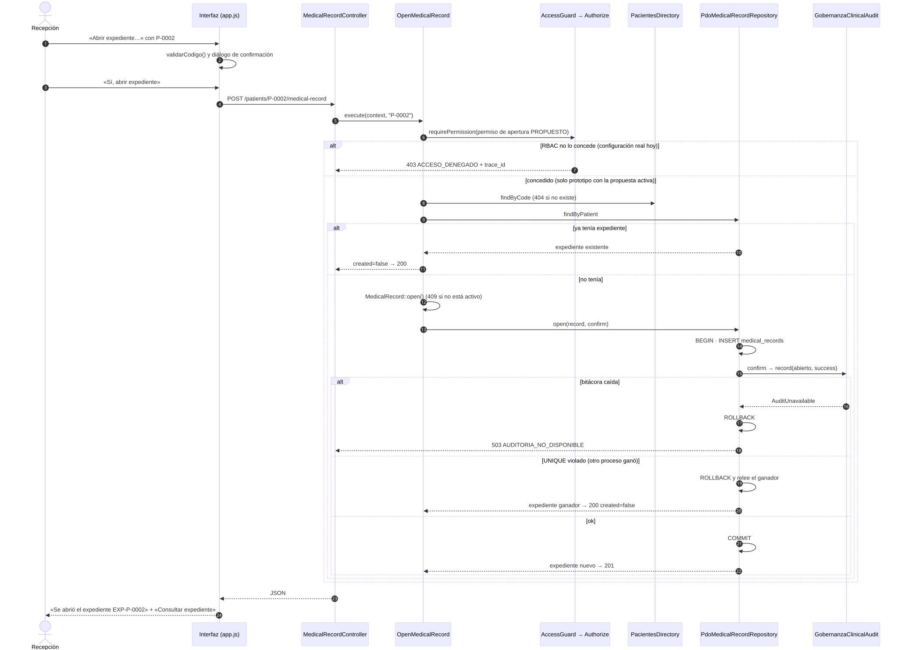

# Evaluación de una frontera de microservicio para el expediente

## Diseño cliente-servidor actual

El mismo núcleo (`Router` → `MedicalRecordController` → casos de uso) atiende dos entradas: el front controller del
prototipo y el adaptador Laravel. El cliente nunca decide permisos: solo valida formato y presenta estados.

## Frontera evaluada (propuesta, no implementada)

| Aspecto | Monolito modular (actual) | Microservicio «Expediente» (evaluado) |
|---|---|---|
| Propiedad de datos | `medical_records` en la base HOSPITAL junto a `care_episodes` y `clinical_notes` | `medical_records` en base propia; episodios y asignaciones por API o réplica |
| Comunicación | Llamadas en proceso a puertos (`AccessAuthorizer`, `PatientDirectory`, …) | HTTP síncrono a RBAC y Pacientes; lectura remota de Admisión/Médicos; evento a Gobernanza |
| Seguridad | Middlewares compartidos + RBAC en el caso de uso | El gateway valida JWT; el servicio debe volver a autorizar (no confiar en la red) |
| Resiliencia | Falla → 503 explícito; apertura idempotente | Además: timeouts, presupuesto de reintentos, circuit breaker por dependencia |
| Observabilidad | `trace_id` RBAC y `correlation_id` en la auditoría | Trazas distribuidas entre 5 servicios |
| Consistencia | Transacción local + UNIQUE + triggers de 000400 | Los triggers de `clinical_notes` exigen `medical_records` en la MISMA base: se romperían |

## Medición (evidencia para decidir)

[`evidencias/medicion-en-proceso.txt`](evidencias/medicion-en-proceso.txt) — medido el 2026-10-23 en este equipo:

- En proceso (Router → caso de uso → PDO SQLite → auditoría en memoria), 500 repeticiones: consulta p50 0.120 ms,
  p95 0.244 ms.
- Ida y vuelta HTTP local al prototipo (`php -S`, 30 peticiones): p50 78.4 ms. Este número incluye arrancar PHP en
  cada petición, abrir los archivos SQLite y escribir la auditoría en disco; no mide solo la red, pero muestra el
  orden de magnitud de un salto HTTP adicional en este entorno.

Con cuatro dependencias remotas por consulta, un microservicio multiplicaría la latencia y los modos de fallo sin
ganar nada medible: el volumen esperado es el de un hospital y no hay requisito de escalar el expediente aparte.

## Decisión

**No se divide.** El expediente sigue como módulo del monolito modular, con fronteras internas ya preparadas
(puertos en Application) para separarlo si en el futuro se cumple alguno de estos disparadores medibles:

1. p95 de la consulta > 300 ms en producción durante una semana por carga propia del expediente;
2. necesidad de desplegar el expediente con una frecuencia distinta a la del resto del HIS;
3. un expediente entre hospitales (MPI) que requiera su propio almacén.

## Migración razonada (si se activa un disparador)

| Paso | Cambio | Reversible |
|---|---|---|
| 1 | Publicar el contrato actual a través del API Gateway sin mover código | Sí |
| 2 | Sustituir `PdoCareRelationship` y `PacientesDirectory` por adaptadores HTTP con timeout (los puertos ya existen) | Sí, por configuración |
| 3 | Auditoría con *outbox*: el evento se guarda en la base del expediente y se envía con reintento idempotente | Sí |
| 4 | Mover `medical_records` a base propia solo después de acordar con Javier y Josué cómo validan `clinical_notes` el expediente sin FK | Requiere migración (no se hace sin Javier) |

