# Componentes backend y frontend del expediente

## Contratos de entrada y salida

| Componente | Entrada | Salida | Errores que produce |
|---|---|---|---|
| `Router` | `Request(method, path, headers)` | arreglo `{status, headers, body}` | 404 `RUTA_NO_ENCONTRADA`, 405 `METODO_NO_PERMITIDO` |
| `MedicalRecordController` | `Request`, `patientCode` | vista JSON | traduce excepciones a 4xx/5xx con `code` |
| `ConsultLongitudinalRecord` | `RequestContext`, `patientCode` | `LongitudinalRecord` | `ExpedienteRuleViolation` (403/404/422/503), `AuditUnavailable`, `PersistenceFailure` |
| `OpenMedicalRecord` | `RequestContext`, `patientCode` | `{record: MedicalRecord, created: bool}` | 403/404/409/422/503, `AuditUnavailable`, `PersistenceFailure` |
| `AccessGuard` | `RequestContext`, permiso `modulo.accion` | nada (o excepción) | 403 `ACCESO_DENEGADO` + `trace_id` |
| `LongitudinalRecord` | `MedicalRecord`, `PatientSummary`, `CareEpisode[]` | episodios ordenados, `openEpisodes()` | 500 `EXPEDIENTE_DE_OTRO_PACIENTE`, `EPISODIO_DE_OTRO_PACIENTE` |
| `LongitudinalPresenter` | `LongitudinalRecord` / `MedicalRecord` | arreglo del contrato (sin `contact` ni `global_id`) | — |
| `GobernanzaClinicalAudit` | contexto, acción, resultado, id, motivo, contexto escalar | evento `expediente_medico.<accion>` | `AuditUnavailable` |
| `estados.js` · `validarCodigo` | texto del campo | `{valido, codigo, mensaje}` | — |
| `estados.js` · `interpretar` | operación, estado HTTP, cuerpo | `{tipo, titulo, mensaje, puedeReintentar, traza?, datos?}` | — |
| `vista.js` | estado interpretado / datos | DOM construido con `textContent` | — |
| `app.js` | eventos del usuario | `fetch` + pintado + foco | límite de 3 reintentos |

## Reglas de diseño de componentes

- La interfaz **no** decide permisos: solo valida formato y presenta lo que respondió el servidor.
- Ningún componente visual recibe HTML del API: todo se pinta con `textContent` (sin XSS aunque un motivo traiga `<script>`).
- El motivo de cada episodio se muestra plegado (`
`) y «Ocultar datos del paciente» limpia la pantalla;
  cambiar de usuario o de hospital también la limpia.
- El módulo no se amplió: no hay componentes de notas, alergias ni signos vitales (son de otros módulos).
