# Refactor del punto de mayor acoplamiento

## Punto elegido

La **consulta longitudinal** es donde se cruzan los cinco temas del módulo: expediente longitudinal, episodios
clínicos, acceso autorizado, integridad y datos sensibles. Un diseño ingenuo los resuelve en una sola función.

## Antes (conceptual — no implementado)



```php
// Pseudocódigo del diseño descartado
public function execute(string $usuario, string $rol, string $codigo): array {
    if (!in_array($rol, ['medico', 'enfermeria'])) { throw new Forbidden(); }        // acceso por nombre de rol
    $p = $pdo->query("SELECT * FROM local_patients WHERE code = '$codigo'")->fetch(); // SQL concatenado
    $r = $pdo->query("SELECT * FROM medical_records WHERE local_patient_id = '{$p['local_patient_id']}'")->fetch();
    $e = $pdo->query("SELECT * FROM care_episodes WHERE local_patient_id = ...")->fetchAll();
    $datos = ['paciente' => $p, 'expediente' => $r, 'episodios' => $e];                 // incluye contacto y global_id
    $pdo->exec("INSERT INTO audit_log ... '" . json_encode($datos) . "'");              // datos clínicos en la bitácora
    return $datos;
}
```

## Después (implementado)



`ConsultLongitudinalRecord::execute` (49 líneas con comentarios) solo **orquesta**; cada preocupación tiene dueño:

| Preocupación | Antes | Después |
|---|---|---|
| Acceso autorizado | `in_array($rol, …)` en la función | `AccessGuard` → `Authorize` real + `CareRelationship` |
| Integridad | ninguna | `LongitudinalRecord` (mismo paciente, orden), `MedicalRecord`/`CareEpisode` (estados y fechas) |
| Datos sensibles | fila completa del paciente, datos en la auditoría | `LongitudinalPresenter` (minimización) y auditoría solo con ids/conteos (`ContextSanitizer` de Gobernanza como segunda barrera) |
| Persistencia | SQL concatenado | `PdoMedicalRecordRepository` con sentencias preparadas |
| Episodios | arreglo sin validar | `CareEpisode` validado y ordenado |

## Comparación verificable

| Medida | Antes (conceptual) | Después (código real) | Cómo comprobarlo |
|---|---|---|---|
| Responsabilidades en la función | 6 | 1 (orquestar) | lectura de `ConsultLongitudinalRecord.php` |
| Dependencias concretas del caso de uso | PDO + tablas | 0 (solo interfaces de Application) | R-02 en `tests/arquitectura.php` |
| SQL concatenado | sí | no | R-05; N-07d (inyección → 422) |
| Datos clínicos en la auditoría | sí | no | C7 (`context === ['episodios' => 3]`), P-07b |
| Probado sin base | no | sí | caja blanca C1–C8 con dobles |

## Justificación

El refactor no amplía el módulo: no agrega funciones nuevas, solo separa responsabilidades para que un cambio de
política de acceso (por ejemplo, el criterio de enfermería pendiente con RBAC) se haga en `AccessGuard` o en un
adaptador de `CareRelationship` sin tocar SQL, integridad ni la forma de la respuesta.
