# Plan de revisión técnica formal — Expediente médico electrónico base

## Objetivo

Encontrar defectos (no discutir estilo) en las reglas de dominio, el contrato API, los permisos/tenant, la
integridad del expediente longitudinal y el manejo de datos sensibles del flujo «apertura y consulta autorizada»,
y confirmar que las dependencias son las estrictamente necesarias.

## Material bajo revisión

| Artefacto | Ruta | Tamaño aprox. |
|---|---|---|
| Dominio y casos de uso | `micro-his/expediente-medico/src/{Domain,Application}` | ~530 líneas |
| Persistencia e integración | `src/{Persistence,Integration}` | ~400 líneas |
| Presentación y contrato | `src/Presentation`, `openapi.yaml` | ~320 líneas |
| Adaptador Laravel | `app/ExpedienteMedico/*` | ~110 líneas |
| Pruebas | `tests/*.php`, `tests/Feature/ExpedienteMedico/*` | referencia |

## Roles (propuesta; confirmar con el grupo)

| Rol | Persona | Responsabilidad | Parte del checklist |
|---|---|---|---|
| Autora | Cindy | Prepara el material, responde preguntas, corrige | — |
| Moderador | A designar (propuesta: Yamilet, revisora y responsable del merge según el plan) | Verifica entrada/salida, conduce la reunión, decide retrabajo | todo |
| Revisor RBAC/tenant | A confirmar (propuesta: María, RBAC) | Permisos `modulo.accion`, membresía por hospital | RT-04…RT-07 |
| Revisor de datos | A confirmar (propuesta: Javier, BD) | Tablas, columnas, integridad, transacciones | RT-08…RT-11 |
| Revisor de contrato | A confirmar (propuesta: Lis, contratos API) | Formato de respuesta y errores | RT-02, RT-03, RT-12 |
| Registrador | Uno de los revisores | Anota hallazgos en el formato acordado | — |

Ningún revisor revisa su propio módulo; los propuestos dependen del expediente según el plan de integración.

## Criterios de entrada

1. `php micro-his/expediente-medico/tests/run.php` termina con `0 FALLO`.
2. `php vendor/bin/phpunit tests/Feature/ExpedienteMedico` y `tests/Feature/Rbac/PublishedContractsTest.php` en verde.
3. Ningún archivo del módulo supera 400 líneas.
4. README, diagramas y contrato usan los mismos nombres que el código.
5. El material se entrega a los revisores al menos 24 h antes.

## Criterios de salida

1. Cero hallazgos críticos y cero mayores abiertos.
2. Cada hallazgo menor tiene corrección o un issue con responsable.
3. Las pruebas de los criterios de entrada siguen en verde después del retrabajo.
4. El moderador firma el informe (comentario en el PR con la tabla de hallazgos).

## Agenda (≤ 2 h de reunión en total)

| Momento | Duración | Actividad |
|---|---|---|
| D-2 | 15 min | Apertura: alcance, roles, checklist |
| D-2 → D-1 | ≤ 90 min por persona | Preparación individual |
| D | ≤ 60 min | Reunión: lectura guiada (casos de uso → integración → persistencia → contrato) |
| D+1 | — | Retrabajo de la autora |
| D+2 | 15 min | Verificación y cierre |

Formato de hallazgos y checklist: [`checklist-revision.md`](checklist-revision.md) y [`formato-hallazgos.md`](formato-hallazgos.md).
