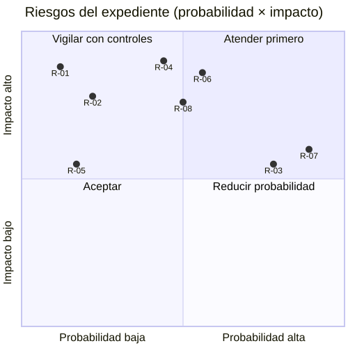

# Plan SQA — Expediente médico electrónico base

Alcance: calidad del flujo «apertura y consulta autorizada del expediente longitudinal», confiabilidad, seguridad y
trazabilidad. Responsable general: Cindy (autora). Los umbrales son propuestas del módulo; los que afectan a todo el
grupo (p. ej. bloquear merges) dependen del pipeline de CI y de la aprobación del grupo.

## Métricas (7)

| Id | Métrica | Umbral | Fuente | Responsable | Acción si no se cumple | Valor al 2026-10-23 |
|---|---|---|---|---|---|---|
| M-1 | Pruebas del micro-HIS aprobadas / total | 100 % | `php micro-his/expediente-medico/tests/run.php`; CI `micro-his/micro-his.xml` | Cindy | No abrir/mergear el PR; corregir el mismo día | 100 % (ver `semana-15/evidencias`) |
| M-2 | Pruebas Feature Laravel del expediente aprobadas / total | 100 % | `php vendor/bin/phpunit tests/Feature/ExpedienteMedico` | Cindy | Igual que M-1 | 100 % (4/4) |
| M-3 | Criterios de aceptación con prueba automática / total | 100 % | Matriz `semana-02/requisitos.md` | Cindy | Agregar la prueba antes de cerrar la semana | 10/10 |
| M-4 | Respuestas 403 del módulo con evento `acceso_denegado` en `audit_log` | 100 % | P-07 (prueba); en producción: conteo de `audit_log` vs. logs de acceso | Cindy (Gobernanza) | Tratar como incidente de seguridad | 100 % en pruebas; producción sin datos |
| M-5 | Archivos del módulo con más de 400 líneas | 0 | R-07 y el conteo de `PLAN-DE-ENTREGAS.md` | Cindy | Dividir el archivo antes del PR | 0 |
| M-6 | Hallazgos de accesibilidad/datos sensibles de severidad Alta abiertos | 0 | `semana-09/hallazgos-backlog.md` | Cindy | Corregir antes de la siguiente entrega | 0 (H-01 corregido) |
| M-7 | p95 de la consulta en proceso | < 5 ms | `semana-05/herramientas/medir-consulta.php` | Cindy | Revisar consultas e índices con Javier | 0.244 ms |

## Matriz de riesgos

Probabilidad (P) e impacto (I): 1 bajo · 2 medio · 3 alto. Exposición = P × I.

| Id | Riesgo | P | I | Exp. | Control preventivo | Control detectivo | Responsable |
|---|---|---|---|---|---|---|---|
| R-01 | Persona con permiso general ve un expediente sin vínculo asistencial | 1 | 3 | 3 | `AccessGuard` + `CareRelationship` (S-01) | Evento `acceso_denegado`; C3/C4/N-02 | Cindy |
| R-02 | La API del expediente deja de existir si se quita o reordena el provider en `bootstrap/providers.php` | 1 | 3 | 3 | Provider registrado (2026-10-23) después de Traslados; prueba F-1 verifica que esté cargado | `php artisan route:list --path=api/v1/patients` | Cindy |
| R-03 | El permiso de apertura no se aprueba y nadie puede abrir expedientes | 3 | 2 | 6 | Propuesta enviada a RBAC con roles | N-08 (403 con la matriz real) | María |
| R-04 | El esquema de prueba SQLite diverge de PostgreSQL | 2 | 3 | 6 | Mismos nombres de tabla/columna; divergencias listadas en `schema.sql` | Ejecutar las pruebas PDO contra PostgreSQL (pendiente: no hay servidor) | Cindy + Javier |
| R-05 | La auditoría se confirma y luego falla el COMMIT local (eventos sin expediente) | 1 | 2 | 2 | Auditoría dentro de la transacción local; apertura idempotente | Conciliación periódica `audit_log` ↔ `medical_records` (propuesta) | Cindy |
| R-06 | Datos clínicos quedan en pantalla sin supervisión (H-07) | 2 | 3 | 6 | «Ocultar datos», limpiar al cambiar usuario/hospital/código | Revisión UX; política de inactividad pendiente | Grupo |
| R-07 | Enfermería necesita consultar y hoy recibe 403 | 3 | 2 | 6 | Mensaje claro; supuesto S-01 documentado | Reportes de usuarios | María + Javier |
| R-08 | Otro módulo cambia `care_episodes` o `care_assignments` | 2 | 3 | 6 | Puertos por necesidad; solo lectura | Pruebas PDO del módulo + `tests/Database` del grupo | Javier |

## Controles

| Tipo | Control | Cuándo |
|---|---|---|
| Preventivo | Reglas de arquitectura R-01…R-07 en la suite | Cada ejecución |
| Preventivo | Validación de entrada (422) y SQL preparado | Siempre (código) |
| Preventivo | Revisión técnica formal (Semana 13) | Antes de pedir revisión del PR final |
| Preventivo | Lista previa del PR del plan de integración (400 líneas, validación real, SVG regenerado) | Cada PR |
| Detectivo | CI: `micro-his-suites.php` ejecuta `tests/run.php` del módulo; `PublishedContractsTest` vigila permisos | Cada push/PR |
| Detectivo | Auditoría de accesos y denegaciones en Gobernanza (`rbac_trace`) | Cada petición |
| Detectivo | Medición de latencia M-7 | Semanal |

## Calendario de seguimiento

| Frecuencia | Actividad | Métricas |
|---|---|---|
| Cada commit/PR | Suite del micro-HIS, Feature, contratos RBAC | M-1, M-2, M-5 |
| Cada merge de la base en `develop` | Actualizar la rama con `origin/develop` y repetir pruebas | M-1, M-2 |
| Semanal (viernes) | Revisar backlog UX y riesgos; medir latencia | M-3, M-6, M-7 |
| Al activar el permiso de apertura o cambiar `bootstrap/providers.php` | Pruebas de integración completas y conteo de auditoría | M-4, R-02, R-03 |
