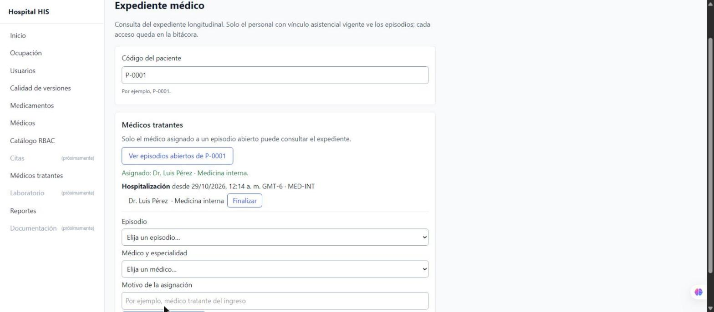

# Semana 16 — Pantalla de médicos tratantes y ajustes de `/expediente` (parte 6)

Interfaz de la parte 4: quien tiene `expediente.asignar` gestiona, desde `/expediente`, qué médico atiende cada episodio
abierto del paciente. Así el flujo completo se hace en la aplicación: Médicos registra al profesional, Admisión abre el
episodio, administración asigna al médico tratante y el médico consulta el expediente.

## Comportamiento

- La ruta `/expediente` acepta `expediente.ver` **o** `expediente.asignar`; el menú muestra «Médicos tratantes» a quien
  solo puede asignar. El botón «Consultar» solo aparece con `expediente.ver`: asignar no da acceso clínico.
- Panel «Médicos tratantes» (`CareAssignmentsPanel.vue`): episodios abiertos sin motivo clínico, médicos tratantes
  vigentes con «Finalizar» (con confirmación) y formulario episodio + médico/especialidad + motivo.
- Validación previa (`erroresDeAsignacion`) y mensajes por código (`mensajeDeAsignacion`); tras cada cambio se recarga
  desde el servidor y se anuncia con `role="status"`. Al cambiar de paciente el panel se vacía.
- Ajustes de la consulta: «2 episodios (1 abierto)» con concordancia (`resumenEpisodios`) y el tipo y estado del
  episodio en una sola línea de la línea de tiempo.

## Evidencia (aplicación con PostgreSQL, datos ficticios)

- admin_hospital (sin `expediente.ver`) entra a «Médicos tratantes», carga P-0001 y asigna al Dr. Luis Pérez (Medicina
  interna) al ingreso abierto → aviso de éxito y el médico aparece en el episodio.
- Pruebas node del módulo (`resources/js/modules/expediente`) y del router (`resources/js/router`) → OK;
  `npx vite build` → OK.
