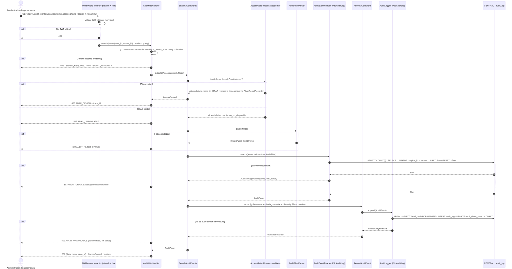

# Gobernanza y Auditoría — Semana 1: análisis y casos de uso

## Objetivo

Analizar el proceso «registrar eventos de auditoría y consultarlos de forma autorizada»: actores, alcance, flujos, reglas y trazabilidad entre tres diagramas que modelan el **mismo** proceso.

## Entregables

| Entregable | Archivo |
|---|---|
| Narrativa, alcance, actores y responsabilidades | [narrativa-alcance.md §1–3](narrativa-alcance.md) |
| Precondiciones y postcondiciones | [narrativa-alcance.md §4](narrativa-alcance.md#4-precondiciones-y-postcondiciones) |
| Flujos principales y alternativos | [§5](narrativa-alcance.md#5-flujos-principales-y-alternativos) |
| Excepciones y reglas de negocio | [§6](narrativa-alcance.md#6-excepciones-y-reglas-de-negocio) |
| Matriz requisitos ↔ diagramas | [§7](narrativa-alcance.md#7-matriz-de-trazabilidad-requisitos--diagramas) |
| Diagrama de casos de uso |  [Fuente Mermaid](fuentes/01-casos-de-uso.mmd) |
| Diagrama de actividades |  [Fuente Mermaid](fuentes/02-actividad.mmd) |
| Diagrama de secuencia |  [Fuente Mermaid](fuentes/03-secuencia.mmd) |

Los tres diagramas usan los mismos identificadores (UC-GOB-01…08), los mismos códigos de error y los nombres de clase reales de `micro-his/gobernanza-auditoria/src`.

## Archivos creados

- `docs/gobernanza-auditoria/semana-01/README.md`, `narrativa-alcance.md`
- `docs/gobernanza-auditoria/semana-01/fuentes/01-casos-de-uso.mmd`, `02-actividad.mmd`, `03-secuencia.mmd`
- `docs/gobernanza-auditoria/semana-01/01-casos-de-uso.svg`, `02-actividad.svg`, `03-secuencia.svg` (generados desde las fuentes)

## Relación con semanas anteriores

Es la primera entrega del módulo; `docs/gobernanza-auditoria/` estaba vacía. Se partió del código y la documentación reales del repositorio:

- `app/Rbac/*` de `origin/develop`, `micro-his/rbac` y la interfaz `DenialRecorder`;
- las migraciones CENTRAL y la especificación openspec;
- el Anexo A de Notas SOAP (`local_access_audits`);
- la rama de Tenants con `audit_log`.

## Instrucciones de renderizado

Las fuentes `.mmd` se editan en cualquier editor Mermaid (por ejemplo mermaid.live o la extensión de VS Code). Los SVG se generaron con Mermaid 11.4.1 en el navegador; el procedimiento está en [../diagramas/README.md](../diagramas/README.md). Después de editar una fuente hay que regenerar su SVG.

Mermaid no tiene un diagrama UML de casos de uso. Por eso el de casos de uso es un `flowchart` con actores «actor» y casos de uso en forma de elipse. Las relaciones «include» y «extend» se dibujan con líneas punteadas.

## Pruebas ejecutadas y resultados

Esta semana es de análisis y no lleva código propio. Las reglas RN-01…RN-10 se verifican en la Semana 15 ([matriz](../semana-15/matriz-pruebas.md)).

## Dependencias pendientes

- **Permiso `auditoria.ver`:** no existe en `config/rbac.php`; hay que pedirlo a RBAC (María).
- **Esquema `audit_log`:** está en la rama de Tenants, sin fusionar; Javier tiene que validar su ubicación (CENTRAL o HOSPITAL).
- **Identidad del servidor:** `TenantMiddleware` usa `App\Models\Tenant`, que no existe en develop, así que las rutas `/api/v1` hoy no funcionan (lo indica el README).

## Limitaciones conocidas

- El rol que recibe `auditoria.ver` es una propuesta. El README habla de *super admin*; si `admin_hospital` también lo recibe lo tiene que decidir el equipo.
- No se modela la exportación de la bitácora, que corresponde a otro módulo.
