# Semana 2 — Diseño inicial de responsabilidades y SOLID

Fuente de referencia del curso: <https://mvpcluster.com/diseno-de-software-2/>, sobre principios SOLID.

## 1. Responsabilidades iniciales

| Capa | Componente | Responsabilidad única |
|---|---|---|
| Domain | `AuditEvent` | Evento inmutable y validado; nombre canónico `modulo.accion`. |
| Domain | `AuditOutcome`, `AuditCriticality` | Ocurrido o intento; obligatorio o informativo. |
| Domain | `ContextSanitizer` | Regla de qué contexto es admisible. |
| Domain | `AuditLogger`, `AuditEventReader` | Contratos de escritura (append-only) y de lectura por tenant. |
| Application | `RecordAuditEvent` | Genera el id y la hora y aplica la política de fallo. |
| Application | `SearchAuditEvents` | Autoriza, valida, lee y audita la consulta. |
| Application | `AuditFilterParser` | Convierte los parámetros públicos en `AuditFilter` o en errores 422. |
| Application | `AccessGate`, `Clock`, `FailureReporter` | Puertos hacia RBAC, el reloj y el log. |
| Persistence | `InMemoryAuditLog`, `PdoAuditLog` | Adaptadores intercambiables; el SQL solo vive aquí. |
| Presentation | `AuditHttpHandler`, `AuditEventPresenter` | Traduce HTTP (tenant, códigos y formato) sin reglas de negocio. |

## 2. Aplicación de SOLID

| Principio | Cómo se aplica en el módulo | Evidencia |
|---|---|---|
| **S**RP | El SQL está en `PdoAuditLog`; el mapeo de filas en `AuditRowMapper`; la cadena de hashes en `AuditChainHasher`; la política de fallo en `RecordAuditEvent`; el formato HTTP en `AuditHttpHandler`. | TC-A-01…03 |
| **O**CP | `RecordAuditEvent` y `SearchAuditEvents` no cambian al agregar un almacén, ya que basta implementar `AuditLogger`/`AuditEventReader`. | [Ejemplo ejecutable](ejemplo/ocp-antes-despues.php) y [salida](../evidencias/s02-ocp-antes-despues.txt) |
| **L**SP | InMemory y PDO cumplen el mismo contrato y se sustituyen sin cambiar el resultado. | TC-C-01…11 (22 casos, ambos adaptadores) |
| **I**SP | La escritura (`AuditLogger`) y la lectura (`AuditEventReader`) son interfaces separadas: RBAC solo depende de la escritura. | `RbacDenialRecorder` |
| **D**IP | Los casos de uso dependen de interfaces del dominio y de puertos. Las implementaciones se inyectan desde fuera (`GobernanzaAuditoriaServiceProvider`, `tests/fixtures.php`). | TC-A-02 |

## 3. Ejemplo antes/después (OCP) con una mejora arquitectónica real

### Antes

 · [fuente](fuentes/01-antes.mmd)

Un servicio `AuditServiceAntes` decide el almacén con un `switch`, concatena SQL y mezcla la política «si es obligatorio, lanzar». Problemas:

1. Agregar un almacén (por ejemplo `local_access_audits` en HOSPITAL, si Javier lo decide) obliga a modificar la clase. Viola OCP.
2. Concatenar SQL abre la puerta a la inyección (RNF-GOB-04).
3. El controlador filtra con un tenant que envía el cliente (viola RNF-GOB-01).

### Después

 · [fuente](fuentes/02-despues.mmd)

`RecordAuditEvent` depende solo de `AuditLogger`. En el ejemplo ejecutable, el **mismo** caso de uso registra en `InMemoryAuditLog`, en `PdoAuditLog` y en un `StdoutAuditLogger` nuevo, sin editar ninguna línea del caso de uso. Salida real:

```text
DESPUÉS: el mismo RecordAuditEvent con tres AuditLogger distintos:
  InMemoryAuditLog: registrado
  PdoAuditLog: registrado
  [stdout] rbac.role_assigned success actor=aaaaaaaa-0000-4000-8000-000000000001 tenant=11111111-1111-4111-8111-111111111111
  StdoutAuditLogger (nuevo): registrado
  filas en audit_log (SQLite): 1
```

**Mejora real que habilita:** la decisión pendiente de Javier (bitácora en CENTRAL `audit_log` o en HOSPITAL `local_access_audits`) se resuelve con **un adaptador nuevo** y un cambio de enlace en el proveedor, sin tocar las reglas de negocio ni las pruebas de contrato.
