# Semana 3 — Arquitectura, contratos y modelo de dominio

## 1. Decisión de ubicación

El repositorio tiene dos formas de construir módulos:

- componentes **PHP vanilla** en `micro-his/<modulo>` (`rbac`, `ocupacion-hospitalaria`, `medicos-especialidades`), con un `bootstrap.php` de autocarga, capas `Domain/Application/Persistence/Presentation` y pruebas `tests/*.php` sin PHPUnit;
- **adaptadores Laravel** que los conectan (`app/Rbac/*`, `RbacServiceProvider`).

Gobernanza sigue la misma convención: el núcleo vive en `micro-his/gobernanza-auditoria` (namespace `MicroHis\Gobernanza`) y el adaptador Laravel en `app/GobernanzaAuditoria`. No se agregan paquetes de Composer.

## 2. C4 — Contexto

 · [fuente](fuentes/01-c4-contexto.mmd)

## 3. C4 — Contenedores

 · [fuente](fuentes/02-c4-contenedores.mmd)

La pantalla Vue de la bitácora **no está implementada**. En su lugar, el prototipo navegable (`micro-his/gobernanza-auditoria/public/prototipo`) consume el mismo contrato desde un servidor de demostración.

## 4. Componentes y dependencias

 · [fuente](fuentes/03-componentes.mmd)

Reglas de dependencia, verificadas por TC-A-01…03:

- `Domain` no depende de nada externo (ni PDO, ni Laravel, ni otras capas).
- `Application` depende solo de `Domain` y de sus propios puertos (`AccessGate`, `Clock`, `FailureReporter`).
- `Persistence` e `Integration` implementan esos puertos.
- `Presentation` depende de `Application` y no contiene SQL.

| Dependencia externa | Puerto del módulo | Adaptador | Estado |
|---|---|---|---|
| RBAC `Authorize` (develop) | `AccessGate` | `Integration\RbacAccessGate` | Probado con la copia de develop (TC-I-04…06). |
| RBAC `DenialRecorder` | (implementa la interfaz de RBAC) | `Integration\RbacDenialRecorder` | Probado (TC-I-01…03, 07). No está enlazado en `RbacServiceProvider` (propuesta). |
| PostgreSQL CENTRAL | `AuditLogger`, `AuditEventReader` | `Persistence\PdoAuditLog` | Probado con SQLite y el esquema equivalente. Falta probarlo con PostgreSQL. |
| Log | `FailureReporter` | `ErrorLogFailureReporter`, `App\GobernanzaAuditoria\LaravelLogFailureReporter` | Implementado. |
| Reloj | `Clock` | `SystemClock` | Implementado. |

## 5. Contratos iniciales de los servicios

El contrato completo de `AuditLogger` (datos mínimos, política de errores y comportamiento ante fallos) está en la [Semana 5, contrato-auditlogger.md](../semana-05/contrato-auditlogger.md). Resumen:

```php
interface AuditLogger      { public function append(AuditEvent $event): void; }                       // @throws AuditStorageFailure
interface AuditEventReader { public function search(string $tenantId, AuditFilter $filter): AuditPage; } // @throws AuditStorageFailure
interface AccessGate       { public function decide(string $userId, string $tenantId, string $permission): AccessDecision; }

final class RecordAuditEvent {   // fachada para consumidores
    public function record(string $actorId, string $tenantId, string $module, string $action,
        AuditOutcome $outcome, AuditCriticality $criticality, ?string $resourceType = null,
        ?string $resourceId = null, ?string $correlationId = null, ?string $reason = null, array $context = []): bool;
}
final class SearchAuditEvents { public function execute(AccessContext $context, array $input): AuditPage; }
```

Ejemplo de uso desde otro módulo (Notas SOAP, al firmar dentro de su transacción):

```php
$pdo->beginTransaction();
// ... UPDATE clinical_notes SET status = 'signed' ...
$recorder->record($userId, $hospitalId, 'notas_soap', 'nota.firmada', AuditOutcome::Success,
    AuditCriticality::Security, 'clinical_note', $noteId, $traceId, null, ['version_no' => 1]);
$pdo->commit();   // si record() lanza AuditStorageFailure, el consumidor hace rollBack()
```

`PdoAuditLog` participa en la transacción abierta del consumidor y no hace su propio commit (TC-W-05). Para eso, el consumidor y la bitácora deben compartir la conexión (hoy CENTRAL).

## 6. Modelo de dominio

 · [fuente](fuentes/04-modelo-dominio.mmd)

| Concepto | Invariantes |
|---|---|
| `AuditEvent` | `event_id` es un UUID v4; `occurredAt` está en UTC; actor y tenant cumplen `^[A-Za-z0-9][A-Za-z0-9._:@-]{0,127}$`; `module` cumple `^[a-z][a-z0-9_]{0,39}$`; `action` es una secuencia `a.b` en minúsculas de hasta 80 caracteres; `resourceId` exige `resourceType`; `reason` es un código. |
| `AuditOutcome` | Solo `success` cuenta como ocurrido; `unknown` no se puede registrar. |
| `AuditCriticality` | `security` es obligatorio; `informational` tolera fallos. |
| `AuditFilter` | `from < until`; `1 ≤ page ≤ 10000`; `1 ≤ perPage ≤ 100`; el resultado no puede ser `unknown`. |
| `ContextSanitizer` | Hasta 20 claves; valores escalares o listas de 20 escalares; cadenas de hasta 200 caracteres; sin secretos ni datos clínicos. |

## 7. Prototipo funcional

El prototipo usa el código real del módulo, sin pseudocódigo ni clases vacías.

```bash
# 1) Pruebas iniciales del comportamiento (InMemory y PDO/SQLite)
php micro-his/gobernanza-auditoria/tests/run.php

# 2) API de demostración con datos ficticios
php -S 127.0.0.1:8091 -t micro-his/gobernanza-auditoria/public micro-his/gobernanza-auditoria/public/index.php
```

```bash
curl -s -H "X-Demo-Session: admin" "http://127.0.0.1:8091/api/v1/audit-events?modulo=rbac&por_pagina=2"
```

```bash
curl -s -H "X-Demo-Session: medico" -o /dev/null -w "%{http_code}\n" "http://127.0.0.1:8091/api/v1/audit-events"
```

El primer `curl` devuelve 200 con 2 eventos y `meta.total`; el segundo, `403`. Se ejecutaron en esta sesión (ver la sección *Pruebas* del README).
