# Semana 7 — Componentes y refactorización

Todos los hallazgos de esta semana se verificaron leyendo el código real (rutas y commits indicados). Solo se modifica código propio del módulo; lo que pertenece a otros módulos queda como **propuesta**.

## 1. Responsabilidades mezcladas

| Id | Ubicación | Responsabilidades mezcladas | Acción |
|---|---|---|---|
| RM-01 | `App\Modules\Tenants\Infrastructure\Audit\AuditLogRepository::logRaw()` (rama de Tenants @ 978ed23) | Saneamiento de secretos, canonicalización y hash, transacción con bloqueo y SQL en una sola clase. Además completa datos ausentes con `'system'` y `'unscoped'`. | **Propuesta para Tenants:** delegar en `AuditLogger` o separar hasher y saneador. No se modifica (otro módulo). |
| RM-02 | `app/Rbac/AuditDenials.php` (develop) | Traduce la denegación al formato libre de `logRaw` sin `result`, así que las filas quedan con resultado `unknown`. | **Propuesta para RBAC:** enlazar `DenialRecorder` → `MicroHis\Gobernanza\Integration\RbacDenialRecorder`, que registra `outcome=denied` (TC-I-01). |
| RM-03 | Diseño descartado de la Semana 2 (`AuditServiceAntes`) | Almacén, SQL y política de fallo juntos. | Resuelto en el diseño implementado (Semana 2). |

## 2. Duplicaciones detectadas

| Id | Duplicación | Dónde | Riesgo |
|---|---|---|---|
| DU-01 | El algoritmo de la cadena SHA-256 (`eventHash` y `canonicalize`) está **copiado** en la migración `2026_10_20_000200_enrich_audit_log.php` y en `AuditLogRepository.php` (rama de Tenants). | Dos copias fuera del módulo. | Si una cambia, la cadena deja de ser verificable. |
| DU-02 | Gobernanza necesitaba el mismo algoritmo para escribir en la misma cadena. | `PdoAuditLog` | Hubiera sido una tercera copia en línea. |

## 3. Refactorizaciones aplicadas (en el módulo)

### 3.1 DU-03: cableado duplicado de los casos de uso → `GobernanzaModule`

| Id | Duplicación detectada | Dónde estaba |
|---|---|---|
| DU-03 | La cadena `RecordAuditEvent` → `SearchAuditEvents` (con `AuditFilterParser`) → `AuditHttpHandler` (con `AuditEventPresenter`) se armaba a mano en **3 lugares**. | `app/GobernanzaAuditoria/GobernanzaAuditoriaServiceProvider.php` (3 `bind` con `new`), `tests/fixtures.php::compose()` y `tests/rbac_integration.php`. |

**Riesgo:** al agregar un parámetro (por ejemplo, el permiso o la zona horaria), una copia podía quedar desalineada. Así, las pruebas verificarían un cableado distinto del que usa Laravel.

**Después:** se agregó `micro-his/gobernanza-auditoria/src/GobernanzaModule.php`, la raíz de composición, que se invoca con `GobernanzaModule::compose(logger, reader, gate, clock, reporter, timezone, permission)`. Los tres lugares ahora la usan, y el proveedor expone `RecordAuditEvent` y `AuditHttpHandler` desde ella.

| Métrica (medida con `grep -rn "new SearchAuditEvents\|new AuditHttpHandler"`) | Antes | Después |
|---|---|---|
| Lugares que construyen `SearchAuditEvents` | 3 | 1 (`GobernanzaModule`) |
| Lugares que construyen `AuditHttpHandler` | 3 | 1 |
| Prueba que ejercita el cableado real del proveedor | 0 | 1 (TC-L-05: `register()` en un `Illuminate\Foundation\Application` real) |

### 3.2 DU-01/DU-02: algoritmo de la cadena en una sola clase

`Persistence\AuditChainHasher` se escribió **desde el inicio** como clase separada, justamente para no crear una tercera copia del algoritmo (DU-02). Lo nuevo de esta semana es la prueba de regresión: `tests/hash_compat.php` invoca por reflexión el `eventHash()` real de Tenants sobre el archivo exportado de la rama, sin cambiar de rama, y compara el resultado byte a byte con `AuditChainHasher`.

**Propuesta DU-01 (Tenants y Javier):** que la migración y `AuditLogRepository` usen un mismo hasher compartido. Una opción es que `AuditLogRepository` delegue en `MicroHis\Gobernanza\Persistence\AuditChainHasher`. Mientras tanto, TC-R-01…03 detectan cualquier divergencia.

## 4. Interfaces para dependencias externas

| Dependencia | Interfaz | Doble de prueba | Adaptador real |
|---|---|---|---|
| RBAC | `Application\AccessGate` | `StaticGate` (tests/fixtures.php) | `Integration\RbacAccessGate` |
| RBAC → bitácora | `MicroHis\Rbac\Domain\DenialRecorder` (de RBAC) | — | `Integration\RbacDenialRecorder` |
| Almacén | `Domain\AuditLogger`, `AuditEventReader` | `BrokenStore`, `SplitStore`, `InMemoryAuditLog` | `PdoAuditLog` |
| Reloj | `Application\Clock` | `FixedClock` | `SystemClock` |
| Log | `Application\FailureReporter` | `RecordingReporter` | `ErrorLogFailureReporter`, `LaravelLogFailureReporter` |

## 5. Diagrama de componentes (actual)

 · [fuente](fuentes/01-componentes.mmd)

## 6. Pruebas de regresión y conservación del comportamiento

| Verificación | Resultado real |
|---|---|
| Suite completa **después** de introducir `GobernanzaModule`, con los mismos escenarios y aserciones de antes | 8 suites aprobadas; ningún caso cambió de resultado. |
| `tests/laravel_glue.php` TC-L-05 (nuevo): cableado del proveedor | Aprobada. |
| `tests/hash_compat.php` con `TENANTS_AUDIT_DIR` (Tenants @ 978ed23) | 3 pruebas, 0 fallos: mismo hash y misma canonicalización. |
| `tests/whitebox.php` TC-W-01/02: cadena recalculable, y una alteración la rompe | Aprobadas. |
| `tests/contract.php`: mismo comportamiento con InMemory y PDO | 22 pruebas, 0 fallos. |
| Suite completa | Ver [../evidencias/s15-ejecucion-suites-rbac-develop.txt](../evidencias/s15-ejecucion-suites-rbac-develop.txt). |

No se hicieron cambios estéticos ni refactorizaciones fuera del módulo.
