# Semana 8 — Flujo UX y wireframes

> **Estado de la interfaz:** la pantalla Vue definitiva **no está implementada**. Estos wireframes describen las capacidades **reales** del contrato `GET /api/v1/audit-events` (Semana 5). El prototipo navegable de la Semana 11 las implementa con datos ficticios.

## 1. Roles con acceso y reglas de visibilidad

| Rol (`hospital_memberships.role_code`) | `auditoria.ver` | Qué ve |
|---|---|---|
| `superadmin` | Propuesto **sí** | Menú «Bitácora» y la consulta completa **de su hospital actual**. |
| `admin_hospital` | **Por decidir** con RBAC | Si se aprueba, lo mismo que `superadmin` dentro de su hospital. |
| `medico`, `enfermeria`, `recepcion` | No | No ven el menú. Si acceden por URL, W5 (acceso denegado) sin filtros ni datos. |
| Sin sesión | — | W6 (sesión requerida). |

Reglas:

- **RV-01:** el menú se muestra solo si el permiso está en `GET /api/v1/permissions` o en `/auth/me/permissions` (RBAC). La API valida siempre de todos modos.
- **RV-02:** el selector de hospital no existe en esta pantalla. El hospital es el de la sesión (`X-Tenant-ID` lo envía la SPA a partir de la sesión).
- **RV-03:** el detalle nunca muestra `previous_hash`, `event_hash` ni valores eliminados; solo los **nombres** de las claves eliminadas.
- **RV-04:** las fechas se muestran en la zona del hospital y el detalle incluye además el instante UTC.
- **RV-05:** un evento `failure`/`denied` se rotula como **intento**, nunca como algo que ocurrió.

## 2. Flujo principal de consulta

 · [fuente](fuentes/01-user-flow.mmd)

1. Abrir la bitácora → últimos 25 eventos del hospital.
2. Combinar filtros → «Buscar».
3. Cargando → resultados, vacío o errores.
4. Paginar.
5. Abrir el detalle → cerrar y volver al mismo botón.

## 3. Wireframes anotados

### W1 · Consulta con filtros (escritorio)

```
┌──────────────────────────────────────────────────────────────────────────────┐
│ Bitácora de auditoría                                Hospital: H1 (sesión)  │
├───────────────────────────┬──────────────────────────────────────────────────┤
│ Filtros                   │ Resultados                                       │
│ ┌ Quién y qué ──────────┐ │ 52 eventos · Página 1 de 3            (1)        │
│ │ Usuario [__________]  │ │ ┌──────────┬────────┬────────────┬──────┬──────┐ │
│ │ Módulo  [rbac     ▾]  │ │ │Fecha/hora│Usuario │Evento      │Recur.│Result│ │
│ │ Acción  [__________]  │ │ ├──────────┼────────┼────────────┼──────┼──────┤ │
│ │ Result. [Todos    ▾]  │ │ │15/10 23:09│aaaa…01│sesiones.   │sess. │Ocurr.│ │
│ └───────────────────────┘ │ │          │        │sesion.revoc│      │[Ver] │ │
│ ┌ Cuándo y correlación ─┐ │ └──────────┴────────┴────────────┴──────┴──────┘ │
│ │ Desde [dd/mm/aaaa]    │ │                       [Anterior] Pág 1 de 3 [Sig]│
│ │ Hasta [dd/mm/aaaa]    │ │                                                  │
│ │ Correl. [_________]   │ │                                                  │
│ │ Por página [25 ▾]     │ │                                                  │
│ └───────────────────────┘ │                                                  │
│ [Buscar] [Limpiar]   (2)  │                                                  │
└───────────────────────────┴──────────────────────────────────────────────────┘
```

1. Región `role="status"` con el total y la página; se anuncia al cambiar.
2. «Limpiar» restablece los filtros y vuelve a consultar. Los valores corresponden 1:1 con los parámetros `usuario…por_pagina`.

### W2 · Resultados paginados, estado de carga y detalle

```
 Cargando…  (aria-busy=true, botón Buscar deshabilitado)
┌ Detalle del evento ─────────────────────────── [×] ┐
│ Identificador   4c64a72f-…                          │
│ Fecha y hora    15/10/2026 23:09 (UTC 2026-10-16T05:09Z) │
│ Usuario         aaaaaaaa-…-001                      │
│ Módulo/Acción   sesiones / sesion.revocada          │
│ Recurso         session / demo-063                  │
│ Resultado       Ocurrió   ·  Criticidad Seguridad   │
│ Correlación     trace-demo0031                      │
│ Contexto        {"canal":"web"}                     │
│ Claves omitidas Ninguna                             │
│ ⓘ El detalle no incluye contraseñas, tokens ni texto clínico. │
└─────────────────────────────────────────────────────┘
```

- **Diálogo modal:** el foco va a [×], Esc cierra y el foco vuelve al botón «Ver detalle» que lo abrió.
- **Paginación:** «Anterior» se deshabilita en la página 1 y «Siguiente» en la última.

### W3 · Sin resultados

```
┌ Sin resultados ──────────────────────────────────────────────┐
│ Ningún evento coincide con los filtros.                      │
│ Amplíe el rango de fechas o quite filtros.                   │
└──────────────────────────────────────────────────────────────┘
```

Corresponde a un 200 con `data: []`. No se confunde con un error.

### W4 · Errores de filtro (422)

```
┌ Revise los filtros: ─────────────────────────────┐   (role=alert, recibe el foco)
│ • Hasta debe ser igual o posterior a «Desde».    │ ← enlace al campo
└──────────────────────────────────────────────────┘
 Hasta [15/10/2026]  ← borde rojo + aria-invalid=true
 Error: Hasta debe ser igual o posterior a «Desde».  (aria-describedby)
```

Textos por código: `fecha_invalida`, `anterior_a_desde`, `formato_invalido`, `fuera_de_rango`, `valor_no_permitido` y `parametro_no_permitido`.

### W5 · Acceso denegado (403)

```
┌ Acceso denegado ──────────────────────────────────────────────┐
│ Su rol no tiene el permiso para consultar la bitácora de este │
│ hospital. Si lo necesita, solicítelo al administrador.        │
│ Referencia: trace-1a2b3c4d5e6f                                │
└───────────────────────────────────────────────────────────────┘
```

No se muestran filtros ni conteos (RV-01). El `trace_id` permite que un auditor encuentre la denegación con `correlacion=`.

### W6 · Sesión requerida (401) y servicio no disponible (503)

```
┌ Servicio no disponible ───────────────────────────────────────┐
│ La bitácora o el control de acceso no responden.              │
│ Intente de nuevo en unos minutos. Referencia: req-…           │
│ [Reintentar]                                                  │
└───────────────────────────────────────────────────────────────┘
```

Nunca se muestra «0 resultados» cuando falló el almacén.

## 4. Reglas de interacción

| Id | Regla |
|---|---|
| RI-01 | Los filtros se envían al pulsar «Buscar» (no en cada tecla), para no generar un evento de auditoría por cada pulsación. |
| RI-02 | Cambiar un filtro reinicia `pagina=1`. |
| RI-03 | Mientras hay una petición en curso, una nueva cancela la anterior (`AbortController`). |
| RI-04 | El 422 conserva los valores escritos y no borra el formulario. |
| RI-05 | El orden es fijo, del más reciente al más antiguo. El contrato no ofrece otro orden, así que la interfaz tampoco. |
