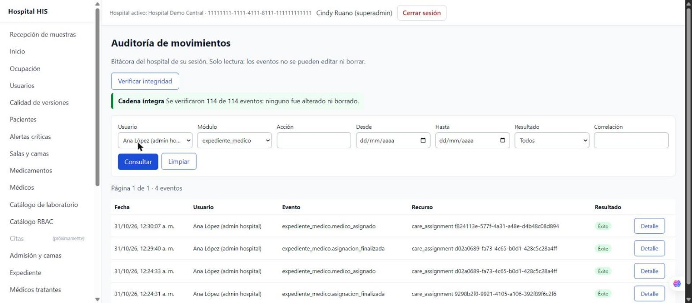

# Semana 16 — Pantalla de integridad y filtros por nombre en `/auditoria` (parte 4)

Interfaz de la parte 3 en la pantalla de auditoría.

## Cambios

- **Verificar integridad**: botón que llama a `GET /api/v1/audit-events/integrity` y muestra «Cadena íntegra» (eventos
  verificados) o «Cadena alterada» con el eslabón y la causa (`estadoIntegridad`); el resultado se anuncia con
  `role="status"` o `role="alert"`.
- **Usuario** y **Módulo** pasan a ser listas con el catálogo del hospital (`GET /api/v1/audit-events/catalog`): el
  usuario se elige por «Nombre — correo» y la API sigue recibiendo su `user_id`. Si el catálogo no responde, los
  campos vuelven a texto libre.
- La tabla muestra el nombre del usuario (`nombreDeActor`); el identificador completo queda en el título de la celda
  y en el detalle del evento.
- Los campos del filtro no se desbordan de su columna (`min-width: 0`).

## Evidencia (aplicación con PostgreSQL, datos ficticios)

- «Verificar integridad» → «Cadena íntegra: se verificaron 114 de 114 eventos».
- Usuario «Ana López (admin hospital)» + módulo `expediente_medico` → 4 eventos de asignación de médicos tratantes.
- Prueba node del módulo de auditoría → OK; `npx vite build` → OK.
