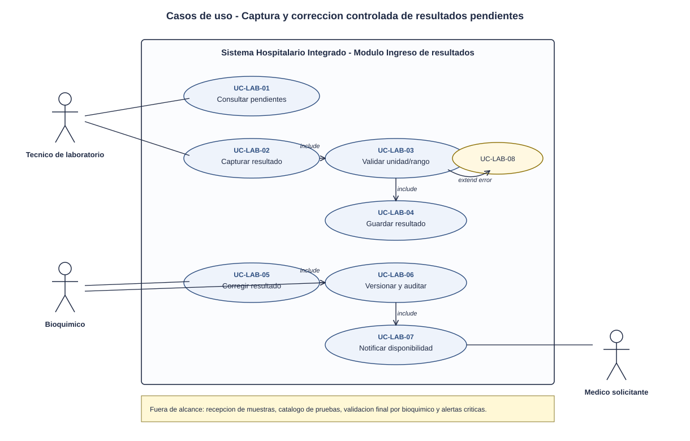
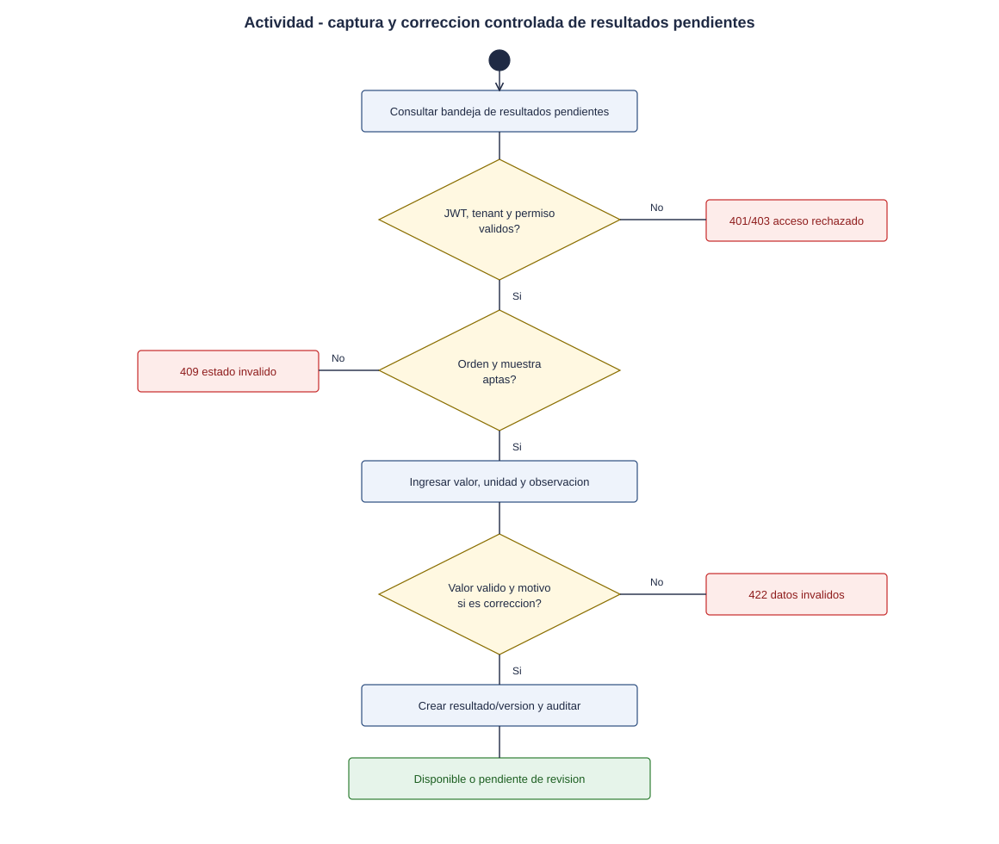
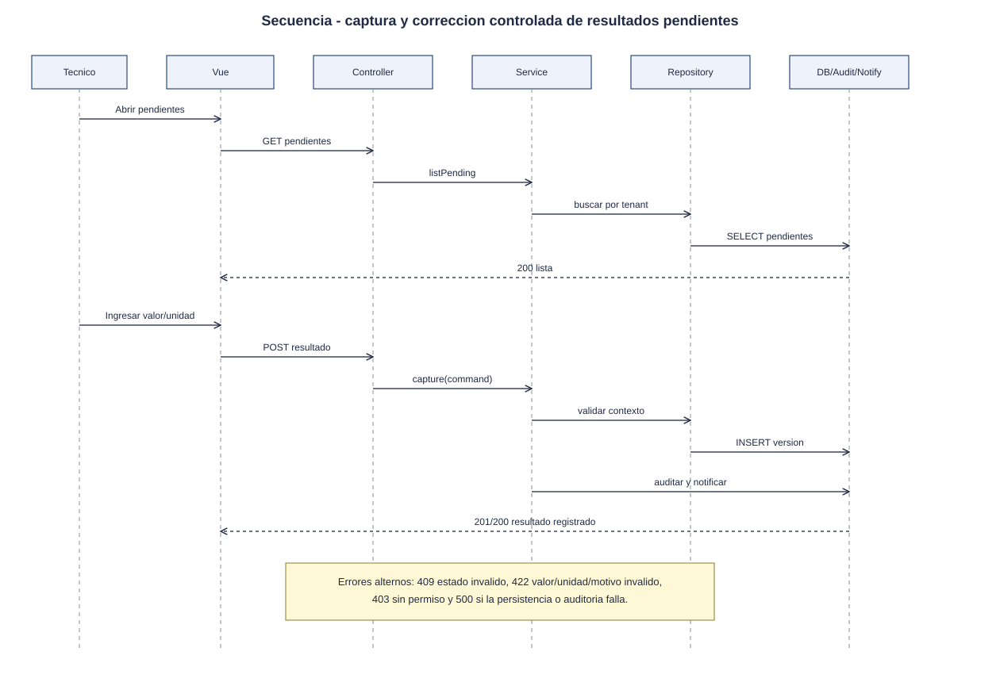

# Ingreso de resultados de laboratorio - Semana 1

## Ficha de la asignacion

- **Estudiante:** Orellana Veliz, Gerson Giovanni (`gioore`)
- **Email:** gorellanav1@miumg.edu.gt
- **Modulo:** Ingreso de resultados de laboratorio
- **Semana:** Semana 1 - Conceptos generales, orientacion a objetos y UML
- **Tarea individual:** Modele el proceso "captura y correccion controlada de resultados pendientes". Casos de uso: delimitar actores y objetivo; el de actividad debe incluir decisiones, excepciones y resultado; el de secuencia debe mostrar participantes, mensajes, validaciones y respuesta. Mantenga trazabilidad entre los tres diagramas.
- **Entregable / evidencia:** UML de casos de uso y narrativa de alcance.
- **Estructura:** Sistema Hospitalario Integrado 2026 | Semanas 1-15.

---

## Contexto arquitectonico

- **Backend:** Laravel 12 (PHP 8.2+) con rutas API bajo `/api/v1`.
- **Base de datos:** PostgreSQL federado. La base **HOSPITAL** contiene las ordenes, muestras, resultados y versiones clinicas; la base **CENTRAL** conserva identidad, red, auditoria transversal y referencias logicas.
- **Multitenancy:** el hospital activo se identifica con `X-Tenant-ID`; las operaciones deben respetar el tenant para no mezclar resultados de hospitales.
- **Seguridad:** el usuario debe estar autenticado y contar con permiso de laboratorio para capturar resultados. La correccion queda controlada por versionamiento, motivo obligatorio y trazabilidad.
- **Frontend:** Vue 3 para la bandeja de resultados pendientes, captura de valores, validacion de unidades/rangos y solicitud/registro de correcciones.

## 1. Diagrama de casos de uso

[Abrir el diagrama de casos de uso en SVG](./01-casos-de-uso.svg)

### Descripcion

El diagrama delimita el objetivo principal del modulo: permitir que el personal de laboratorio capture resultados pendientes y que cualquier correccion posterior sea controlada, justificada, versionada y trazable.

- **Actores principales:**
  - *Tecnico de laboratorio:* ingresa resultados de pruebas pendientes.
  - *Bioquimico:* revisa resultados, autoriza correcciones cuando el flujo lo exige y puede validar valores criticos.
  - *Medico solicitante:* consulta resultados disponibles dentro del expediente.
- **Actores secundarios:** *Sistema de laboratorio*, *Modulo de auditoria* y *Sistema HIS*.
- **Casos incluidos:** consultar resultados pendientes, capturar resultado, validar formato/unidad/rango, guardar resultado preliminar, corregir resultado, registrar motivo de correccion, conservar version anterior y notificar disponibilidad.

## 2. Diagrama de actividades

[Abrir el diagrama de actividades en SVG](./02-actividad.svg)

### Descripcion

El flujo inicia cuando el tecnico consulta resultados pendientes de una muestra recibida. El sistema valida identidad, tenant, estado de la orden, unidad, rango y obligatoriedad de campos. Si el resultado es invalido, queda rechazado con detalle de errores. Si es valido, se registra como preliminar o disponible segun regla del estudio. Cuando hay correccion, el sistema exige motivo, crea nueva version, conserva el valor anterior y registra auditoria.

## 3. Diagrama de secuencia

[Abrir el diagrama de secuencia en SVG](./03-secuencia.svg)

### Descripcion

El diagrama asigna responsabilidades a objetos concretos:

- **Vue / Bandeja de laboratorio:** solicita pendientes, muestra formulario y envia resultados.
- **ResultEntryController:** recibe la solicitud HTTP y aplica validacion de entrada.
- **ResultEntryService:** ejecuta reglas de negocio de captura y correccion.
- **ResultRepository:** persiste resultados y versiones en la base HOSPITAL.
- **AuditLogger:** registra eventos sin exponer datos clinicos innecesarios.
- **NotificationService:** avisa disponibilidad o necesidad de revision cuando aplica.

## 4. Narrativa de alcance y trazabilidad

La narrativa completa, con la tabla de trazabilidad UC - actividad - secuencia, esta en [narrativa-alcance-trazabilidad.md](./narrativa-alcance-trazabilidad.md).

## Fuentes editables

- Casos de uso: el SVG es editable en draw.io, Inkscape o un editor de texto.
- Actividad y secuencia: [`fuentes/02-actividad.mmd`](./fuentes/02-actividad.mmd) y [`fuentes/03-secuencia.mmd`](./fuentes/03-secuencia.mmd) (Mermaid; GitHub los renderiza y se pueden editar en mermaid.live).

## Declaracion de uso de IA

Se uso Codex/OpenAI para estructurar la evidencia, redactar el primer borrador y generar diagramas a partir del enunciado de Odoo y del repositorio del proyecto. El estudiante debe revisar nombres, reglas de negocio, trazabilidad y alcance antes de marcar la tarea como terminada en Odoo.
