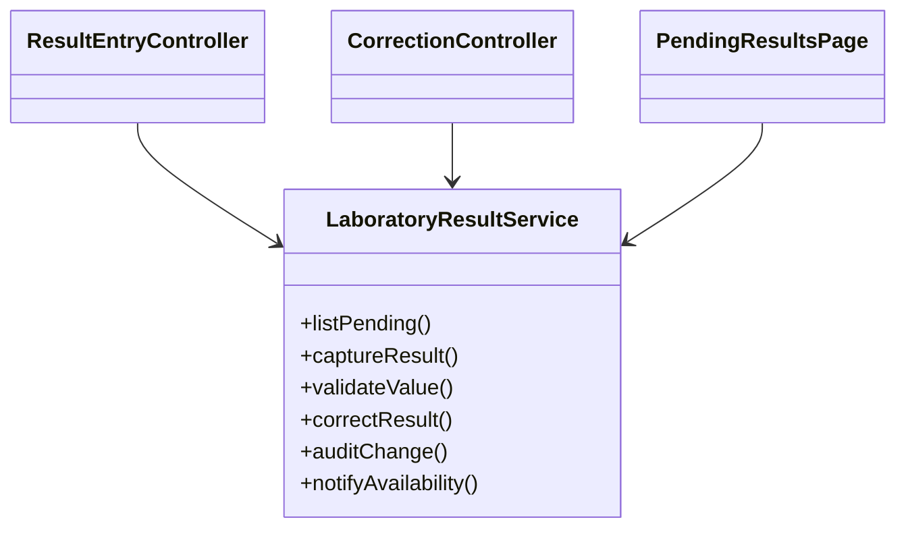
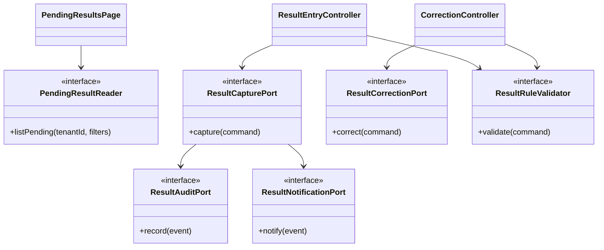

# Aplicacion de ISP - Ingreso de resultados

## Principio aplicado

ISP indica que los clientes no deben depender de interfaces que no usan. En este modulo, el riesgo principal es crear un servicio grande tipo `LaboratoryResultService` con metodos de captura, validacion, correccion, auditoria, notificacion y consulta. Eso acopla a todos los consumidores con responsabilidades que no les corresponden.

Fuente academica indicada por el curso: `https://mvpcluster.com/diseno-de-software-2/`.

## Diseno antes de ISP

### Problemas detectados

- La pagina de pendientes depende de metodos de correccion y auditoria que no usa.
- El controlador de captura queda acoplado a notificacion y auditoria.
- Cambiar la forma de auditar puede obligar a recompilar o modificar clientes que solo consultan.
- Las pruebas unitarias necesitan dobles demasiado grandes.

## Diseno despues de ISP

## Responsabilidades propuestas

| Contrato | Responsabilidad | Consumidor principal |
|---|---|---|
| `PendingResultReader` | Consultar resultados pendientes. | Bandeja de laboratorio |
| `ResultCapturePort` | Registrar resultado nuevo. | Controlador de captura |
| `ResultCorrectionPort` | Crear version corregida con motivo. | Controlador de correccion |
| `ResultRuleValidator` | Validar formato, unidad, rango y estado. | Captura y correccion |
| `ResultAuditPort` | Registrar evento trazable. | Casos de uso de escritura |
| `ResultNotificationPort` | Emitir notificacion interna. | Casos de uso de escritura |

## Beneficio verificable

- Cada controlador depende solo de los contratos que usa.
- Las pruebas pueden reemplazar validacion, auditoria o notificacion por dobles especificos.
- Agregar otro mecanismo de notificacion no cambia la interfaz de captura.
- El modulo queda listo para Semana 3, donde el microproyecto puede separar Presentation, Application, Domain y Persistence.
