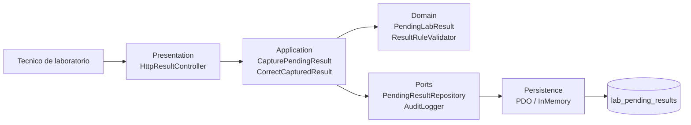
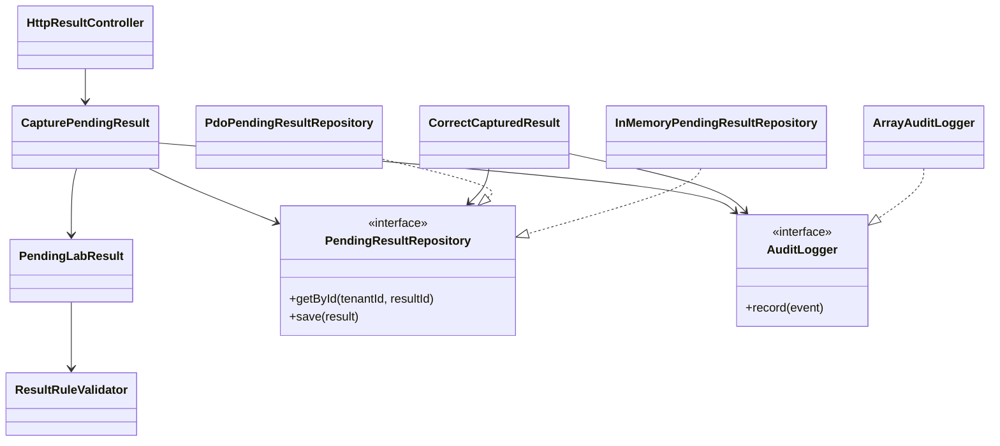

# Vista arquitectonica C4/UML

## Contexto

El micro-HIS permite a un tecnico de laboratorio capturar resultados pendientes y corregirlos de forma controlada sin depender del framework principal. La implementacion es vanilla PHP 8.2+ para evidenciar las capas y dependencias de forma explicita.

## Contenedores / capas

## Componentes

## Decisiones arquitectonicas

| Decision | Justificacion |
| --- | --- |
| PHP vanilla en `micro-his/` | Cumple la restriccion de no usar framework para esta semana. |
| Casos de uso en Application | Evita SQL y reglas de negocio en Presentation. |
| Entidad `PendingLabResult` en Domain | Centraliza reglas de estado, unidad, valor y correccion. |
| `PendingResultRepository` como puerto | Permite probar con InMemory y persistir con PDO. |
| `PdoPendingResultRepository` con `prepare/execute` | Cumple sentencia preparada y evita concatenar SQL. |

## Trazabilidad hacia pruebas

| Requisito de la semana | Evidencia |
| --- | --- |
| Separar Presentation, Application, Domain y Persistence | Carpetas `src/Presentation`, `src/Application`, `src/Domain`, `src/Persistence`. |
| PDO con sentencias preparadas | `PdoPendingResultRepository::getById` y `save`. |
| Camino feliz | `tests/run.php`, captura de `res-001`. |
| Regla de dominio | `tests/run.php`, unidad incompatible y correccion sin motivo. |
| Error de persistencia | `tests/run.php`, repositorio anonimo que lanza excepcion. |
