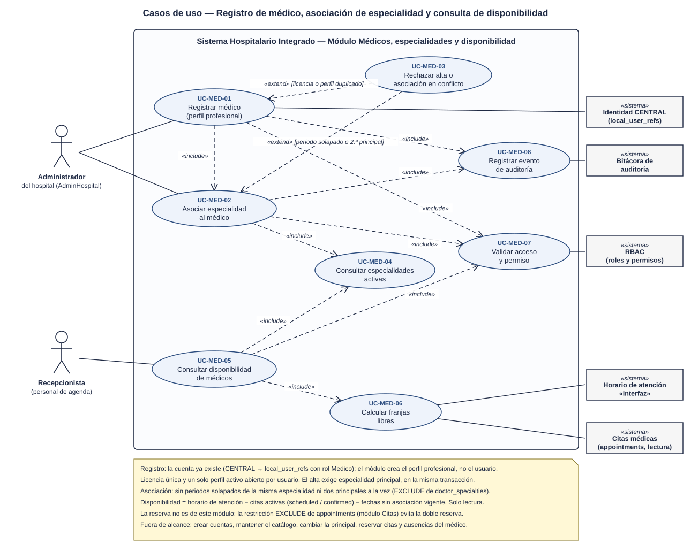
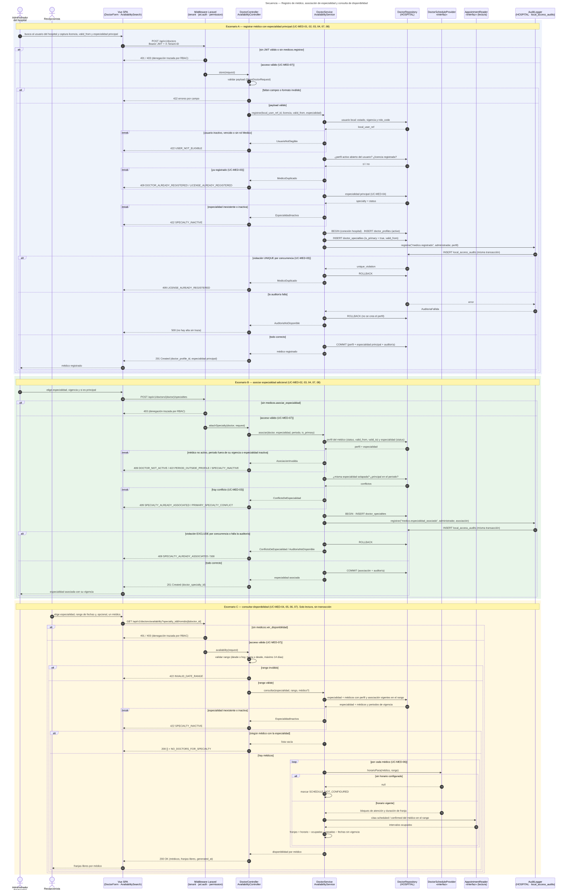

# Médicos, especialidades y disponibilidad — Semana 1

## Ficha de la asignación

- **Estudiante:** Hicho García, Josué Fernando (`Jhos-hgnu`)
- **Módulo:** ASII-04 — Médicos, especialidades y disponibilidad
- **Semana:** Semana 1 — Conceptos generales, orientación a objetos y UML
- **Tarea individual:** Modele el proceso «registro de médico, asociación de especialidad y consulta de disponibilidad». Casos de uso: delimitar actores y objetivo; el de actividad debe incluir decisiones, excepciones y resultado; el de secuencia debe mostrar participantes, mensajes, validaciones y respuesta. Mantenga trazabilidad entre los tres diagramas.
- **Entregable / evidencia:** UML de casos de uso y narrativa de alcance.
- **Estructura:** Sistema Hospitalario Integrado 2026 | Semanas 1–15.

---

## Contexto arquitectónico

- **Backend:** Laravel 12 (PHP 8.2+), JWT y RBAC por permisos (`medicos.registrar`, `medicos.asociar_especialidad`, `medicos.ver_disponibilidad`).
- **Base de datos HOSPITAL (PostgreSQL):** las tablas del módulo ya existen en la migración `2026_08_11_000100_create_local_identity_and_professional_tables.php` (slice H1):
  - `local_user_refs`: referencia local del usuario de CENTRAL (`central_user_id`, `membership_id`, `role_code`, `status`, `valid_to`). **No guarda credenciales** y se alimenta por sincronización desde CENTRAL; este módulo solo la lee.
  - `doctor_profiles`: perfil profesional con `license_number` **único** (`doctor_profiles_license_number_unique`), estados `active` / `inactive` / `suspended` y vigencia `valid_from` / `valid_to`. Un usuario tiene **un solo perfil activo abierto** (`doctor_profiles_active_open_user_unique`).
  - `specialties`: catálogo con `code` único y estado `active` / `inactive`.
  - `doctor_specialties`: asociación médico ↔ especialidad con vigencia e `is_primary`. Dos restricciones `EXCLUDE` (por eso el esquema exige `btree_gist`): **no se solapan** periodos activos de la misma especialidad y **no hay dos especialidades principales** activas en el mismo periodo.
- **Lo que ya exige el resto del esquema:** `appointments` (módulo *Citas*) y `care_assignments` (asignación del médico a un episodio) solo aceptan un médico con la especialidad **activa y vigente** en la fecha (triggers `enforce_appointment_integrity` y `enforce_care_assignment_integrity`). Por eso el alta exige especialidad principal: un médico sin especialidad no puede atender ni recibir citas.
- **Disponibilidad derivada, no guardada:** `disponibilidad = horario de atención − citas activas (scheduled / confirmed) − franjas pasadas − fechas sin perfil o asociación vigente`. Las citas se **leen** de `appointments` (del módulo *Citas*) detrás de la interfaz `AppointmentReader`, que devuelve solo intervalos ocupados, sin datos del paciente.
- **Horario de atención pendiente de acordar:** el esquema HOSPITAL (27 entidades) no tiene una entidad de horario. El servicio depende de la interfaz `DoctorScheduleProvider`; la propuesta de tabla está en el [Anexo B de la narrativa](./narrativa-alcance-trazabilidad.md#anexo-b--propuesta-de-horario-de-atención-doctor_schedules) y se acuerda antes de implementarla (ver [Coordinación pendiente](./narrativa-alcance-trazabilidad.md#coordinación-pendiente-con-otros-módulos)).
- **Traza:** el alta y la asociación se registran en `local_access_audits` (HOSPITAL, slice H8) **en la misma transacción** de la conexión `hospital`. Se reutiliza la propuesta del [Anexo A de Notas SOAP](../../notas-soap/semana-01/narrativa-alcance-trazabilidad.md#anexo-a--propuesta-de-la-tabla-local_access_audits-hospital).
- **Multitenancy:** el hospital activo llega en `X-Tenant-ID`; el perfil y sus especialidades viven en la base de ese hospital.
- **Frontend:** Vue 3, Pinia y Axios (formulario del médico, asociación de especialidades y buscador de disponibilidad).
- **Endpoints preliminares** (se formalizan en la Semana 5):
  - `POST /api/v1/doctors` (alta con especialidad principal)
  - `POST /api/v1/doctors/{doctor}/specialties`
  - `GET /api/v1/specialties?status=active`
  - `GET /api/v1/doctors/availability?specialty_id=…&from=…&to=…[&doctor_id=…]`

---

## 1. Diagrama de casos de uso

[Abrir el diagrama de casos de uso en SVG](./01-casos-de-uso.svg)

### Descripción

El objetivo es que **cada médico del hospital quede registrado con una especialidad vigente y que su disponibilidad se pueda consultar** para agendar citas, sin perfiles duplicados, sin especialidades en conflicto y con traza de cada cambio.

- **Actores principales:**
  - *Administrador del hospital* (rol `AdminHospital`): registra el perfil profesional del médico y le asocia especialidades.
  - *Recepcionista* (personal de agenda): consulta la disponibilidad por especialidad y rango de fechas. El módulo *Citas* usa la misma consulta.
- **Actores secundarios (sistemas):** *Identidad CENTRAL* (usuarios ya sincronizados en `local_user_refs`), *Bitácora de auditoría*, *RBAC*, *Horario de atención* «interfaz» y *Citas médicas* (lectura de `appointments`).
- **UC-MED-01 (Registrar médico)** incluye `<<include>>` la asociación de la especialidad principal (UC-MED-02), la validación de acceso (UC-MED-07) y la auditoría (UC-MED-08).
- **UC-MED-02 (Asociar especialidad)** incluye la consulta de especialidades activas (UC-MED-04), la validación de acceso y la auditoría.
- **UC-MED-03 (Rechazar alta o asociación en conflicto)** extiende `<<extend>>` a UC-MED-01 cuando la licencia o el perfil ya existen, y a UC-MED-02 cuando el periodo se solapa con la misma especialidad o ya hay una principal.
- **UC-MED-05 (Consultar disponibilidad)** incluye la consulta de especialidades activas (UC-MED-04), el cálculo de franjas libres (UC-MED-06) y la validación de acceso.

## 2. Diagrama de actividades

[Abrir el diagrama de actividades en SVG](./02-actividad.svg)

### Descripción

Recorre el proceso en tres particiones. Los conectores UML **(B)** y **(C)** muestran que una partición continúa en la siguiente.

- **A · Registrar médico con especialidad principal:** acceso (401/403), formato (422), usuario elegible (`422 USER_NOT_ELIGIBLE`), perfil o licencia ya registrados (UC-MED-03, `409`) y especialidad activa (`422 SPECIALTY_INACTIVE`). Luego, **en una sola transacción**: perfil, especialidad principal y auditoría `medico.registrado`. Una violación `UNIQUE` por concurrencia da `409`; si falla la auditoría, `ROLLBACK` y `500`: **no hay alta sin traza**. Resultado: `201`.
- **B · Asociar especialidad adicional:** permiso (403), médico activo y periodo dentro de su vigencia (`409` / `422`), especialidad activa (422) y conflictos (UC-MED-03): misma especialidad solapada o segunda principal (`409`). Asociación y auditoría `medico.especialidad_asociada` van en una transacción. Resultado: `201`.
- **C · Consultar disponibilidad:** permiso (401/403), rango de fechas (`422 INVALID_DATE_RANGE`), especialidad activa (422). Sin médicos: `200` con lista vacía y `NO_DOCTORS_FOR_SPECIALTY`. Con médicos, un ciclo por médico: sin horario se marca `SCHEDULE_NOT_CONFIGURED`; con horario se generan las franjas y se restan las citas activas, las franjas pasadas y las fechas sin vigencia. Resultado: `200` con franjas libres (solo lectura).

## 3. Diagrama de secuencia

[Abrir el diagrama de secuencia en SVG](./03-secuencia.svg)

### Descripción

- **Participantes:** Vue (`DoctorForm` y `AvailabilitySearch`), middlewares, `DoctorController` / `AvailabilityController`, `DoctorService` / `AvailabilityService`, `DoctorRepository` (HOSPITAL), `DoctorScheduleProvider` «interfaz», `AppointmentReader` «interfaz» y `AuditLogger` (HOSPITAL · `local_access_audits`).
- **Dependencias como interfaz:** `DoctorScheduleProvider` aísla al servicio de dónde se guarda el horario, que aún no está acordado (configuración hoy, tabla propuesta después). `AppointmentReader` aísla la lectura de `appointments`, que pertenece al módulo *Citas*, y solo expone intervalos ocupados. Se desarrolla en la Semana 2 con el principio DIP.
- **Escenario A (registrar médico):** `alt` para 401/403 y 422 de formato; `break` para usuario no elegible (422), médico o licencia duplicados (409) y especialidad inactiva (422). Perfil, especialidad principal y auditoría en una transacción, con `alt` para violación `UNIQUE` (409), auditoría fallida (500) y `COMMIT` (201).
- **Escenario B (asociar especialidad):** `break` para médico, periodo o especialidad inválidos y para conflictos de especialidad (409). Asociación y auditoría en una transacción.
- **Escenario C (consultar disponibilidad):** solo lectura. `alt` para rango inválido (422) y para lista vacía; `loop` por médico con `alt` para horario no configurado. Responde `200` con las franjas libres y `generated_at`.

### Eventos de auditoría del módulo (resumen)

Se escriben en `local_access_audits` con la estructura propuesta en Notas SOAP. El detalle está en el [Anexo A de la narrativa](./narrativa-alcance-trazabilidad.md#anexo-a--eventos-de-auditoría).

| `action` | Cuándo | `metadata` (solo metadatos) |
|---|---|---|
| `medico.registrado` | Al crear el perfil con su especialidad principal | Licencia, especialidad principal y `valid_from` |
| `medico.especialidad_asociada` | Al asociar una especialidad | Especialidad, vigencia e `is_primary` |

La consulta de disponibilidad **no** se audita: no contiene datos de pacientes y es de solo lectura. Las denegaciones de acceso las traza RBAC.

## 4. Narrativa de alcance y trazabilidad

La narrativa completa, con la tabla de trazabilidad UC ↔ actividad ↔ secuencia, los riesgos detectados en el esquema, la **coordinación pendiente con otros módulos** y la propuesta de horario de atención, está en [narrativa-alcance-trazabilidad.md](./narrativa-alcance-trazabilidad.md).

## Fuentes editables

- Casos de uso: el SVG es editable en draw.io o Inkscape.
- Actividad y secuencia: [`fuentes/02-actividad.mmd`](./fuentes/02-actividad.mmd) y [`fuentes/03-secuencia.mmd`](./fuentes/03-secuencia.mmd) (Mermaid; GitHub los renderiza y se pueden editar en mermaid.live).

## Declaración de uso de IA

Se usó Claude (Anthropic) para proponer la estructura de los diagramas, generar los SVG y redactar el primer borrador de este documento a partir del repositorio del proyecto (en particular, la migración de `doctor_profiles`, `specialties` y `doctor_specialties`, los triggers de `appointments` y `care_assignments`, y las entregas de Notas SOAP y Signos vitales) y del enunciado de la tarea. El estudiante revisó los actores, las reglas del registro (licencia única, un perfil activo y especialidad principal obligatoria), el cálculo de disponibilidad, la decisión de no modificar entidades de otros módulos y la trazabilidad, y es responsable del contenido final.
