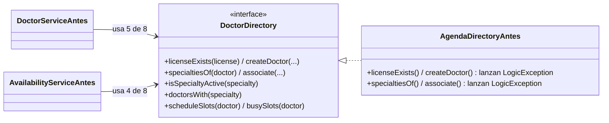
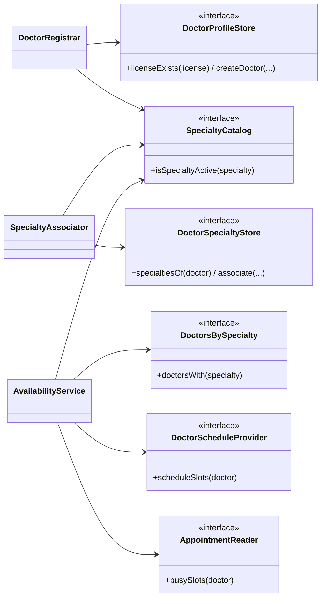

# Aplicación de ISP — Médicos, especialidades y disponibilidad

## Principio aplicado

> «Mejor crear muchas interfaces que contengan pocos métodos, que crear pocas interfaces que definan demasiados métodos.» (Rodríguez González, L. M. *Principios básicos del diseño de software*. MVP Cluster. <https://mvpcluster.com/diseno-de-software-2/>)

La fuente lo ilustra con una interfaz `IOferta` que obliga a `Proyecto` a implementar `EstablecerDesplazamiento`, que no le sirve y lanza una excepción. En este módulo pasa lo mismo si el registro, la asociación y la disponibilidad (particiones A, B y C de la Semana 1) comparten una sola interfaz de acceso a datos.

## Diseño antes de ISP

**Problemas:**

- `AvailabilityServiceAntes` es de solo lectura, pero depende de cuatro métodos de escritura; `DoctorServiceAntes` depende de tres métodos de agenda que nunca llama.
- La vista de agenda que aportaría *Citas* (C2 de la Semana 1) tendría que "implementar" el alta y la asociación lanzando `LogicException`, un error que solo aparece en ejecución.

## Diseño después de ISP

## Responsabilidades

| Interfaz | Cliente(s) | Responsabilidad | Implementación prevista |
|---|---|---|---|
| `DoctorProfileStore` | `DoctorRegistrar` | Validar licencia y crear perfil + especialidad principal (una transacción). | Repositorio `hospital` (`doctor_profiles`, `doctor_specialties`) |
| `DoctorSpecialtyStore` | `SpecialtyAssociator` | Leer y crear asociaciones de especialidad. | Repositorio `hospital` (`doctor_specialties`) |
| `SpecialtyCatalog` | Los tres | Saber si una especialidad está activa. | Lectura de `specialties` |
| `DoctorsBySpecialty` | `AvailabilityService` | Médicos con perfil y asociación activos. | Lectura de `doctor_profiles` + `doctor_specialties` |
| `DoctorScheduleProvider` | `AvailabilityService` | Franjas del horario de atención. | Configuración hoy; tabla si se acuerda C1 |
| `AppointmentReader` | `AvailabilityService` | Intervalos ocupados, sin datos del paciente. | Lectura de `appointments` (módulo *Citas*) |

## Justificación de dependencias

- Cada cliente recibe solo las interfaces cuyos métodos usa: el registro no conoce la agenda y la disponibilidad no puede escribir.
- `DoctorScheduleProvider` y `AppointmentReader` ya eran interfaces en la Semana 1; ISP confirma que deben ir separadas porque cambian por razones de otros módulos (C1 y C2).
- Un mismo adaptador puede implementar varias interfaces pequeñas (en la demo, `MemoryDirectory`); lo que se segrega es lo que **ve** cada cliente.

## Beneficio verificable

La [demo ejecutable](./evidencia/demo-isp.php) mide, por reflexión, qué métodos de sus interfaces nunca llama cada cliente: 4 y 3 en el diseño antes, 0 en el después. También comprueba que ambos diseños responden igual y que un adaptador de solo lectura sirve a la disponibilidad sin métodos de escritura. La salida está en [evidencia-verificable.md](./evidencia-verificable.md).
