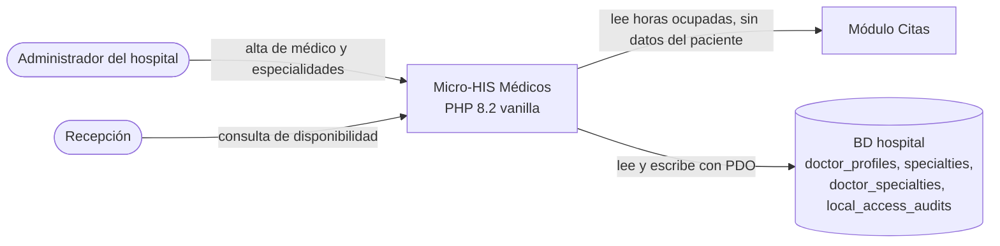
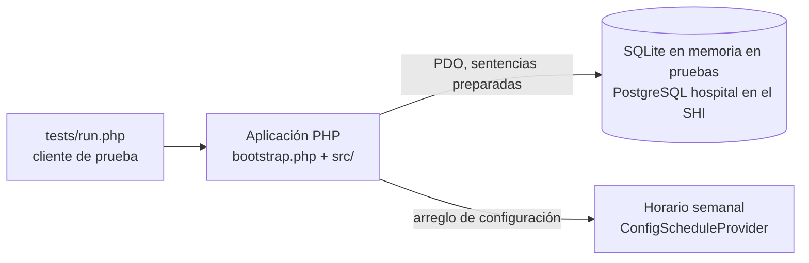
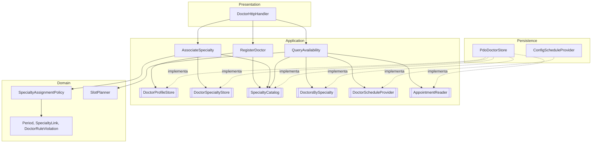
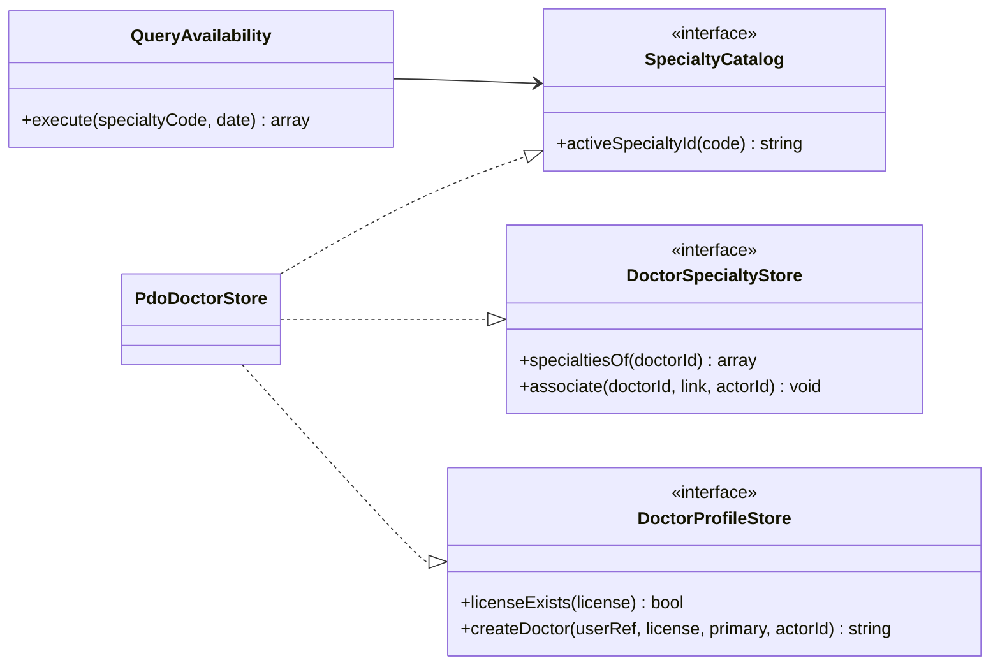

# Vista arquitectónica C4/UML — Micro-HIS Médicos, especialidades y disponibilidad

## Nivel 1: contexto

## Nivel 2: contenedores

En el prototipo el cliente es `tests/run.php`. En el SHI será la ruta HTTP con JWT y `X-Tenant-ID` (fuera de alcance esta semana).

## Nivel 3: componentes por capa

## UML de clases: puertos segregados (ISP de la Semana 2)

`QueryAvailability` es de solo lectura: no conoce `DoctorProfileStore` ni `DoctorSpecialtyStore`. La prueba `ISP` de `tests/run.php` lo verifica por reflexión.

## Decisiones arquitectónicas

| Decisión | Justificación |
|---|---|
| Puertos en Application, adaptadores en Persistence | Inversión de dependencias: Application define lo que necesita y PDO queda en el borde. |
| Seis puertos pequeños (ISP) y un adaptador PDO que implementa cinco | Cada caso de uso depende solo de los métodos que usa. Un adaptador de solo lectura (vista de agenda) no tiene que implementar el alta. |
| `SpecialtyAssignmentPolicy` y `SlotPlanner` sin dependencias | Las reglas de vigencia, duplicado y principal y el cálculo de franjas se prueban sin BD. |
| Alta, especialidad principal y auditoría en una transacción | RNF-MED-02: si falla la auditoría no queda un perfil sin traza (rollback). |
| Horario por configuración | `doctor_schedules` no existe en el esquema federado (acuerdo C1). Se cambia por un adaptador PDO sin tocar Application. |
