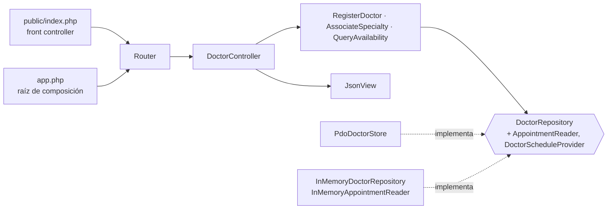

# Médicos, especialidades y disponibilidad — Semana 4

## Ficha de la asignación

- **Estudiante:** Hicho García, Josué Fernando (`Jhos-hgnu`)
- **Módulo:** ASII-04 — Médicos, especialidades y disponibilidad
- **Semana:** Semana 4 — Arquitectura en capas y patrón repositorio
- **Tarea individual:** Continúe el MISMO «Micro-HIS Médicos, especialidades y disponibilidad» y el flujo «registro de médico, asociación de especialidad y consulta de disponibilidad». Organice la entrada con MVC; defina una interfaz Repository en el límite apropiado y adaptadores PDO e InMemory. El controlador no tendrá SQL ni reglas de negocio. Además, analice y diagrame cómo un repositorio de datos compartido integraría este módulo.
- **Entregable / evidencia:** Capas, responsabilidades y objetos reutilizables. Código en [`micro-his/medicos-especialidades/`](../../../micro-his/medicos-especialidades/).

## Punto de partida

La Semana 3 dejó cuatro capas: `DoctorHttpHandler` como entrada y `PdoDoctorStore` implementando los puertos de ISP de la [Semana 2](../semana-02/solid-isp.md). Esta semana se construye sobre la rama `semana-03-...-adapters-tests` (#126), que ya valida el tipo de cada campo de entrada (`422 PAYLOAD_INVALID`); ver [organización de la entrega](#organización-de-la-entrega).

## Qué cambió (implementado)



- **MVC:** `Router` elige la acción, `DoctorController` lee la `Request` (que rechaza con `422 PAYLOAD_INVALID` los campos con tipo incorrecto), llama al caso de uso (modelo) y entrega el resultado a `JsonView`. `DoctorHttpHandler` se reemplazó por el controlador.
- **Repository:** `DoctorRepository` (Application) une los cuatro puertos del agregado Médico. Lo implementan `PdoDoctorStore` e `InMemoryDoctorRepository`; los casos de uso siguen recibiendo solo su puerto.
- **Composición:** `app.php` arma el mismo MVC con cualquiera de los dos adaptadores.

## Archivos de esta entrega

- [Capas, responsabilidades y contrato del Repository](./capas-y-repository.md)
- [Repositorio de datos compartido](./repositorio-compartido.md)
- [Declaración de uso de IA](./DECLARACION_IA.md)

## Cómo verificar

```bash
php micro-his/medicos-especialidades/tests/run.php
php micro-his/medicos-especialidades/tests/core.php
php -S 127.0.0.1:8004 -t micro-his/medicos-especialidades/public
```

`run.php` ejecuta la misma suite contra los dos adaptadores (prefijos `[pdo]` y `[memoria]`). Resultado con PHP 8.3.33 (código de salida 0), resumido a las líneas de un adaptador porque el otro repite los mismos 20 casos:

```text
OK: [pdo] camino feliz: POST /doctors -> 201 JSON con CARD principal y auditoría
OK: [pdo] camino feliz: POST /doctors/{id}/specialties NEURO secundaria -> 201
OK: [pdo] camino feliz: disponibilidad del lunes -> Ana libre 08:00 y 09:00 (08:30 confirmada)
OK: [pdo] RF-MED-07: médico sin horario aparece con SCHEDULE_NOT_CONFIGURED
OK: [pdo] vigencia del perfil: médico con perfil vencido no aparece en la disponibilidad
OK: [pdo] RF-MED-06: especialidad sin médicos -> 200 NO_DOCTORS_FOR_SPECIALTY
OK: [pdo] regla de dominio: misma especialidad en periodo solapado -> 409
OK: [pdo] regla de dominio: otra principal en el mismo periodo -> 409
OK: [pdo] regla de dominio: vigencia fuera del perfil -> 422
OK: [pdo] regla de dominio: especialidad inactiva -> 422
OK: [pdo] regla de dominio: licencia repetida -> 409
OK: [pdo] regla de dominio: médico inexistente -> 404
OK: [pdo] validación: fecha inválida -> 422
OK: [pdo] validación: campo no escalar -> 422 sin llegar al repositorio
OK: [pdo] validación de tipos: is_primary "false" (cadena), valid_to numérico o specialty_code arreglo -> 422 sin guardar
OK: [pdo] validación de tipos: encabezado o licencia no string -> 422 sin guardar
OK: [pdo] validación de tipos: fecha de disponibilidad no string -> 422
OK: [pdo] is_primary booleano: false se guarda como secundaria
OK: [pdo] ruta desconocida -> 404 ROUTE_NOT_FOUND
OK: [pdo] error de persistencia: base caída -> 500 y sin perfil a medias
(los mismos 20 casos con [memoria])
OK: regla de dominio pura (sin BD): la política rechaza dos principales
OK: ISP: la disponibilidad no depende de puertos de escritura
OK: MVC: el controlador solo recibe casos de uso y la vista, sin SQL ni PDO
Todas las pruebas pasaron.
```

Prueba manual del front controller con el adaptador InMemory (sin `MEDICOS_DSN`):

```text
POST /doctors {"local_user_ref_id":"u-ana","license_number":"COL-1","specialty_code":"CARD","valid_from":"2026-01-01"}
  -> 201 Content-Type: application/json; charset=utf-8  {"doctor_profile_id":"doc-1"}
GET /availability?specialty=CARD&date=2026-10-19  -> 200 {"code":"NO_DOCTORS_FOR_SPECIALTY","doctors":[]}
POST /doctors con cuerpo '{malo'                   -> 422 {"code":"PAYLOAD_INVALID"}
GET /nada                                          -> 404 {"code":"ROUTE_NOT_FOUND"}
```

El adaptador InMemory se reinicia en cada petición, por eso la consulta no ve al médico recién creado. Con `MEDICOS_DSN` el front controller usa `PdoDoctorStore`.

## Supuestos y límites

- **SD-MED-08:** `is_primary` debe ser booleano JSON; cualquier otro tipo, incluida la cadena `"false"`, responde `422 PAYLOAD_INVALID` sin guardar, igual que la Semana 3 después de la revisión de #126.
- **SD-MED-09:** autenticación, RBAC y tenant siguen fuera del micro-HIS; `X-User-ID` identifica al actor de la auditoría.
- El rango de hasta 14 días de RF-MED-06 sigue pendiente: la consulta es por un día.

## Organización de la entrega

Para respetar el límite de 400 líneas por PR, la semana se entrega en tres ramas con archivos que no se solapan:

| Rama | Contenido | Base | Orden de integración |
|---|---|---|---|
| `feature/asii-04-semana-04-medicos-especialidades-repository-jhos-hgnu` | `DoctorRepository`, `PdoDoctorStore` e InMemory | `develop` + `semana-03-...-adapters-tests` (#126) | 1 |
| `feature/asii-04-semana-04-medicos-especialidades-mvc-tests-jhos-hgnu` | `Router`, `DoctorController`, `Request`, `JsonView`, `app.php`, `public/index.php` y `tests/run.php` | rama 1 | 2 |
| `feature/asii-04-semana-04-medicos-especialidades-docs-jhos-hgnu` | Esta documentación | `develop` | 3 |

El PR de la rama 1 incluye los cambios de #126 hasta que este se integre; el de la rama 2 queda en borrador hasta que entren #126 y la rama 1, porque antes mostraría también sus líneas. Después de cada merge se actualiza la rama con `origin/develop`, sin force push.
